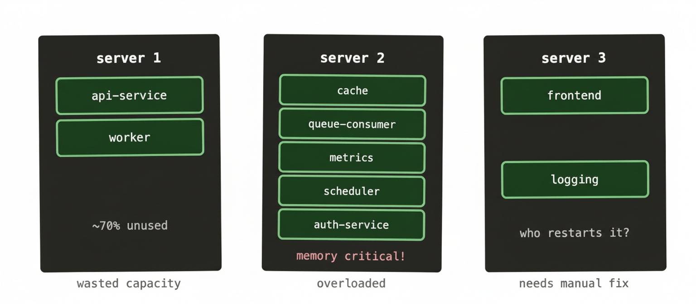
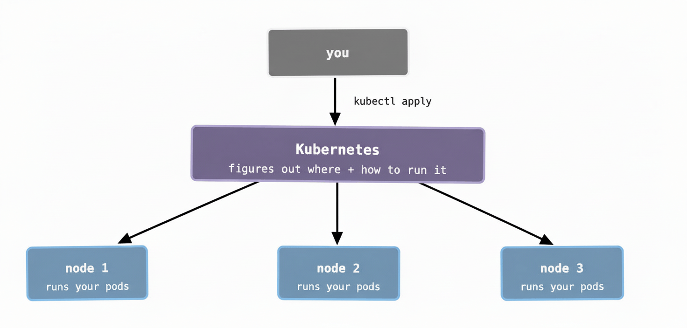

Let’s be honest: the Kubernetes docs are a bit of a wall. You go looking for a simple explanation of what the thing actually *is*, and you end up reading about “container orchestration platforms” and “desired state reconciliation loops” before you’ve had your morning coffee.

So let’s skip all that. Here’s the problem Kubernetes solves, told plainly.

## Start here: the single server era

Cast your mind back to how most services were deployed not that long ago. You’d have a server — a real machine in a rack, or a VM if you were feeling fancy — and you’d SSH into it, install your app, configure it by hand, and pray nothing went wrong. If traffic spiked, you’d SSH into another server and do it again.

These servers were what the industry started calling “pets.” You named them. You nursed them when they got sick. You knew the quirks of each one. `web-prod-03` had that weird disk issue; `db-02` needed a restart every few weeks. If one died, it was a genuine crisis.

This worked fine — until it really didn’t.

## Then containers came along

Docker changed the game around 2013. Instead of “install your app on the server,” you could package your app and all its dependencies into a container image. Run that image anywhere Docker was installed and it’d behave the same way. No more “works on my machine.” No more dependency conflicts between two apps sharing the same server.

This was genuinely great. But it created a new problem almost immediately.

If containers made it easy to run your app anywhere, teams started running a *lot* of them. A single modern service isn’t just one thing — it’s an API server, a background worker, a cache, a queue consumer, a metrics exporter… each one its own container. Multiply that across every service your company runs, and suddenly you’ve got hundreds of containers that need to live somewhere across a fleet of servers.

And that’s where the chaos begins.

## The bin-packing problem

Imagine you’ve got 10 servers and 80 containers to run. How do you decide which container goes where? Someone has to think about:

- Which servers have enough spare CPU and memory to take on more containers?
- What happens when a container crashes — where does the replacement go?
- If a server dies entirely, how do you move its containers somewhere else?
- How do you update a container to a new version without taking your service down?

In the early days, the answer was usually a spreadsheet, a wiki page, or — at some companies — one very stressed-out engineer who held all of this in their head. That doesn’t scale. It also doesn’t recover gracefully at 2am when something falls over.

This is sometimes called the **bin-packing problem**: you’ve got bins (servers) of various sizes and items (containers) of various sizes, and you need to fit the items into the bins as efficiently as possible — while accounting for the fact that the bins occasionally catch fire.

Here’s what that looks like in practice:

Every team running containers at any scale hits this exact situation: wasted capacity on some servers, others creaking under the load, crashed containers sitting dead until someone notices. Managing this by hand is exhausting — and it gets exponentially worse as the number of servers and containers grows. At a large enterprise company , where you might have hundreds of clusters running thousands of workloads, doing this manually isn’t just impractical. It’s simply not possible.

## Enter Kubernetes

Kubernetes (usually shortened to K8s) is software that manages this for you. You stop thinking about individual servers and start thinking about a pool of resources. You tell Kubernetes what you want to run — “I need 3 copies of this container, each with 512MB of memory and half a CPU core” — and it figures out where to put them.

When a container crashes, Kubernetes restarts it. When a node dies, Kubernetes moves its containers to healthy nodes. When you deploy a new version of your app, Kubernetes replaces the old containers one by one so your service never goes down. You describe the world you want; Kubernetes works constantly to make reality match that description.

That last part — the “constantly works to match your desired state” bit — is the fundamental idea underpinning everything in Kubernetes. It’s worth holding onto because it explains a lot of otherwise confusing behaviour you’ll encounter later.

Here’s the shape of it:

You write YAML files that describe what you want — “run 3 copies of this image, expose it on port 8080, restart it if it crashes.” Kubernetes takes that description and makes it happen across however many nodes (servers) you have. You don’t pick which node. You don’t SSH anywhere. You just describe the outcome.

This is the shift from “pets” to “cattle.” The individual servers stop mattering. What matters is the pool of capacity and the workloads running in it.

## So is Kubernetes just “Docker but for multiple servers”?

Kind of — but it does a lot more. It handles:

- Deciding where to place containers based on available resources
- Restarting containers that crash
- Spreading containers across nodes so one failure doesn’t take everything down
- Rolling out updates without downtime
- Letting containers find each other by name rather than IP address
- Storing configuration and secrets in a central place
- Scaling the number of containers up and down based on traffic

Kubernetes is opinionated about *how* you structure your workloads, but once you’re working with it, a lot of the operational drudgery disappears. The 2am page where someone’s container died and needs to be moved? Kubernetes handles that on its own.

## The honest caveat

Kubernetes is not simple. It solves a genuinely hard problem, and it comes with genuine complexity of its own. The learning curve is real, the configuration is verbose, and debugging it when things go wrong requires understanding several layers of abstraction at once.

But the reason it’s taken over the industry isn’t because engineers like complexity — it’s because the alternative (managing container placement by hand across dozens or hundreds of servers) is worse. Once you’re running at any serious scale, Kubernetes starts to feel less like overhead and more like the thing that keeps you sane.

In the next post, we’ll look at *how* Kubernetes is structured internally — what the control plane is, what a worker node actually does, and how a container gets from your kubectl apply command to actually running in a cluster.

`
