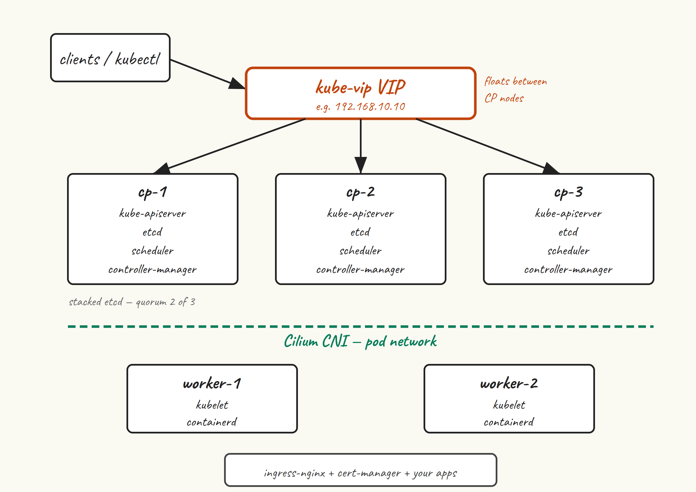

Most “install Kubernetes” tutorials fall into one of two camps. There’s the five-minute k3s/kind crowd, where you run a single command and end up with something that boots but doesn’t behave like the cluster you’ll meet at work. And there’s the production-architecture-from-day-one crowd, where post one is a 4,000-word essay on etcd quorum before you’ve typed `kubeadm`.

This series sits in the middle. We’re going to build a real Kubernetes cluster on VMs using `kubeadm` — the same tool the upstream project actively maintains, the same tool the CKA exam tests on, and the same tool that most “we run our own clusters” shops are using somewhere. By the end of the series, you’ll have three control plane nodes with a kube-vip floating VIP, a couple of workers, Cilium for networking, ingress-nginx and cert-manager for getting traffic in, and the muscle memory to upgrade, back up, and break-then-fix the whole thing.

## Why kubeadm?

There are easier ways to get a Kubernetes cluster. k3s install is one `curl | sh`. kind spins up a cluster inside Docker. EKS, GKE and AKS will hand you a control plane and a bill. They’re all fine tools. None of them are what `kubeadm` is for.

`kubeadm` gives you four things the easier options don’t:

- **The same components you’ll find in any conformant cluster.** kube-apiserver, etcd, kube-scheduler, kube-controller-manager, kubelet, kube-proxy (or its CNI replacement). No vendor abstractions. No embedded shims. What you learn here transfers directly to whatever cluster you log into next.
- **A bootstrapping path you can actually read.** `kubeadm init` tells you phase-by-phase what it’s doing — preflight checks, certs, kubeconfig, control-plane manifests, kubelet config, addon install. Each phase is a `kubeadm` subcommand you can run individually if you need to debug or customise.
- **A maintained upgrade story.** `kubeadm upgrade plan` tells you what version you can move to. `kubeadm upgrade apply` does it. The version skew rules are documented and enforced. This matters more than people expect until they’ve been on the wrong side of a homegrown upgrade script.
- **Honest exposure to what’s actually running.** If etcd is unhappy, you’ll know, because etcd is right there in `/etc/kubernetes/manifests/etcd.yaml` as a static pod and `journalctl -u kubelet` will tell you what containerd is doing about it. There’s no opaque agent in the way.

You give up some convenience. `kubeadm` doesn’t install a CNI. It doesn’t provision load balancers. It doesn’t give you a single command to add a worker — you have to run two commands on two machines, in order. That’s also *why* people use it: because every step is visible.

If you want convenience, use k3s. If you want to learn Kubernetes the way the people running on-prem fleets learn it, keep reading.

## What we’re building

Three control plane nodes. Each runs the full set of control-plane components — kube-apiserver, etcd (as a stacked member of a three-node etcd quorum), kube-scheduler, kube-controller-manager — plus kubelet and the container runtime. We use stacked etcd because, for a small cluster, the operational simplicity beats the marginally better blast-radius isolation of external etcd. If one CP node dies, etcd still has quorum (2 of 3), the other two API servers keep serving, and we lose no state.

**A kube-vip VIP in front of the three API servers.** kube-vip runs in ARP mode as a static pod on each CP node. The VIP lives on whichever node currently holds the lease. `kubectl`, the worker kubelets, and any other client talks to the VIP, not to a specific node. When the holder of the VIP goes down, kube-vip moves the address to another node within seconds. We use kube-vip rather than HAProxy + keepalived because it’s a single static-pod manifest with no external load balancer to keep alive separately.

**Two worker nodes.** You can add more — two is just the smallest number that lets us see scheduling actually do something. Each runs kubelet, containerd, and (rather than kube-proxy) the Cilium agent.

**Cilium as the CNI.** We pick Cilium because it can replace kube-proxy entirely (less iptables sprawl, fewer moving parts), gives us network policies that actually work, and ships with `cilium connectivity test` for catching CNI problems before they catch us. Calico would also be fine; we’ll talk about the choice properly in post 6.

**ingress-nginx and cert-manager** so the cluster is actually useful. By the time we’re done, you’ll be able to deploy a workload, expose it through an Ingress, and have cert-manager pull a valid TLS certificate from Let’s Encrypt.

## The series roadmap

1. **Why kubeadm and what we’re building** — you’re reading it.
2. **VM prep on Ubuntu 24.04** — swap off, kernel modules, sysctl, time sync, hostnames. The boring stuff that decides whether the cluster comes up at all.
3. **Container runtime: containerd** — install, the `SystemdCgroup = true` gotcha, sanity-checking with `crictl`.
4. **Installing kubeadm, kubelet, kubectl** — the `pkgs.k8s.io` repo, version pinning, why `apt-mark hold` is non-negotiable.
5. **Bootstrapping the first control plane node** — `kubeadm init`, reading the phases, what the output actually means.
6. **Installing Cilium as the CNI** — kube-proxy replacement, the Helm install, verifying with `cilium status`.
7. **Adding worker nodes** — join tokens, troubleshooting joins that hang, the discovery-token-ca-cert-hash dance.
8. **HA control plane with kube-vip** — bringing up the VIP, joining cp-2 and cp-3, what failover actually looks like.
9. **Storage and ingress** — local-path-provisioner for default storage, ingress-nginx and cert-manager so traffic can actually arrive.
10. **Day-2: upgrades, etcd backup, breaking things on purpose** — `kubeadm upgrade plan`, etcd snapshots, the failure modes you’ll meet first.

## What you’ll need

- **Five VMs running Ubuntu 24.04 LTS.** Three for control plane, two for workers. Minimum 2 vCPU and 2 GB RAM for CP nodes, 2 vCPU and 4 GB for workers. SSD-backed disks — etcd is fsync-sensitive and you’ll feel it on spinning rust.
- **Wherever they live is fine.** vSphere, Proxmox, libvirt, Multipass, a cloud provider, your laptop with enough RAM. They need to be able to reach each other on a flat layer-2 network (the kube-vip ARP mode we’re using needs that — we’ll talk about BGP mode in passing).
- **One spare unused IP** in the same subnet as the CP nodes. This becomes the kube-vip VIP. If your subnet is `192.168.10.0/24` and your CP nodes are `.11`, `.12`, `.13`, then `.10` will work fine.
- **Hostname resolution between the VMs.** Either DNS or matching `/etc/hosts` entries. We’ll set this up in post 2 but you should know it’s coming.
- **sudo and SSH key access** on all five. Time sync working — `chrony` is fine and is installed by default.

## What you’ll get out of this

- **A cluster you understand.** Not just “ran the install command, got nodes Ready”. You’ll know what `kubeadm` did, why each component exists, and where to look when something breaks.
- **An upgradeable cluster.** We do version pinning and the `apt-mark hold` dance in post 4 specifically so that future-you can run `kubeadm upgrade` without surprises.
- **A repeatable cluster.** The series leans toward command-line steps, but most of the patterns translate cleanly to Ansible or Terraform when you want to wrap them later.

## Versions we’re targeting

Kubernetes **v1.35** on Ubuntu **24.04 LTS**, with containerd **2.x**, Cilium **1.17**, and kube-vip **0.9**. v1.36 is also out and the series will mostly work against it — I’ll flag the places where it matters. The reason for picking v1.35 rather than v1.36 is that it’ll have the longer remaining support window by the time you read this, and more patches behind it.

## Next up

[Post 2](/blog/2-vm-prep/)is the boring-but-essential prep work: getting Ubuntu 24.04 ready for kubelet. Swap off, kernel modules loaded, sysctl tuned, hostnames sorted, time sync verified. None of it is glamorous. All of it is the reason your cluster either comes up cleanly or doesn’t.

See you there.
