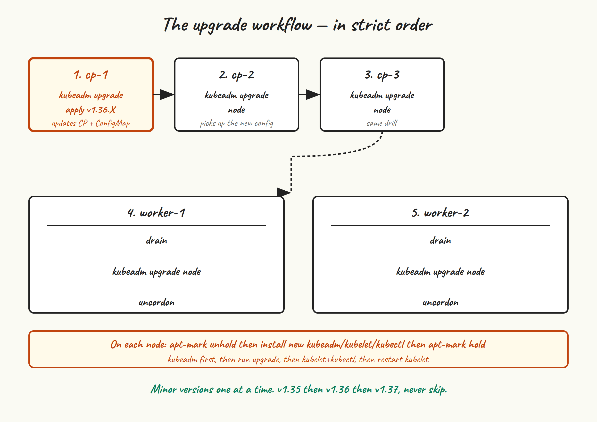

Building a cluster is the easy part. Operating one for two years without losing data is the actual job. This last post in the series covers the three things that distinguish a cluster you can rely on from a cluster you’ve built: the upgrade workflow, etcd backups, and the failure modes you’ll meet in real use.

## The upgrade workflow



Kubernetes lets you skip patch versions freely but never lets you skip a minor version. The upgrade workflow is:

1. Upgrade `kubeadm` on the first control plane node.
2. Run `kubeadm upgrade plan` — it tells you what versions you can move to and what components will be touched.
3. Run `kubeadm upgrade apply` on that first node. This upgrades the control plane components (apiserver, controller-manager, scheduler) on this node and updates the cluster’s `kubeadm-config` ConfigMap.
4. Upgrade `kubelet` and `kubectl` on that first node, restart kubelet.
5. On the other two control plane nodes: upgrade `kubeadm`, run `kubeadm upgrade node` (different command from `apply`), upgrade kubelet/kubectl, restart kubelet.
6. On each worker, one at a time: drain it, upgrade `kubeadm`/`kubelet`/`kubectl`, run `kubeadm upgrade node`, restart kubelet, uncordon.

Concretely, going from v1.35.5 to v1.35.6 (a patch upgrade) looks like this. On `cp-1`:

```
sudo apt-mark unhold kubeadm
sudo apt-get update
sudo apt-get install -y kubeadm=1.35.6-1.1
sudo apt-mark hold kubeadm

sudo kubeadm upgrade plan
# Output tells you what's available. For a patch upgrade,
# everything goes to the same patch version.

sudo kubeadm upgrade apply v1.35.6

sudo apt-mark unhold kubelet kubectl
sudo apt-get install -y kubelet=1.35.6-1.1 kubectl=1.35.6-1.1
sudo apt-mark hold kubelet kubectl

sudo systemctl daemon-reload
sudo systemctl restart kubelet
```

On `cp-2` and `cp-3`, same idea but with `upgrade node` instead of `upgrade apply`:

```
sudo apt-mark unhold kubeadm
sudo apt-get install -y kubeadm=1.35.6-1.1
sudo apt-mark hold kubeadm

sudo kubeadm upgrade node

sudo apt-mark unhold kubelet kubectl
sudo apt-get install -y kubelet=1.35.6-1.1 kubectl=1.35.6-1.1
sudo apt-mark hold kubelet kubectl

sudo systemctl daemon-reload
sudo systemctl restart kubelet
```

For workers, drain first so workloads relocate:

```
# From any control plane node:
kubectl drain worker-1 --ignore-daemonsets --delete-emptydir-data

# On worker-1:
sudo apt-mark unhold kubeadm
sudo apt-get install -y kubeadm=1.35.6-1.1
sudo apt-mark hold kubeadm
sudo kubeadm upgrade node
sudo apt-mark unhold kubelet kubectl
sudo apt-get install -y kubelet=1.35.6-1.1 kubectl=1.35.6-1.1
sudo apt-mark hold kubelet kubectl
sudo systemctl daemon-reload
sudo systemctl restart kubelet

# Back on a control plane node:
kubectl uncordon worker-1
# Repeat for worker-2
```

### Minor-version upgrades

To go from v1.35 to v1.36, do everything above plus one extra step at the very start: switch the apt repo on each node from the v1.35 to the v1.36 URL.

```
sudo sed -i 's|core:/stable:/v1.35|core:/stable:/v1.36|' \
  /etc/apt/sources.list.d/kubernetes.list
curl -fsSL https://pkgs.k8s.io/core:/stable:/v1.36/deb/Release.key | \
  sudo gpg --dearmor --yes -o /etc/apt/keyrings/kubernetes-apt-keyring.gpg
sudo apt-get update
```

Then proceed with `kubeadm upgrade plan` etc. `kubeadm upgrade apply` handles API deprecations — it’ll refuse to upgrade if the cluster is using removed APIs, with an error pointing you at what to fix. Don’t skip the plan step; that’s where you find these out.

## etcd backups

etcd contains the entire desired state of your cluster. Lose it, and the cluster is gone — everything except the actual container images and the local-path PVs has to be restored from backup or rebuilt from manifests. Take snapshots regularly.

```
sudo ETCDCTL_API=3 etcdctl \
  --endpoints=https://127.0.0.1:2379 \
  --cacert=/etc/kubernetes/pki/etcd/ca.crt \
  --cert=/etc/kubernetes/pki/etcd/server.crt \
  --key=/etc/kubernetes/pki/etcd/server.key \
  snapshot save /var/backups/etcd-$(date +%Y%m%d-%H%M%S).db

sudo etcdctl --write-out=table snapshot status /var/backups/etcd-20260525-1830.db
# +----------+----------+------------+------------+
# | HASH     | REVISION | TOTAL KEYS | TOTAL SIZE |
# +----------+----------+------------+------------+
# | abcd1234 |    18439 |       1247 |      14 MB |
# +----------+----------+------------+------------+
```

If `etcdctl` isn’t on the host’s PATH, run it inside an etcd pod as in post 8.

Automate this with a cron job on one of the control plane nodes (etcd snapshots are consistent across the cluster — you only need to snapshot from one member):

```
sudo tee /etc/cron.d/etcd-snapshot <<'EOF'
0 */6 * * * root ETCDCTL_API=3 /usr/bin/etcdctl \
  --endpoints=https://127.0.0.1:2379 \
  --cacert=/etc/kubernetes/pki/etcd/ca.crt \
  --cert=/etc/kubernetes/pki/etcd/server.crt \
  --key=/etc/kubernetes/pki/etcd/server.key \
  snapshot save /var/backups/etcd/etcd-$(date +\%Y\%m\%d-\%H\%M).db
0 4 * * * root find /var/backups/etcd -name 'etcd-*.db' -mtime +14 -delete
EOF
sudo mkdir -p /var/backups/etcd
```

Snapshots every six hours, retention of fourteen days. Adjust to taste. And critically: **copy them off the cluster**. Backups on the same machine as the data they back up don’t help when the machine dies. `rsync` to your NAS, `aws s3 cp` to a bucket, whatever — just get them off the box.

### Restoring from a snapshot

You hopefully never need this, so it’s worth practising in a non-prod cluster. The high-level flow:

1. Stop kubelet on all control plane nodes so etcd isn’t running.
2. On the node that will host the restored etcd, run `etcdctl snapshot restore` against your snapshot file, with appropriate `--name`, `--initial-cluster`, and `--initial-advertise-peer-urls` flags pointing at a single-member cluster.
3. Replace the contents of `/var/lib/etcd` with the restored data directory.
4. Start kubelet on that node. You now have a single-member etcd with the restored state.
5. On the other two CP nodes, `kubeadm reset` and `kubeadm join --control-plane` to grow back to three members.

The full recipe lives in the official Kubernetes docs under “Backing up an etcd cluster”. Don’t write your own from memory the day you need it.

## Common failure modes

### Kubelet client cert expired

Kubelet’s client cert (in `/var/lib/kubelet/pki/kubelet-client-current.pem`) is auto-rotated by default. The control-plane component certs (in `/etc/kubernetes/pki/`) are not auto-rotated; they have a one-year lifetime. If you go a year without running `kubeadm upgrade` (which rotates them as a side effect), they expire and the cluster falls over.

Check when they expire:

```
sudo kubeadm certs check-expiration
```

To renew without upgrading:

```
sudo kubeadm certs renew all
# Then restart static pods so they pick up new certs:
sudo systemctl restart kubelet
```

Do this on each control plane node.

### etcd lost quorum

Two of three etcd members are unreachable. The remaining member can read but not write — new pods won’t schedule, kubectl applies hang.

If the missing members are coming back (rebooting, network blip): wait. Most of the time, etcd recovers on its own within minutes once peers are reachable.

If they’re not coming back (data corruption, disks died): you need to force a single-member cluster from the surviving node, then re-add new members. The procedure is in the etcd docs as “etcdctl member promote / disaster recovery”. This is a moment to take a snapshot first if you can.

### Disk full on a control plane node

etcd’s WAL grows. containerd’s image store grows. Logs grow. If `/var` fills up, kubelet evicts pods (DiskPressure), etcd starts complaining (NOSPACE alarm), and very bad things happen in sequence.

Prevention: a disk usage alert, log rotation, and `etcdctl defrag` in a monthly cron job:

```
sudo etcdctl --endpoints=https://127.0.0.1:2379 \
  --cacert=/etc/kubernetes/pki/etcd/ca.crt \
  --cert=/etc/kubernetes/pki/etcd/server.crt \
  --key=/etc/kubernetes/pki/etcd/server.key \
  defrag
```

### kube-vip lost the VIP for no obvious reason

Most often: the API server on the current VIP holder became unhealthy, kube-vip’s health check failed, lease moved. `kubectl -n kube-system logs kube-vip-cp-1` will tell you. Sometimes it’s a kernel-side ARP cache issue on a particular switch; clearing the ARP table on the affected switch or its uplink usually fixes it.

### “node lease can’t be renewed”

Kubelet renews a node lease every 10 seconds, and the controller-manager declares a node NotReady if leases stop arriving for 40 seconds. If you see workers flapping in and out of Ready: either networking between worker and API server is iffy, or the API server itself is overloaded, or both clocks are drifting.

```
# From the worker
journalctl -u kubelet -f | grep -i lease
# Look for "Failed to update node lease" with the actual error
```

## Where to go next

You have a working, upgradeable, HA Kubernetes cluster you built yourself. There’s a lot more you could add — pick the ones that match how you’ll use the cluster:

- **Velero** for application-level backups (PVCs, namespaces, the bits etcd snapshots don’t cover well).
- **Longhorn or Rook** if you outgrow local-path and need real distributed block storage.
- **Prometheus + Grafana** (via kube-prometheus-stack) for actual metrics. Cilium’s Hubble UI is great for network observability; Prometheus is everything else.
- **External-DNS** so Ingress hostnames automatically become DNS records.
- **MetalLB or kube-vip in BGP mode** if you want real LoadBalancer Services rather than the hostPort hack from post 9.
- **ArgoCD or Flux** if you want everything you just installed manually to live in a git repo and reconcile itself.
- **Wrap it all in Terraform/Ansible.** Provisioning the VMs and running through posts 2-9 by hand once is educational. Doing it ten times is busywork.

## Closing the series

Ten posts in, you have a cluster you understand — not just one that works. You know what every component does, where its logs live, and which static pod manifest to edit when you need to. You know how to upgrade it without holding your breath. You’ve watched a control plane node fail and seen kubectl keep working through the gap.

The cluster is not a finished thing. It never is. But it’s *yours*, and you can read every line of how it got there. If you want to add more nodes, swap the CNI, replace ingress-nginx with Traefik, switch from local-path to Longhorn, plug in ArgoCD — you’ve got the muscle for it now.

Thanks for reading. Break things, fix them, write about it.
