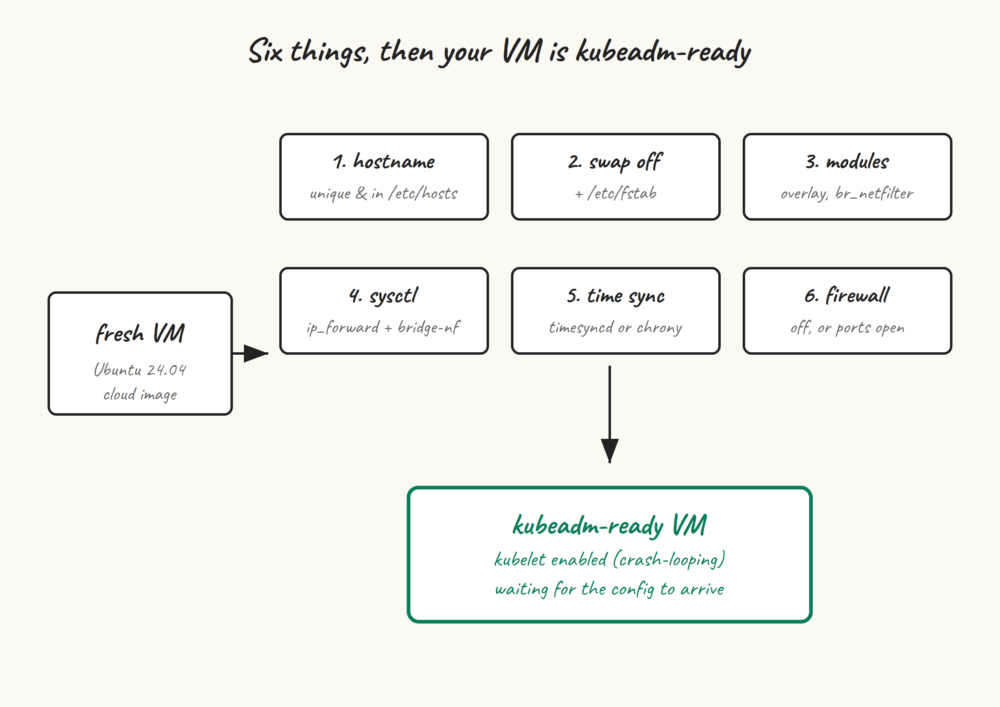

If post 1 was the setup, this post is the part where we make sure the VMs are actually ready to host a Kubernetes cluster. Nothing in this post is glamorous. All of it is the reason your cluster either comes up cleanly when you run `kubeadm init`, or doesn’t.

Run every command in this post on all five VMs — `cp-1`, `cp-2`, `cp-3`, `worker-1`, `worker-2`. The order between VMs doesn’t matter, but the order of steps within a VM matters in one place (swap before sysctl) which I’ll flag.

## What we’re doing and why



Kubelet has a set of expectations about its host:

- A unique hostname that resolves consistently — kubelet uses it as the node name.
- No swap. Kubelet’s resource accounting assumes RAM is RAM. (You *can* run kubelet with swap on as of v1.30+, but it’s still beta and not what kubeadm sets up by default.)
- The right kernel modules loaded (`overlay` for the overlay filesystem the runtime uses, `br_netfilter` so iptables can see bridged traffic).
- A handful of sysctl values flipped, primarily IP forwarding and bridged-traffic iptables hooks.
- Working time sync. etcd’s Raft is unhappy when clocks drift.
- Either no firewall, or one with the right ports opened. We’ll go with “no firewall” for the lab and talk about ports as a coda.

Let’s go.

## Hostnames and /etc/hosts

Set a unique, stable hostname on each VM. On `cp-1`:

```
sudo hostnamectl set-hostname cp-1
exec bash  # reload your shell so $PS1 reflects the new name
```

Repeat with `cp-2`, `cp-3`, `worker-1`, `worker-2` on their respective VMs.

Now make every VM able to resolve every other VM by name. The proper way is DNS; the pragmatic way for a lab is `/etc/hosts`. Pick one:

```
sudo tee -a /etc/hosts <<'EOF'
192.168.10.11   cp-1
192.168.10.12   cp-2
192.168.10.13   cp-3
192.168.10.21   worker-1
192.168.10.22   worker-2
192.168.10.10   k8s-api
EOF
```

Substitute your actual IPs. That last entry, `k8s-api`, is the hostname we’ll attach to the kube-vip VIP. We use a name (not the bare IP) for the control-plane endpoint so that if you ever change the VIP, you only have to update `/etc/hosts` or DNS — not regenerate certificates.

Sanity check by pinging from any node:

```
ping -c 1 cp-2
ping -c 1 worker-1
```

## Swap off

Turn it off now, and make sure it stays off after reboot:

```
sudo swapoff -a
sudo sed -i.bak '/\sswap\s/s/^/#/' /etc/fstab
```

The `sed` comments out any swap entry in `/etc/fstab` and leaves a `.bak` behind in case you want to revert. On a stock Ubuntu 24.04 cloud image you usually don’t have a swap entry; on a Proxmox/VMware-installed VM you sometimes do.

Ubuntu 24.04 sometimes also has a `swap.img` managed via a systemd `.swap` unit. Check and disable it if present:

```
systemctl --type swap
# If anything shows up, e.g. swap.img.swap:
sudo systemctl mask swap.img.swap
sudo systemctl daemon-reload
```

Verify swap is actually off:

```
free -h | grep -i swap
# Swap:    0B    0B    0B
```

## Kernel modules

Two modules need to be loaded at boot. `overlay` is what containerd uses for the OverlayFS snapshotter (i.e. how container layers stack). `br_netfilter` is what makes iptables and nftables rules apply to traffic that’s been bridged — without it, your Service-IP NAT rules silently do nothing for pod-to-pod traffic going through the cluster’s bridge.

```
sudo tee /etc/modules-load.d/k8s.conf <<'EOF'
overlay
br_netfilter
EOF

sudo modprobe overlay
sudo modprobe br_netfilter
```

Quick check:

```
lsmod | grep -E 'overlay|br_netfilter'
```

## sysctl

Three values, all related to networking. `net.ipv4.ip_forward = 1` turns the node into a router for pod-to-pod and pod-to-service traffic. The two `bridge-nf-call` lines tell the bridge code to push frames through iptables/ip6tables, which is what makes `kube-proxy`-style service NAT actually work. (We’re going kube-proxy-free with Cilium in post 6, but this still matters for some CNI dataplane paths and is a kubeadm preflight requirement.)

```
sudo tee /etc/sysctl.d/k8s.conf <<'EOF'
net.bridge.bridge-nf-call-iptables  = 1
net.bridge.bridge-nf-call-ip6tables = 1
net.ipv4.ip_forward                 = 1
EOF

sudo sysctl --system | tail -n 20
```

The order matters here: `br_netfilter` has to be loaded before sysctl can set `net.bridge.*` values, because those sysctls don’t exist until the module is loaded. We loaded the module in the previous step, so we’re fine. If you ever see `sysctl: cannot stat /proc/sys/net/bridge/bridge-nf-call-iptables`, you’ve hit this ordering trap.

## Time sync

Ubuntu 24.04 ships with `systemd-timesyncd` enabled by default. That’s fine for kubeadm — it’s not as accurate as `chrony`, but it keeps clocks within a few milliseconds of NTP, which is well inside what etcd cares about. Verify it’s running:

```
timedatectl
# System clock synchronized: yes
# NTP service: active
```

If you see `System clock synchronized: no` for more than a minute or so after boot, something is wrong — check that the VM can reach `time.ubuntu.com:123/udp`, or swap in your own NTP servers in `/etc/systemd/timesyncd.conf`.

If you’d rather use chrony (slightly tighter sync, more diagnostics):

```
sudo apt install -y chrony
sudo systemctl enable --now chrony
chronyc tracking
```

## Firewall

The path of least resistance for a lab is to disable `ufw`:

```
sudo ufw disable
sudo systemctl disable --now ufw
```

If you can’t disable the firewall (most production environments), here are the ports kubeadm needs open between nodes:

- **Control plane nodes:** 6443 (kube-apiserver), 2379-2380 (etcd peers and clients), 10250 (kubelet), 10257 (controller-manager), 10259 (scheduler).
- **Worker nodes:** 10250 (kubelet), 30000-32767 (NodePort range, only if you’ll use NodePort services).
- **Cilium (added in post 6):** 4240 (cluster health), 4244 (Hubble), 8472/UDP (VXLAN, if you don’t use eBPF native routing).
- **kube-vip:** ARP mode broadcasts on the local segment; no specific port to allow, but the host needs to be able to send gratuitous ARPs.

## Sanity check

Before we move on to containerd in post 3, run this on each VM as a final check:

```
echo "=== hostname ==="
hostname
echo
echo "=== swap ==="
swapon --show
free -h | grep -i swap
echo
echo "=== modules ==="
lsmod | grep -E 'overlay|br_netfilter'
echo
echo "=== sysctl ==="
sysctl net.bridge.bridge-nf-call-iptables net.ipv4.ip_forward
echo
echo "=== time ==="
timedatectl | grep -E 'synchronized|NTP service'
```

What you want to see: hostname matches what you set, `swapon --show` outputs nothing, `free` shows zero swap, both modules listed, both sysctls equal to 1, NTP active and clock synchronized.

If any of that’s wrong, fix it now. Kubeadm’s preflight checks will catch most of it — but the failure messages are clearer when you know what they’re checking for, and you waste less time debugging when prep is solid before `kubeadm init` runs.

## A note on cloud-init and Ansible

If you’re provisioning these VMs through Terraform, Proxmox templates, or anything else that lets you run a script at first boot, everything in this post is two dozen lines of cloud-init or a small Ansible role. I’d recommend doing it that way once you’ve worked through it manually here — you’ll provision the cluster again sooner than you think, even if it’s just to rebuild a broken node.

## Next up

[Post 3](/blog/3-containerd/) installs containerd, configures it for kubelet, and walks through the `SystemdCgroup = true` change that is probably the single most common reason brand-new kubeadm clusters end up in a kubelet/runtime restart loop on day one.
