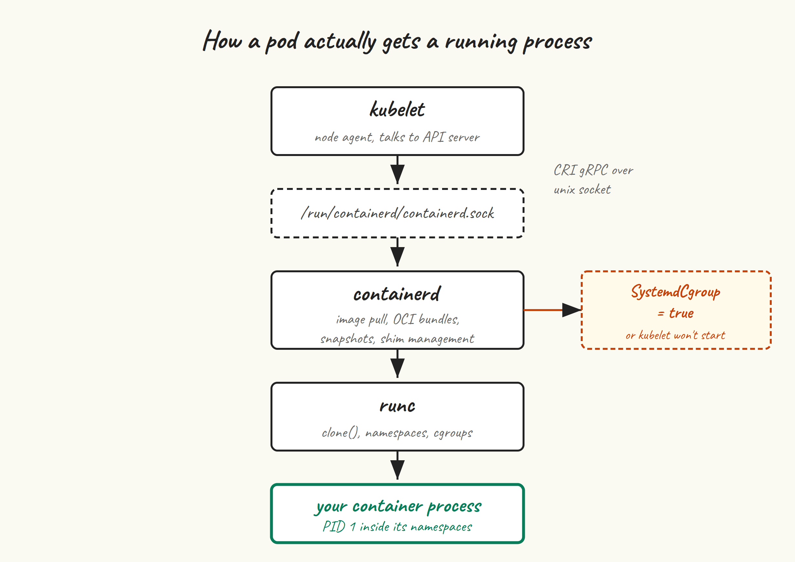

Kubelet doesn’t run containers directly. It talks over a socket to a container runtime, using the Container Runtime Interface (CRI). The runtime does the actual work — pulling images, creating namespaces and cgroups, calling out to `runc` to start the process, and reporting back. `containerd` is the runtime kubelet most commonly talks to these days, and it’s what we’re going to use.

## Where containerd fits



Kubelet calls `containerd` over a Unix socket at `/run/containerd/containerd.sock`. Containerd, for each container, sets up the OCI bundle (the rootfs and config), invokes `runc` to create the process, and hands back a container ID. `runc` is what actually does the `clone(2)` with the right namespace flags, sets up cgroups, and execs your container’s entrypoint.

You don’t run Docker. Docker Engine ships its own container runtime (also called containerd under the hood, confusingly) plus a daemon that adds a REST API, image building, network management, and so on. None of that is useful to kubelet, and kubelet stopped talking to Docker Engine entirely in v1.24. CRI-O is the other supported runtime and is a fine alternative — we’re picking containerd because it’s the default in most managed and self-hosted Kubernetes setups, so the troubleshooting context transfers.

## Install

Run on all five VMs. Ubuntu’s own `containerd` package is fine but trails upstream by a few minor versions. Docker’s apt repo gives you current containerd 2.x without the rest of Docker. Pick one:

**Option A — Ubuntu’s package** (simpler, slightly older):

```
sudo apt update
sudo apt install -y containerd
```

**Option B — Docker’s apt repo** (current containerd):

```
sudo install -m 0755 -d /etc/apt/keyrings
curl -fsSL https://download.docker.com/linux/ubuntu/gpg | \
  sudo gpg --dearmor -o /etc/apt/keyrings/docker.gpg
sudo chmod a+r /etc/apt/keyrings/docker.gpg

echo "deb [arch=$(dpkg --print-architecture) signed-by=/etc/apt/keyrings/docker.gpg] \
  https://download.docker.com/linux/ubuntu $(lsb_release -cs) stable" | \
  sudo tee /etc/apt/sources.list.d/docker.list

sudo apt update
sudo apt install -y containerd.io
```

Note that the package is called `containerd.io` in Docker’s repo and just `containerd` in Ubuntu’s. Pick whichever, but don’t mix — if you’ve installed Ubuntu’s and later add Docker’s, `apt` will refuse to upgrade without a manual `apt remove` first.

Verify:

```
containerd --version
# containerd github.com/containerd/containerd/v2 v2.2.x ...
```

## Generate the default config

The Ubuntu and Docker packages both ship an empty or minimal `/etc/containerd/config.toml`, which makes containerd run with all defaults compiled in. Kubelet needs a couple of specific values set, so we generate the full default config and edit it.

```
sudo mkdir -p /etc/containerd
containerd config default | sudo tee /etc/containerd/config.toml > /dev/null
```

This is the canonical move — never hand-write `config.toml` from scratch, always start from `containerd config default`. The schema changes across versions (it shifted significantly between containerd 1.x and 2.x), and the default reflects what your installed version expects.

## SystemdCgroup = true

This is the line that catches people. Ubuntu 24.04 uses cgroups v2 with systemd as the cgroup manager. Kubelet, by default, uses the `systemd` cgroup driver. If containerd uses a different cgroup driver (`cgroupfs`), you end up with two managers fighting over the same cgroup hierarchy and kubelet refuses to start. The fix is one line:

```
sudo sed -i 's/SystemdCgroup = false/SystemdCgroup = true/' /etc/containerd/config.toml
grep SystemdCgroup /etc/containerd/config.toml
# SystemdCgroup = true
```

If `grep` returns nothing, you’ve got a containerd version where the key is in a different stanza. Open `config.toml` in `$EDITOR` and search for `SystemdCgroup` manually — it’s under the runc runtime’s options block, somewhere around `[plugins.'io.containerd.cri.v1.runtime'.containerd.runtimes.runc.options]` in containerd 2.x or `[plugins."io.containerd.grpc.v1.cri".containerd.runtimes.runc.options]` in 1.x. Set it to `true`, save.

## Sandbox image

Containerd has a “sandbox image” — the tiny image used as the pause container that holds the network and IPC namespaces for every pod. Kubelet expects the sandbox image to match the one it’s been built against. When they mismatch, you’ll see “FailedCreatePodSandBox” errors with weirdly cryptic messages about pulling images.

Find what kubelet wants:

```
# If kubeadm is already installed (it won't be yet on a fresh VM; this is for reference):
kubeadm config images list | grep pause
# registry.k8s.io/pause:3.10
```

And update containerd’s config to match. For containerd 2.x, the key is `sandbox_image` under the CRI plugin:

```
sudo sed -i 's|sandbox_image = .*|sandbox_image = "registry.k8s.io/pause:3.10"|' \
  /etc/containerd/config.toml
grep sandbox_image /etc/containerd/config.toml
```

Use whatever version `kubeadm config images list` tells you — it’s bumped from time to time. If you don’t have kubeadm yet, `3.10` is correct for Kubernetes 1.34 through 1.36. We’ll revisit this in post 5 if needed.

## Restart and enable

```
sudo systemctl restart containerd
sudo systemctl enable containerd
sudo systemctl status containerd --no-pager
```

You want `active (running)` and no errors in the last few lines of `journalctl -u containerd --since '1 minute ago'`. If containerd refused to start, the journal will tell you why — most often a syntax error in `config.toml` from a hand-edit gone wrong, in which case regenerating from `containerd config default` and re-applying your two edits is the fastest fix.

## crictl — the runtime-side kubectl

Kubelet talks to containerd over the CRI socket. `crictl` is a CLI for hitting that same socket directly, which is invaluable for debugging when kubelet itself is unhappy. It’s not installed by default; let’s add it.

```
VERSION=v1.35.0
curl -fsSL -o crictl.tar.gz \
  "https://github.com/kubernetes-sigs/cri-tools/releases/download/${VERSION}/crictl-${VERSION}-linux-amd64.tar.gz"
sudo tar -C /usr/local/bin -xzf crictl.tar.gz
rm crictl.tar.gz
crictl --version
```

Configure it so you don’t have to pass the socket path every time:

```
sudo tee /etc/crictl.yaml <<'EOF'
runtime-endpoint: unix:///run/containerd/containerd.sock
image-endpoint: unix:///run/containerd/containerd.sock
timeout: 10
debug: false
EOF
```

Sanity check:

```
sudo crictl info | head -n 20
sudo crictl ps          # no containers yet, but no error means CRI is healthy
sudo crictl images      # likewise
```

If `crictl info` hangs or errors, containerd isn’t healthy — go back and check the config and journal. If it returns JSON describing the runtime, you’re done.

## Pull the pause image early

Optional but a nice habit: pre-pull the pause image now. It saves a few seconds during `kubeadm init` and verifies that the node can actually reach `registry.k8s.io`:

```
sudo crictl pull registry.k8s.io/pause:3.10
sudo crictl images | grep pause
```

## Common failure modes

- **kubelet crash-loops with cgroup driver mismatch.** You skipped the `SystemdCgroup = true` edit, or set it under the wrong stanza, or you’ve got a leftover config from a previous install. Regenerate, edit, restart containerd, restart kubelet.
- **FailedCreatePodSandBox: pulling image registry.k8s.io/pause:3.X.** Wrong pause image version in `sandbox_image`. Match it to what `kubeadm config images list` reports.
- **containerd refuses to start with TOML parse error.** Hand-edits gone wrong. Regenerate config: `containerd config default | sudo tee /etc/containerd/config.toml`, then re-apply the two `sed` commands above.
- **crictl shows no socket / connection refused.** Containerd isn’t running, or your `/etc/crictl.yaml` points at the wrong socket. `ls -la /run/containerd/` should show `containerd.sock`.

## Next up

[Post 4](/blog/4-install-kubeadm/) installs `kubeadm`, `kubelet`, and `kubectl` from the official `pkgs.k8s.io` repo, pins their versions, and explains why `apt-mark hold` is non-negotiable for these three packages.
