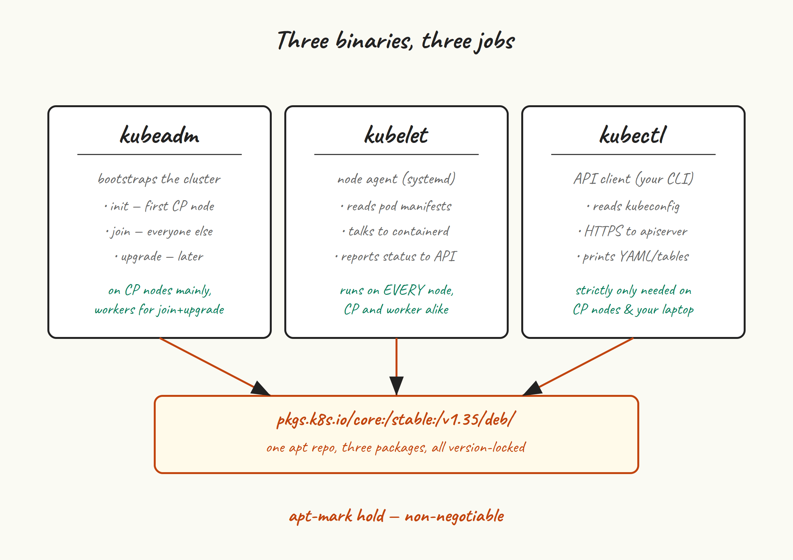

Three binaries, one apt repo, two gotchas. This is the shortest post in the series and one of the most consequential to get right, because the choice you make about which Kubernetes minor version to install in this step is the one you’ll live with until you decide to upgrade.

## What each binary does



- **kubeadm** bootstraps a cluster. You’ll run it twice on the first control plane node (once to `init`, once or twice to `upgrade` later) and once per other node (to `join`). After that you barely think about it until upgrade day.
- **kubelet** is the agent that runs on every single node, control plane and worker. It talks to the API server to get its pod manifests, talks to containerd to actually run them, and talks back to the API server with status. It’s a systemd service.
- **kubectl** is the API client you’ll use day to day. Strictly, you only need it on the control plane nodes (where kubeadm puts an admin kubeconfig), but I install it everywhere for convenience.

## Add the apt repo

The Kubernetes project has its own apt repo at `pkgs.k8s.io`. Critically, there is *one repo per Kubernetes minor version* — v1.34, v1.35, v1.36 each have a distinct URL. This is the project’s deliberate design: it makes it impossible to accidentally jump minors with a casual `apt upgrade`.

The old `apt.kubernetes.io` repo was deprecated in September 2023 and now serves nothing useful. If you find a tutorial that still references it, the rest of the tutorial is also stale.

We’re targeting **v1.35**. Run on all five VMs:

```shell
sudo apt update
sudo apt install -y apt-transport-https ca-certificates curl gpg

K8S_MINOR=v1.35

sudo mkdir -p /etc/apt/keyrings
curl -fsSL "https://pkgs.k8s.io/core:/stable:/${K8S_MINOR}/deb/Release.key" | \
  sudo gpg --dearmor -o /etc/apt/keyrings/kubernetes-apt-keyring.gpg
sudo chmod 0644 /etc/apt/keyrings/kubernetes-apt-keyring.gpg

echo "deb [signed-by=/etc/apt/keyrings/kubernetes-apt-keyring.gpg] \
  https://pkgs.k8s.io/core:/stable:/${K8S_MINOR}/deb/ /" | \
  sudo tee /etc/apt/sources.list.d/kubernetes.list

sudo apt update
```

The `chmod 0644` on the keyring file is there because more recent `apt` versions on Ubuntu complain (loudly) about keyrings that aren’t world-readable. Older `apt` didn’t care. Setting it to 0644 makes both happy.

## Install

You can install the latest patch in the v1.35 series with no version constraint:

```shell
sudo apt install -y kubelet kubeadm kubectl
```

If you want a specific patch version (recommended for repeatable builds), check what’s available and pin:

```shell
apt-cache madison kubeadm | head -n 5
# kubeadm | 1.35.5-1.1 | https://pkgs.k8s.io/core:/stable:/v1.35/deb Packages
# kubeadm | 1.35.4-1.1 | https://pkgs.k8s.io/core:/stable:/v1.35/deb Packages
# ...

sudo apt install -y \
  kubelet=1.35.5-1.1 \
  kubeadm=1.35.5-1.1 \
  kubectl=1.35.5-1.1
```

All three should be the same version. Mixing — say, kubelet 1.35.5 with kubeadm 1.35.0 — is technically allowed under the version skew policy but is the kind of “technically allowed” that bites you at upgrade time.

## apt-mark hold — non-negotiable

This is the gotcha. If you don’t hold these packages, the next time you (or unattended-upgrades) runs `apt upgrade`, kubelet may get bumped to a newer patch independently of kubeadm or kubectl. Kubernetes has strict rules about version skew between these components, and even patch-level disagreement can put a node in a degraded state. Hold them:

```shell
sudo apt-mark hold kubelet kubeadm kubectl
apt-mark showhold
```

Now `apt upgrade` will skip these three. Upgrades become a deliberate two-step: `apt-mark unhold`, install the new version, `apt-mark hold` again. We’ll do this properly in post 10 when we cover upgrades.

Same applies to `containerd` from the previous post, if you care about runtime stability:

```shell
sudo apt-mark hold containerd     # Ubuntu's package
# or
sudo apt-mark hold containerd.io  # Docker's package
```

## Enable kubelet

```shell
sudo systemctl enable --now kubelet
systemctl status kubelet --no-pager
```

Kubelet will start, immediately fail to find its config (because we haven’t run `kubeadm init` yet), and enter a restart loop. **This is expected.** Don’t try to “fix” it. The journal will look like:

```shell
journalctl -u kubelet --since '1 minute ago' | tail -n 5
# kubelet.service: Main process exited, code=exited, status=1/FAILURE
# kubelet.service: Failed with result 'exit-code'.
# kubelet.service: Scheduled restart job, restart counter is at 3.
```

The reason we enable kubelet now is that `kubeadm init` in post 5 will write kubelet’s config and drop pod manifests in `/etc/kubernetes/manifests`. Once those files appear, the next kubelet restart picks them up and the loop ends. Having kubelet already enabled means there’s nothing manual to do after `kubeadm init` finishes.

## Verify

```shell
kubelet --version
kubeadm version --short
kubectl version --client
# all three should report v1.35.5 (or whatever patch you installed)

apt-mark showhold
# containerd
# kubeadm
# kubectl
# kubelet
```

## A note on minor-version upgrades

When you eventually want to move to v1.36, you’ll edit `/etc/apt/sources.list.d/kubernetes.list` and replace `v1.35` with `v1.36`, re-import the v1.36 key, and run an `apt update`. The v1.35 repo and the v1.36 repo are completely separate — `apt` won’t suggest jumping between them on its own. This is a feature, not a bug.

Patch upgrades within v1.35 (say, 1.35.5 to 1.35.6) are also a deliberate action: `apt-mark unhold`, `apt install kubeadm=1.35.6-1.1 ...`, `apt-mark hold`.

## Next up

[Post 5](/blog/4-install-kubeadm/) is the big one: `kubeadm init` on `cp-1`, with the kube-vip static pod pre-staged so the VIP is up the moment the API server is. We’ll walk through every flag, read the phase output, and end up with a working (single-node) control plane.
