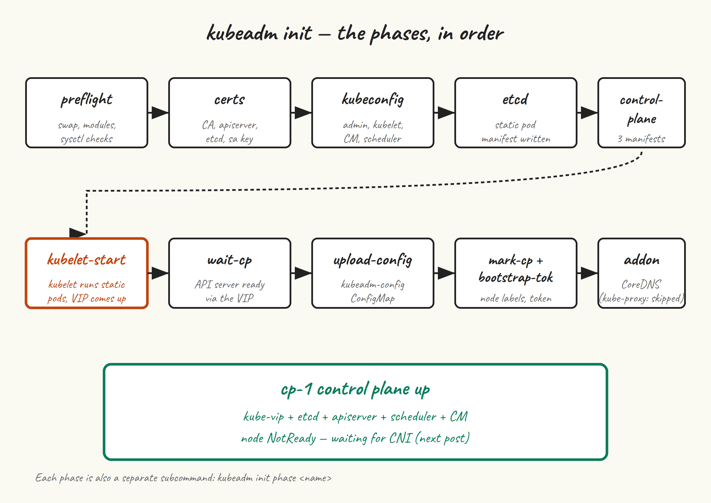

This is the post where we actually get a Kubernetes API server running. After this, you’ll have a single-node control plane on `cp-1` that’s already wearing its kube-vip VIP — ready for Cilium in post 6, workers in post 7, and the other two control plane nodes in post 8. The cluster won’t be highly available yet, but the certificates, the API endpoint, and the etcd configuration will all be HA-ready from the moment of birth.

Everything in this post runs on **cp-1** only.

## Decide on values

Before you type `kubeadm init`, you need three numbers and a name. Pick them now — changing any of them later is more painful than getting them right the first time.

- **Control-plane endpoint:** a DNS name (or bare IP) that all kubeconfigs and node bootstraps will use to reach the API server. We set up `k8s-api` pointing at `192.168.10.10` in post 2’s `/etc/hosts`. We’ll use `k8s-api:6443`.
- **Pod CIDR:** the network range pods get IPs from. `10.244.0.0/16` is the kubeadm/Flannel convention; Cilium happily uses whatever you tell kubeadm. Don’t overlap with your VM subnet.
- **Service CIDR:** the range for ClusterIP services. Default is `10.96.0.0/12`; leave it alone unless it collides with something on your network.
- **Kube-vip VIP:** the IP `k8s-api` resolves to — `192.168.10.10`.

## Pre-stage the kube-vip static pod manifest



kube-vip runs as a static pod: a manifest YAML dropped into `/etc/kubernetes/manifests/`, which kubelet watches and runs as a pod even before there’s an API server. By staging the kube-vip manifest *before* `kubeadm init` starts, kube-vip will come up as soon as kubelet does — the VIP starts answering ARP while kubeadm is still generating certificates, and by the time kubeadm tries to talk to the API server through the VIP, the VIP exists.

Generate the manifest using kube-vip’s own container as a CLI:

```
sudo mkdir -p /etc/kubernetes/manifests

# Pull the kube-vip image first so 'ctr run' below is fast
sudo ctr image pull ghcr.io/kube-vip/kube-vip:v0.9.3

VIP=192.168.10.10
INTERFACE=$(ip -4 -o route get "$VIP" | awk '{print $5; exit}')

sudo ctr run --rm --net-host \
  ghcr.io/kube-vip/kube-vip:v0.9.3 vip /kube-vip manifest pod \
  --interface "$INTERFACE" \
  --address "$VIP" \
  --controlplane \
  --arp \
  --leaderElection \
  | sudo tee /etc/kubernetes/manifests/kube-vip.yaml > /dev/null
```

What that command does: tells kube-vip to generate a static pod manifest for control-plane VIP duty (`--controlplane`), using ARP for the VIP (`--arp` — layer 2, no BGP), with leader election so only one node holds the VIP at a time. The output is written to where kubelet will find it.

The `--interface` auto-detection picks the interface that has a route to the VIP, which on a flat /24 is the one you want. If your network is more complex, set `INTERFACE=eth0` (or whatever) by hand.

Don’t worry that the VIP isn’t pingable yet — kubelet isn’t running this manifest yet either, because kubelet is in its restart loop waiting for the kubeadm config.

## kubeadm init

```
sudo kubeadm init \
  --control-plane-endpoint="k8s-api:6443" \
  --upload-certs \
  --pod-network-cidr=10.244.0.0/16 \
  --skip-phases=addon/kube-proxy
```

The flags, one by one:

- `--control-plane-endpoint=k8s-api:6443` — the address every kubeconfig will use to reach the API server. By setting it now we make sure all generated certs include `k8s-api` and the VIP in their Subject Alternative Names, so cp-2 and cp-3 can join later without regenerating anything.
- `--upload-certs` — uploads the control-plane CA certs and keys to a Kubernetes secret, encrypted with a single-use key. We’ll need this in post 8 when cp-2 and cp-3 join; without it, you’d have to `scp` certs between machines manually.
- `--pod-network-cidr=10.244.0.0/16` — the pod IP range. Cilium will use this in post 6.
- `--skip-phases=addon/kube-proxy` — don’t install kube-proxy. We’re going kube-proxy-free with Cilium; installing it now and deleting it later is messier than skipping it.

## Reading the output

What kubeadm does, in order, and how to tell when each phase has gone wrong:

```
[init] Using Kubernetes version: v1.35.5
[preflight] Running pre-flight checks
```

**Preflight** is where most of your “I forgot to do something in post 2” pain shows up. Missing kernel modules, swap still on, bridge-nf sysctls wrong, kubelet not running — preflight catches all of these. Read the output carefully. If you get `[ERROR XXX]` entries you can’t ignore (sometimes a warning is OK; an error is not), fix and rerun.

```
[certs] Generating "ca" certificate and key
[certs] Generating "apiserver" certificate and key
[certs] apiserver serving cert is signed for DNS names [cp-1 k8s-api kubernetes ...]
        and IPs [10.96.0.1 192.168.10.11 192.168.10.10]
```

Notice the SANs in that `apiserver` cert include both `cp-1`, `k8s-api`, and the VIP `192.168.10.10`. That’s because we set `--control-plane-endpoint`. If you ever need to add more, you can regenerate with `kubeadm init phase certs apiserver` after editing the kubeadm config — but it’s an annoying process best avoided by getting SANs right at init time.

```
[kubeconfig] Writing "admin.conf" kubeconfig file
[kubeconfig] Writing "super-admin.conf" kubeconfig file
[kubeconfig] Writing "kubelet.conf" kubeconfig file
[kubeconfig] Writing "controller-manager.conf" kubeconfig file
[kubeconfig] Writing "scheduler.conf" kubeconfig file
```

kubeadm generates five kubeconfigs in `/etc/kubernetes/`. `admin.conf` is the one you copy to `~/.kube/config`. `super-admin.conf` is a higher-privilege backup that bypasses RBAC entirely (in case you lock yourself out); keep it safe and don’t use it day-to-day.

```
[etcd] Creating static Pod manifest for local etcd
[control-plane] Creating static Pod manifest for "kube-apiserver"
[control-plane] Creating static Pod manifest for "kube-controller-manager"
[control-plane] Creating static Pod manifest for "kube-scheduler"
[kubelet-start] Starting the kubelet
```

This is the moment things get real. kubeadm writes static pod manifests into `/etc/kubernetes/manifests/` — alongside the `kube-vip.yaml` we already put there — and tells kubelet to (re)start. Kubelet finds the manifests, starts containers via containerd, and within a few seconds you have etcd running, an API server running, and a VIP that the local API server is reachable through.

```
[wait-control-plane] Waiting for the kubelet to boot up the control plane
[wait-control-plane] All control plane components healthy after 12.34 seconds
[upload-config] Storing configuration in the "kubeadm-config" ConfigMap
[mark-control-plane] Marking node cp-1 as control-plane
[bootstrap-token] Using token: abcdef.0123456789abcdef
[addons] Applied essential addon: CoreDNS
```

If kubeadm hangs on “Waiting for the kubelet to boot up the control plane” for more than two minutes, something is wrong with kubelet, containerd, or the static pods. `journalctl -u kubelet -f` and `sudo crictl ps` are your two windows into what’s happening.

At the bottom of the output, kubeadm prints three things you need to save somewhere safe:

```
You can now join any number of control-plane nodes by copying certificate authorities
and service account keys on each node and then running the following as root:

  kubeadm join k8s-api:6443 --token abcdef.0123456789abcdef \
    --discovery-token-ca-cert-hash sha256:1234abcd... \
    --control-plane --certificate-key 5678efgh...

Then you can join any number of worker nodes by running the following on each as root:

  kubeadm join k8s-api:6443 --token abcdef.0123456789abcdef \
    --discovery-token-ca-cert-hash sha256:1234abcd...
```

The control-plane join command (with `--control-plane --certificate-key`) is what we use in post 8. The worker join command is what we use in post 7. Copy both into a notes file. The token expires in 24 hours and the certificate-key in 2 hours by default — regenerating them is two commands which we’ll cover when we need them, but save them now anyway.

## Set up kubeconfig

```
mkdir -p $HOME/.kube
sudo cp -i /etc/kubernetes/admin.conf $HOME/.kube/config
sudo chown $(id -u):$(id -g) $HOME/.kube/config
```

Now you can talk to your cluster:

```
kubectl get nodes
# NAME   STATUS     ROLES           AGE   VERSION
# cp-1   NotReady   control-plane   1m    v1.35.5

kubectl get pods -A
# kube-system   coredns-...                       0/1   Pending   0   1m
# kube-system   coredns-...                       0/1   Pending   0   1m
# kube-system   etcd-cp-1                         1/1   Running   0   1m
# kube-system   kube-apiserver-cp-1               1/1   Running   0   1m
# kube-system   kube-controller-manager-cp-1      1/1   Running   0   1m
# kube-system   kube-scheduler-cp-1               1/1   Running   0   1m
# kube-system   kube-vip-cp-1                     1/1   Running   0   1m
```

Three things to notice:

- `cp-1` is `NotReady`. That’s correct — we haven’t installed a CNI yet, so kubelet refuses to mark itself Ready. Post 6 fixes this.
- CoreDNS pods are `Pending` for the same reason — they need a pod network.
- `kube-vip-cp-1` is Running. It’s the static pod we pre-staged.

Verify the VIP is actually answering:

```
ip addr show | grep 192.168.10.10
# inet 192.168.10.10/32 scope global ...

curl -k https://k8s-api:6443/healthz
# ok
```

If `ip addr` shows the VIP and `curl` returns `ok`, kube-vip is doing its job and your API server is reachable through the VIP rather than just through `cp-1`‘s primary IP.

## If kubeadm init fails

The first thing to do is read the actual error. The second is to reset and try again — `kubeadm` is designed for this:

```
sudo kubeadm reset --force
sudo rm -rf /etc/cni/net.d /var/lib/etcd
# Re-stage the kube-vip manifest (reset removes /etc/kubernetes/manifests contents)
# Then re-run kubeadm init
```

If preflight failed: fix the underlying issue (re-read post 2) and rerun.

If “Waiting for the kubelet” timed out: `journalctl -u kubelet --since '5 minutes ago' | tail -n 50`. Most often this is a containerd cgroup driver mismatch (re-read post 3) or a stale config from a previous failed init.

If you got a TLS error talking to the API server after init: usually a clock skew issue. `timedatectl` on cp-1.

## Next up

[Post 6](/blog/6-cillium/) installs Cilium with kube-proxy replacement, which gets us a working pod network and turns `cp-1` Ready. After that we can start adding nodes.
