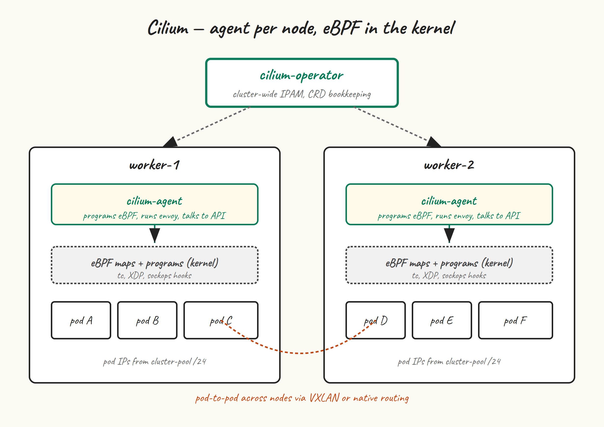

At the end of post 5 we had a control plane running but `cp-1` stuck in `NotReady`. That’s because kubelet refuses to be Ready until a CNI plugin has installed itself into `/etc/cni/net.d/` and can hand out pod IPs. This post installs Cilium, gets the node Ready, and gives us a working pod network with kube-proxy already replaced.

## What a CNI actually does



Three jobs:

- **IP address management (IPAM).** Allocate an IP from the pod CIDR for each new pod, recycle them when pods die.
- **Network plumbing.** When a pod starts on a node, set up the veth pair, route, and any overlay encapsulation. When the pod talks to another pod on another node, get the packet there.
- **Network policy enforcement.** If a NetworkPolicy says “pods in namespace A can’t talk to pods in namespace B”, actually enforce that.

## Why Cilium

The three serious choices in 2026 are Cilium, Calico, and Flannel. Flannel is fine but minimal — it does network plumbing and not much else. Calico is mature, BGP-fluent, and what a lot of enterprise clusters have run for years. Cilium uses eBPF for the dataplane, which means:

- **kube-proxy replacement.** Cilium can replace kube-proxy entirely — no `iptables` rules for Service NAT, no `ipvs`, just eBPF programs attached to the right hooks. The result is faster service traffic and a node that doesn’t have ten thousand iptables rules to scroll through.
- **Hubble.** Built-in observability for pod-to-pod traffic, layer 3 through 7. You can answer “what is this pod actually talking to” without a packet capture.
- **NetworkPolicy that works as expected.** Including L7 policies (HTTP method/path) on top of the usual L3/L4 rules.

You give up some operational simplicity. eBPF debugging when something is weird is harder than reading iptables rules. The Cilium docs are excellent but the surface area is large. If you want the smallest possible CNI, Flannel. If you want what most “we have opinions about networking” shops run today, Cilium.

## Install the Cilium CLI

Install on `cp-1` only — this is a control-plane tool you run from where you have a kubeconfig.

```
CILIUM_CLI_VERSION=$(curl -s https://raw.githubusercontent.com/cilium/cilium-cli/main/stable.txt)
CLI_ARCH=amd64
curl -L --fail --remote-name-all \
  "https://github.com/cilium/cilium-cli/releases/download/${CILIUM_CLI_VERSION}/cilium-linux-${CLI_ARCH}.tar.gz"
sudo tar xzf "cilium-linux-${CLI_ARCH}.tar.gz" -C /usr/local/bin
rm "cilium-linux-${CLI_ARCH}.tar.gz"
cilium version --client
```

## Install Helm (if you don’t have it)

The `cilium` CLI can install Cilium directly with `cilium install`, which is the easiest path. But for a cluster you’ll keep around, doing it with Helm gives you a values file you can commit to git and reuse. I’d recommend Helm.

```
curl -fsSL https://baltocdn.com/helm/signing.asc | \
  sudo gpg --dearmor -o /usr/share/keyrings/helm.gpg
echo "deb [signed-by=/usr/share/keyrings/helm.gpg] https://baltocdn.com/helm/stable/debian/ all main" | \
  sudo tee /etc/apt/sources.list.d/helm-stable-debian.list
sudo apt update
sudo apt install -y helm
helm version
```

## Install Cilium with kube-proxy replacement

```
helm repo add cilium https://helm.cilium.io/
helm repo update

helm install cilium cilium/cilium \
  --version 1.17.4 \
  --namespace kube-system \
  --set kubeProxyReplacement=true \
  --set k8sServiceHost=k8s-api \
  --set k8sServicePort=6443 \
  --set ipam.mode=cluster-pool \
  --set ipam.operator.clusterPoolIPv4PodCIDRList='{10.244.0.0/16}' \
  --set hubble.enabled=true \
  --set hubble.relay.enabled=true \
  --set hubble.ui.enabled=true
```

The flags that matter most:

- `kubeProxyReplacement=true` — what makes this kube-proxy-free. We skipped `addon/kube-proxy` in post 5’s `kubeadm init`, so there is no kube-proxy DaemonSet for Cilium to compete with.
- `k8sServiceHost` and `k8sServicePort` — with kube-proxy gone, Cilium needs to know how to reach the API server *before* it can program the service mesh. Point it at the VIP.
- `ipam.mode=cluster-pool` with `clusterPoolIPv4PodCIDRList` — tell Cilium to allocate pod IPs from the same range we gave kubeadm. Cilium’s cluster-pool IPAM handles the per-node /24 carving automatically.
- `hubble.*` — opt-in observability stack. Skip if you want the smallest possible install.

## Watch it come up

```
kubectl -n kube-system get pods -w
```

You’re watching for the `cilium` DaemonSet pods and `cilium-operator` Deployment to become Ready, after which the CoreDNS pods that were Pending will become Running and the node will flip to Ready.

```
kubectl get nodes
# NAME   STATUS   ROLES           AGE   VERSION
# cp-1   Ready    control-plane   8m    v1.35.5
```

If the node didn’t go Ready: the most common cause is that Cilium’s agent can’t reach the API server because `k8sServiceHost` isn’t resolvable on the node. Check `kubectl -n kube-system logs ds/cilium` for connection errors; check that `k8s-api` resolves to the VIP on the node (`getent hosts k8s-api`); check that kube-vip is actually advertising the VIP.

## cilium status — the readout

```
cilium status --wait
```

You’re looking for green checkmarks across the board:

```
    /¯¯\
 /¯¯\__/¯¯\    Cilium:             OK
 \__/¯¯\__/    Operator:           OK
 /¯¯\__/¯¯\    Envoy DaemonSet:    OK
 \__/¯¯\__/    Hubble Relay:       OK
    \__/       ClusterMesh:        disabled

DaemonSet              cilium             Desired: 1, Ready: 1/1, Available: 1/1
Deployment             cilium-operator    Desired: 1, Ready: 1/1, Available: 1/1
...
Cluster Pods:          2/2 managed by Cilium
Helm chart version:    1.17.4
```

“1/1” on the DaemonSet is expected — we only have one node so far. Once workers join, that becomes 3/3 and eventually 5/5.

## Prove kube-proxy is actually gone

```
kubectl -n kube-system get ds kube-proxy
# Error from server (NotFound): daemonsets.apps "kube-proxy" not found

# And no iptables sprawl for Services:
sudo iptables -t nat -L KUBE-SERVICES 2>&1 | head
# iptables: No chain/target/match by that name.
```

That second command is the satisfying one. On a kube-proxy cluster, `KUBE-SERVICES` would be a long chain of NAT rules. With Cilium kube-proxy replacement, those rules don’t exist — Service-IP translation happens in eBPF on the TC ingress hook.

## Connectivity test

Cilium ships a connectivity test that deploys a set of pods and runs L3/L4/L7 checks between them. It takes a few minutes and is worth running once at the end of CNI install — if it passes, you know pod networking, DNS, and basic service routing all work.

```
cilium connectivity test --request-timeout 30s
```

On a single-node cluster many of the tests will skip (“at least 2 nodes required”), and that’s fine — we’ll re-run the test in post 7 once workers are present. The point right now is that the test runs at all and the non-skipped checks pass.

## Hubble — quick tour

We enabled Hubble in the Helm values. Install the CLI:

```
HUBBLE_VERSION=$(curl -s https://raw.githubusercontent.com/cilium/hubble/master/stable.txt)
curl -L --fail --remote-name-all \
  "https://github.com/cilium/hubble/releases/download/${HUBBLE_VERSION}/hubble-linux-amd64.tar.gz"
sudo tar xzf hubble-linux-amd64.tar.gz -C /usr/local/bin
rm hubble-linux-amd64.tar.gz
```

Port-forward Hubble Relay and tail flows:

```
cilium hubble port-forward &
hubble observe --since 1m
```

You’ll see CoreDNS lookups, kube-apiserver health probes, and not much else right now. Once you have apps running, Hubble becomes the first place you look when something networky is off.

## A values file you should keep

I deliberately ran `helm install` with `--set` flags above so you can see each one. For real use, dump them to `cilium-values.yaml` and check it into git:

```
cat <<'EOF' > cilium-values.yaml
kubeProxyReplacement: true
k8sServiceHost: k8s-api
k8sServicePort: 6443
ipam:
  mode: cluster-pool
  operator:
    clusterPoolIPv4PodCIDRList:
      - 10.244.0.0/16
hubble:
  enabled: true
  relay:
    enabled: true
  ui:
    enabled: true
EOF

helm upgrade cilium cilium/cilium \
  --version 1.17.4 \
  --namespace kube-system \
  -f cilium-values.yaml
```

That `helm upgrade` is a no-op if everything’s already at the right values — it just confirms the install matches your file. Now your CNI configuration is git-able.

## Next up

[Post 7](/blog/7-workers/) adds `worker-1` and `worker-2` with `kubeadm join`. They’ll register through the kube-vip VIP, Cilium will program their nodes, and our cluster will start to actually look like one.
