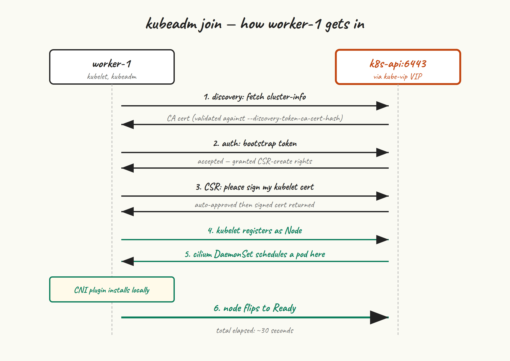

One control plane node, one CNI, zero workers. Time to fix the third one. By the end of this post we’ll have `worker-1` and `worker-2` joined, Cilium running on them, and three nodes Ready. The mechanics are simple; the failure modes are where the interesting bits live.

## What “join” actually does



The handshake has four steps:

- **Discovery.** The worker reaches out to the API server (through `k8s-api:6443`, our VIP) and asks for the cluster-info ConfigMap. To make sure it’s talking to the right cluster, it verifies the cluster’s CA certificate against the `--discovery-token-ca-cert-hash` hash supplied in the join command.
- **Authentication.** The worker presents the bootstrap token. The API server validates it against the `bootstrap-token-*` secrets in `kube-system`.
- **TLS bootstrap.** The worker generates a kubelet client cert CSR and submits it. The cluster auto-approves it (via the `system:bootstrappers:kubeadm:default-node-token` group) and the worker gets a signed cert.
- **Registration.** Kubelet starts with its new credentials, registers the node, and starts reporting status. Cilium’s DaemonSet schedules a pod on the new node and the CNI plugin gets installed locally. Once that’s in place, kubelet flips the node to Ready.

The whole handshake takes about 30 seconds when nothing goes wrong.

## The join command

You should have saved the worker join command from the bottom of `kubeadm init`‘s output in post 5. If you did, skip ahead. If you didn’t, generate a fresh one on `cp-1`:

```
sudo kubeadm token create --print-join-command
# kubeadm join k8s-api:6443 --token abcdef.0123456789abcdef \
#   --discovery-token-ca-cert-hash sha256:1234abcd...
```

That command does two things in one shot: creates a new 24-hour token, and prints the full join command including the CA cert hash (which doesn’t change unless you rotate your CA).

Now SSH to `worker-1` and run the command with sudo:

```
sudo kubeadm join k8s-api:6443 \
  --token abcdef.0123456789abcdef \
  --discovery-token-ca-cert-hash sha256:1234abcd...
```

Expected output, with the bits that matter:

```
[preflight] Running pre-flight checks
[preflight] Reading configuration from the cluster...
[kubelet-start] Writing kubelet configuration to file "/var/lib/kubelet/config.yaml"
[kubelet-start] Writing kubelet environment file with flags to file "/var/lib/kubelet/kubeadm-flags.env"
[kubelet-start] Starting the kubelet
[kubelet-check] Waiting for a healthy kubelet at http://127.0.0.1:10248/healthz. ...
[kubelet-check] The kubelet is healthy after 1.001s

This node has joined the cluster ...
```

Repeat on `worker-2`. The same join command works on as many workers as you want, as long as the token hasn’t expired.

## Verify from cp-1

```
kubectl get nodes
# NAME       STATUS   ROLES           AGE   VERSION
# cp-1       Ready    control-plane   25m   v1.35.5
# worker-1   Ready    <none>          2m    v1.35.5
# worker-2   Ready    <none>          1m    v1.35.5

kubectl -n kube-system get pods -o wide | grep cilium
# cilium-aaaaa   1/1   Running   0   25m   192.168.10.11  cp-1
# cilium-bbbbb   1/1   Running   0   2m    192.168.10.21  worker-1
# cilium-ccccc   1/1   Running   0   1m    192.168.10.22  worker-2
```

Three Cilium agent pods, one per node. If a worker showed up as `NotReady`, the most common cause is that Cilium’s pod can’t start on that node — `kubectl logs -n kube-system cilium-bbbbb` will tell you why.

Now’s also a good moment to re-run the Cilium connectivity test, which is much more useful with multiple nodes:

```
cilium connectivity test
```

Pod-to-pod across nodes, pod-to-service, node-to-pod — all of it should pass. If something fails, the test output points at the failed flow specifically, which beats reading Hubble.

## Roles — optional but tidy

Notice the workers’ ROLES column shows `<none>`. That’s purely cosmetic — Kubernetes doesn’t have a real concept of “worker role”; nodes are just nodes, and any node without the control-plane taint can run workloads. But labelling them is nice for kubectl output:

```
kubectl label node worker-1 node-role.kubernetes.io/worker=
kubectl label node worker-2 node-role.kubernetes.io/worker=
kubectl get nodes
# NAME       STATUS   ROLES           AGE   VERSION
# cp-1       Ready    control-plane   25m   v1.35.5
# worker-1   Ready    worker          5m    v1.35.5
# worker-2   Ready    worker          4m    v1.35.5
```

## Common failure modes

The four ways a join goes wrong, ranked by how often they bite:

### 1. “couldn’t validate the identity of the API Server”

The CA cert hash you passed doesn’t match what the API server is presenting. Either you mistyped it, or you reset and re-initialised `cp-1` and forgot the hash changes when the CA is regenerated.

Get the correct hash on `cp-1`:

```
openssl x509 -pubkey -in /etc/kubernetes/pki/ca.crt | \
  openssl rsa -pubin -outform der 2>/dev/null | \
  openssl dgst -sha256 -hex | sed 's/^.* //'
```

Or just `kubeadm token create --print-join-command` again to get a fresh, correct command.

### 2. “token is invalid” or “expired”

Default token lifetime is 24 hours. After that, you need a new one:

```
sudo kubeadm token list           # see what's there
sudo kubeadm token create --print-join-command
```

### 3. Connection refused / no route to host

The worker can’t reach `k8s-api:6443`. From the worker:

```
getent hosts k8s-api
# 192.168.10.10  k8s-api

nc -vz k8s-api 6443
# Connection to k8s-api 6443 port [tcp/*] succeeded!
```

If hostname resolution fails: your `/etc/hosts` from post 2 is missing or wrong on the worker. If the TCP connection fails: kube-vip may not be advertising the VIP, or your firewall is blocking it. Check from `cp-1` that `ip addr` shows the VIP and that `ss -tlnp | grep 6443` shows kube-apiserver listening.

### 4. Join hangs at “Waiting for a healthy kubelet”

Join got past discovery and authentication, kubelet has its config, but kubelet can’t start cleanly. Almost always one of:

- containerd isn’t running or isn’t healthy on this node (re-read post 3 on that node)
- cgroup driver mismatch (also post 3 — `SystemdCgroup = true`)
- swap isn’t actually off (post 2)

Diagnose on the worker:

```
journalctl -u kubelet --since '2 minutes ago' | tail -n 30
sudo crictl info | head -n 20
systemctl is-active containerd
```

## Recovering from a botched join

If you got partway through, the cleanest fix is to reset the worker and try again:

```
sudo kubeadm reset --force
sudo rm -rf /etc/cni/net.d
sudo systemctl restart containerd

# Then re-run the join command
```

And on `cp-1`, if the half-joined node showed up in `kubectl get nodes`, clean it out so it doesn’t haunt you:

```
kubectl delete node worker-1   # only if it shouldn't be there
```

## A small test workload

To confirm the cluster actually schedules things across workers:

```
kubectl create deployment whoami --image=traefik/whoami --replicas=4
kubectl get pods -o wide
# whoami-...   1/1   Running   ...   worker-1
# whoami-...   1/1   Running   ...   worker-1
# whoami-...   1/1   Running   ...   worker-2
# whoami-...   1/1   Running   ...   worker-2

kubectl expose deployment whoami --port=80
kubectl run curl --rm -it --image=curlimages/curl --restart=Never -- curl -s whoami
```

You should get a response from one of the four whoami pods, identifying itself by hostname. That’s Cilium doing service load-balancing via eBPF, with no kube-proxy involved.

Clean up:

```
kubectl delete deployment whoami
kubectl delete service whoami
```

## Next up

[Post 8](/blog/8-ha-kube-vip/) turns this single-CP cluster into a real HA cluster by joining `cp-2` and `cp-3`. We’ll handle the certificate-key dance, watch kube-vip elect a new leader when we shut down the current one, and end up with a control plane that can lose a node without anyone noticing.
