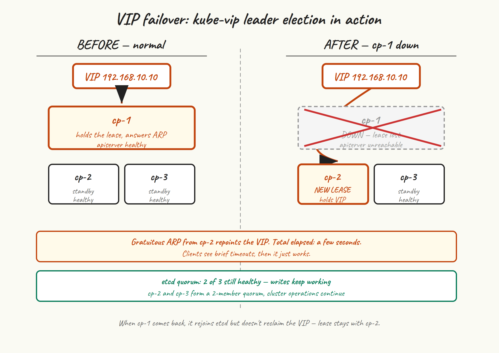

One control plane node is enough for a working cluster. It is not enough for an HA cluster. If `cp-1` goes down right now, every kubectl call hangs, no pods can be scheduled, and worker kubelets eventually start panicking about node leases they can’t renew. This post adds `cp-2` and `cp-3` to fix all of that.

## What HA actually buys us



Three nodes give us:

- **etcd quorum tolerance for one failure.** A three-member etcd cluster needs two members to make progress. Lose one, you keep running. Lose two, you’re read-only at best.
- **VIP failover.** Three kube-vip pods compete for the lease. Whichever holds it answers ARP for the VIP. When that node disappears, the next one notices within a few seconds and takes over.
- **Three API servers behind the VIP.** Technically kube-vip ARP mode only routes to one at a time, but with three live API servers you’ve got two warm standbys ready the moment the lease moves.

What HA does *not* buy you: tolerance to losing two nodes at once, or to the loss of the network that connects them. Three nodes survive one failure cleanly. Five would survive two. We’re going with three because it’s the sweet spot for a small cluster.

## Get a fresh certificate-key

The control-plane join needs two extra pieces compared to a worker join: `--control-plane` as a flag, and `--certificate-key` with the key that decrypts the uploaded CA cert bundle. We uploaded that bundle when we ran `kubeadm init` with `--upload-certs`, but the encryption key it gave us in the output expires after two hours. It’s almost certainly expired by now.

Generate a new one on `cp-1`:

```
sudo kubeadm init phase upload-certs --upload-certs
# [upload-certs] Using certificate key:
# 5678efgh9012ijkl3456mnop7890qrst1234uvwxyz...
```

This re-uploads the encrypted CA bundle with a new key. Copy the key from the output — it’s valid for two hours from now, so don’t dawdle.

While you’re at it, get a fresh join token and CA hash:

```
sudo kubeadm token create --print-join-command
# kubeadm join k8s-api:6443 --token NEW.TOKEN \
#   --discovery-token-ca-cert-hash sha256:HASH
```

The full control-plane join command is the worker join command above plus `--control-plane --certificate-key <the-key-from-upload-certs>`.

## Pre-stage kube-vip on cp-2

Same trick as on `cp-1` in post 5: drop the kube-vip static pod manifest into `/etc/kubernetes/manifests/` *before* joining, so kubelet brings up kube-vip as part of the join. This way, the moment `cp-2` is operational, it’s a candidate for the VIP lease.

On `cp-2`:

```
sudo mkdir -p /etc/kubernetes/manifests
sudo ctr image pull ghcr.io/kube-vip/kube-vip:v0.9.3

VIP=192.168.10.10
INTERFACE=$(ip -4 -o route get "$VIP" | awk '{print $5; exit}')

sudo ctr run --rm --net-host \
  ghcr.io/kube-vip/kube-vip:v0.9.3 vip /kube-vip manifest pod \
  --interface "$INTERFACE" \
  --address "$VIP" \
  --controlplane \
  --arp \
  --leaderElection \
  | sudo tee /etc/kubernetes/manifests/kube-vip.yaml > /dev/null
```

## Join cp-2 as a control plane

```
sudo kubeadm join k8s-api:6443 \
  --token NEW.TOKEN \
  --discovery-token-ca-cert-hash sha256:HASH \
  --control-plane \
  --certificate-key CERT_KEY_FROM_UPLOAD_CERTS
```

This takes longer than a worker join — closer to a minute — because kubeadm:

- Downloads and decrypts the CA bundle using your certificate-key.
- Generates new certs for this node’s API server, controller-manager, scheduler — signed by the shared cluster CA.
- Stages the static pod manifests for etcd, apiserver, controller-manager, scheduler.
- Joins the local etcd member to the existing etcd cluster (turning a 1-member cluster into 2).
- Starts kubelet, which starts everything including the kube-vip manifest we pre-staged.

The etcd join step is the riskiest. If it fails — usually due to network issues between `cp-1` and `cp-2` on ports 2379/2380, or a clock skew — you’ll see `etcdserver: request timed out` and the join aborts. Reset and try again after fixing the underlying issue.

## Join cp-3

Same drill, on `cp-3`. Pre-stage kube-vip, then join.

If your certificate-key has expired by now (more than two hours since you ran `upload-certs` on `cp-1`), do that step again on `cp-1` to get a new key.

## Verify the HA control plane

```
kubectl get nodes
# NAME       STATUS   ROLES           AGE   VERSION
# cp-1       Ready    control-plane   1h    v1.35.5
# cp-2       Ready    control-plane   3m    v1.35.5
# cp-3       Ready    control-plane   1m    v1.35.5
# worker-1   Ready    worker          45m   v1.35.5
# worker-2   Ready    worker          45m   v1.35.5

kubectl -n kube-system get pods | grep -E 'etcd|kube-vip|apiserver'
# etcd-cp-1                    1/1   Running   0   1h
# etcd-cp-2                    1/1   Running   0   3m
# etcd-cp-3                    1/1   Running   0   1m
# kube-apiserver-cp-1          1/1   Running   0   1h
# kube-apiserver-cp-2          1/1   Running   0   3m
# kube-apiserver-cp-3          1/1   Running   0   1m
# kube-vip-cp-1                1/1   Running   0   1h
# kube-vip-cp-2                1/1   Running   0   3m
# kube-vip-cp-3                1/1   Running   0   1m
```

## Check etcd cluster health

etcd’s own command-line tool lives inside the etcd pod. The simplest way to use it:

```
kubectl -n kube-system exec -it etcd-cp-1 -- etcdctl \
  --endpoints=https://127.0.0.1:2379 \
  --cacert=/etc/kubernetes/pki/etcd/ca.crt \
  --cert=/etc/kubernetes/pki/etcd/server.crt \
  --key=/etc/kubernetes/pki/etcd/server.key \
  member list

# 1a2b...   started   cp-1   https://192.168.10.11:2380   https://192.168.10.11:2379
# 3c4d...   started   cp-2   https://192.168.10.12:2380   https://192.168.10.12:2379
# 5e6f...   started   cp-3   https://192.168.10.13:2380   https://192.168.10.13:2379
```

And endpoint status:

```
kubectl -n kube-system exec -it etcd-cp-1 -- etcdctl \
  --endpoints=https://192.168.10.11:2379,https://192.168.10.12:2379,https://192.168.10.13:2379 \
  --cacert=/etc/kubernetes/pki/etcd/ca.crt \
  --cert=/etc/kubernetes/pki/etcd/server.crt \
  --key=/etc/kubernetes/pki/etcd/server.key \
  endpoint status --write-out=table
```

You’ll get a table showing which member is leader, raft index, and a few other things. Healthy looks like one leader, the other two as followers, and the same raft index across all three.

## Watch kube-vip failover

Find out who currently holds the VIP. On each CP node:

```
ip addr show | grep 192.168.10.10
```

One of the three nodes will show the VIP as a `/32` on its primary interface. Say it’s `cp-1`. From your laptop or a node, start a watch on the API:

```
while true; do
  date +%H:%M:%S; curl -k --max-time 2 https://k8s-api:6443/healthz; echo
  sleep 1
done
```

Now ungracefully shut down the VIP holder. On `cp-1`:

```
sudo poweroff
```

In your watch loop you’ll see a few seconds of curl timeouts, then `ok` coming back. Check from another CP node that the VIP has moved:

```
ssh ubuntu@cp-2 'ip addr show | grep 192.168.10.10'
# inet 192.168.10.10/32 scope global ...
```

The VIP is now on `cp-2`. kubectl is working again, because the new VIP holder has a healthy local API server. etcd is still healthy with quorum 2 of 3.

Bring `cp-1` back up. After a minute or two it rejoins the etcd cluster and is once again a candidate for the VIP lease. The VIP doesn’t move back — it stays on whoever currently holds it, which is fine.

## What “HA” doesn’t fix

A few things to keep in mind:

- **kube-vip ARP needs layer-2 adjacency.** All three CP nodes must be on the same broadcast domain as anything that needs to reach the VIP. If your nodes are in different subnets, switch kube-vip to BGP mode (different topic, separate post some day).
- **Two-node loss = read-only.** Lose two of three etcd members and the cluster keeps serving reads but no writes. New pods can’t be scheduled, existing ones keep running.
- **The split-brain story is good but not magic.** If you lose connectivity between cp-1 and {cp-2, cp-3}, the side with two members continues, the lone node steps out. If you split 1-1-1, no progress at all — which is correct behaviour.
- **Backups still matter.** HA gives you availability; it doesn’t protect you from `kubectl delete -f everything.yaml`. We’ll cover etcd snapshots in post 10.

## Next up

[Post 9](/blog/9-storage-ingress/) makes the cluster useful: local-path-provisioner so PersistentVolumeClaims actually work, ingress-nginx so traffic can come in, and cert-manager so it can come in over TLS. By the end of post 9 you’ll be able to deploy a webapp, point a DNS name at it, and get a Let’s Encrypt certificate — the full small-cluster experience.
