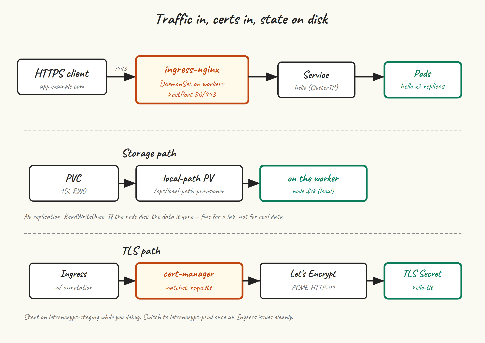

The cluster is healthy and HA, but it’s not yet useful. Stateful workloads need somewhere to put their data, and HTTP workloads need a way to be reachable. This post installs `local-path-provisioner` as a default StorageClass, `ingress-nginx` as our ingress controller, and `cert-manager` so we can pull Let’s Encrypt certificates without thinking about it.

## The shape of what we’re adding



- **local-path-provisioner** watches for PVCs that ask for the `local-path` StorageClass and provisions a directory on whichever node the pod lands on as the PV. Fine for a lab; not appropriate for production data that needs to survive node loss.
- **ingress-nginx** runs as a DaemonSet on workers, accepts incoming HTTP(S), and routes by Host header / path to Services. We’ll bind it to `hostPort` 80 and 443 on each worker, so any worker IP can take ingress traffic.
- **cert-manager** watches for `Certificate` resources (or `cert-manager.io/cluster-issuer` annotations on Ingresses) and provisions TLS certs by talking to ACME, including Let’s Encrypt.

## local-path-provisioner

```
kubectl apply -f https://raw.githubusercontent.com/rancher/local-path-provisioner/v0.0.30/deploy/local-path-storage.yaml

kubectl -n local-path-storage get pods
# local-path-provisioner-xxxxx   1/1   Running
```

By default it creates PVs under `/opt/local-path-provisioner` on whatever node the pod lands on. Make it the cluster default StorageClass:

```
kubectl patch storageclass local-path \
  -p '{"metadata":{"annotations":{"storageclass.kubernetes.io/is-default-class":"true"}}}'

kubectl get storageclass
# NAME                   PROVISIONER             RECLAIMPOLICY ...
# local-path (default)   rancher.io/local-path   Delete
```

Now PVCs without an explicit `storageClassName` get the local-path treatment.

### Test it

```
cat <<'EOF' | kubectl apply -f -
apiVersion: v1
kind: PersistentVolumeClaim
metadata:
  name: test-pvc
spec:
  accessModes: ["ReadWriteOnce"]
  resources:
    requests:
      storage: 1Gi
---
apiVersion: v1
kind: Pod
metadata:
  name: test-storage
spec:
  containers:
  - name: app
    image: busybox
    command: ["sh","-c","echo hello > /data/x; sleep 3600"]
    volumeMounts:
    - { name: data, mountPath: /data }
  volumes:
  - name: data
    persistentVolumeClaim: { claimName: test-pvc }
EOF

kubectl get pvc test-pvc
# NAME       STATUS   VOLUME       CAPACITY   STORAGECLASS
# test-pvc   Bound    pvc-...      1Gi        local-path

kubectl exec test-storage -- cat /data/x
# hello

kubectl delete pod test-storage
kubectl delete pvc test-pvc
```

A note on what local-path can’t do: it’s `ReadWriteOnce`, single-node, and the PV is gone if the node it lives on is gone. For real workloads where you want resilient storage, you’d run Longhorn, Rook+Ceph, or hook into your hypervisor’s storage (CSI drivers for vSphere, Proxmox, etc). local-path is what we use here because it works on every node without any setup.

## ingress-nginx

We’re going to install ingress-nginx as a DaemonSet on the worker nodes, with `hostPort: 80` and `hostPort: 443` so any worker IP can take incoming traffic. The “proper” production setup would be a separate LoadBalancer Service (e.g. backed by MetalLB or kube-vip’s other mode), but hostPort works fine for a lab and lets you point your router or DNS at the worker IPs directly.

```
helm repo add ingress-nginx https://kubernetes.github.io/ingress-nginx
helm repo update

cat <<'EOF' > ingress-nginx-values.yaml
controller:
  kind: DaemonSet
  hostPort:
    enabled: true
    ports:
      http: 80
      https: 443
  service:
    enabled: false
  nodeSelector:
    node-role.kubernetes.io/worker: ""
  ingressClassResource:
    default: true
  config:
    use-forwarded-headers: "true"
EOF

helm install ingress-nginx ingress-nginx/ingress-nginx \
  --namespace ingress-nginx \
  --create-namespace \
  -f ingress-nginx-values.yaml
```

What’s going on in those values:

- `kind: DaemonSet` — one ingress controller per worker.
- `hostPort.enabled: true` — bind 80 and 443 directly on the node, no Service required.
- `service.enabled: false` — we don’t need a Service object if we’re binding hostPorts.
- `nodeSelector` — only on workers, not control plane nodes.
- `ingressClassResource.default: true` — Ingresses without an explicit `ingressClassName` get this one.

```
kubectl -n ingress-nginx get pods -o wide
# ingress-nginx-controller-xxxxx   1/1   Running   ...   worker-1
# ingress-nginx-controller-yyyyy   1/1   Running   ...   worker-2
```

Sanity check: from anywhere that can reach the worker IPs:

```
curl -I http://192.168.10.21
# HTTP/1.1 404 Not Found
# Server: nginx
```

The 404 is what we want — ingress-nginx is responding, it just has no Ingress objects yet to route to.

## cert-manager

```
helm repo add jetstack https://charts.jetstack.io
helm repo update

helm install cert-manager jetstack/cert-manager \
  --namespace cert-manager \
  --create-namespace \
  --version v1.17.0 \
  --set installCRDs=true

kubectl -n cert-manager get pods
# cert-manager-...               1/1   Running
# cert-manager-cainjector-...    1/1   Running
# cert-manager-webhook-...       1/1   Running
```

### A Let’s Encrypt ClusterIssuer

Start with the staging issuer. Let’s Encrypt’s production has aggressive rate limits and you don’t want to hit them while debugging cert-manager. Get a staging cert first, switch to production once it works.

```
cat <<'EOF' | kubectl apply -f -
apiVersion: cert-manager.io/v1
kind: ClusterIssuer
metadata:
  name: letsencrypt-staging
spec:
  acme:
    server: https://acme-staging-v02.api.letsencrypt.org/directory
    email: you@example.com
    privateKeySecretRef:
      name: letsencrypt-staging-account
    solvers:
    - http01:
        ingress:
          ingressClassName: nginx
---
apiVersion: cert-manager.io/v1
kind: ClusterIssuer
metadata:
  name: letsencrypt-prod
spec:
  acme:
    server: https://acme-v02.api.letsencrypt.org/directory
    email: you@example.com
    privateKeySecretRef:
      name: letsencrypt-prod-account
    solvers:
    - http01:
        ingress:
          ingressClassName: nginx
EOF
```

Substitute a real email address. Let’s Encrypt uses it for expiry notices and policy updates.

The HTTP-01 challenge needs your cluster’s ingress-nginx to be reachable from the public internet at the domain you’re requesting a cert for. For a homelab, that usually means port-forwarding 80/443 from your router to a worker IP and pointing the domain’s DNS at your public IP. (DNS-01 is the alternative, doesn’t require a public ingress, and is what you’d do for internal-only domains — cert-manager has a separate solver for that, with a config per DNS provider.)

## End-to-end: deploy something with TLS

Replace `app.example.com` with a domain you actually control:

```
cat <<'EOF' | kubectl apply -f -
apiVersion: apps/v1
kind: Deployment
metadata:
  name: hello
spec:
  replicas: 2
  selector: { matchLabels: { app: hello } }
  template:
    metadata: { labels: { app: hello } }
    spec:
      containers:
      - name: hello
        image: traefik/whoami
        ports: [{ containerPort: 80 }]
---
apiVersion: v1
kind: Service
metadata: { name: hello }
spec:
  selector: { app: hello }
  ports: [{ port: 80, targetPort: 80 }]
---
apiVersion: networking.k8s.io/v1
kind: Ingress
metadata:
  name: hello
  annotations:
    cert-manager.io/cluster-issuer: letsencrypt-staging
spec:
  ingressClassName: nginx
  tls:
  - hosts: [app.example.com]
    secretName: hello-tls
  rules:
  - host: app.example.com
    http:
      paths:
      - path: /
        pathType: Prefix
        backend:
          service:
            name: hello
            port:
              number: 80
EOF
```

Watch the certificate get issued:

```
kubectl get certificate
# NAME        READY   SECRET      AGE
# hello-tls   False   hello-tls   10s
# ... 30 seconds pass ...
# hello-tls   True    hello-tls   45s

kubectl describe certificate hello-tls   # if it's not progressing
```

When `READY` flips to `True`, you have a working cert. Test:

```
curl -kI https://app.example.com
# HTTP/2 200
# server: nginx
```

The `-k` is because the staging cert won’t validate against the public CA bundle. Once it works, edit the Ingress annotation to `letsencrypt-prod` and delete the staging secret so cert-manager re-issues from production:

```
kubectl delete secret hello-tls
# cert-manager will see the missing secret and re-request from prod
```

## If the cert won’t issue

Three things to check:

- **DNS.** `dig app.example.com` from anywhere should return your cluster’s public IP.
- **Reachability on port 80.** `curl http://app.example.com/.well-known/acme-challenge/test` from the public internet should not time out (it’ll 404, which is fine — Let’s Encrypt cares that the connection succeeds).
- **The Order resource.** `kubectl describe order $(kubectl get order -o name | head -1)` usually has a useful error message from Let’s Encrypt itself.

## Next up

One post left. [Post 10](/blog/10-day-2-ops/) is day-2 operations: how to upgrade the cluster, how to back up etcd, and a short tour of the failure modes you’ll actually meet in the first six months of running this thing.
