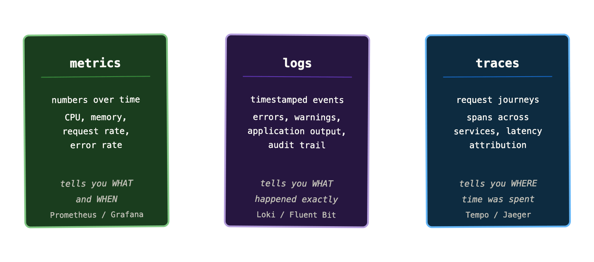
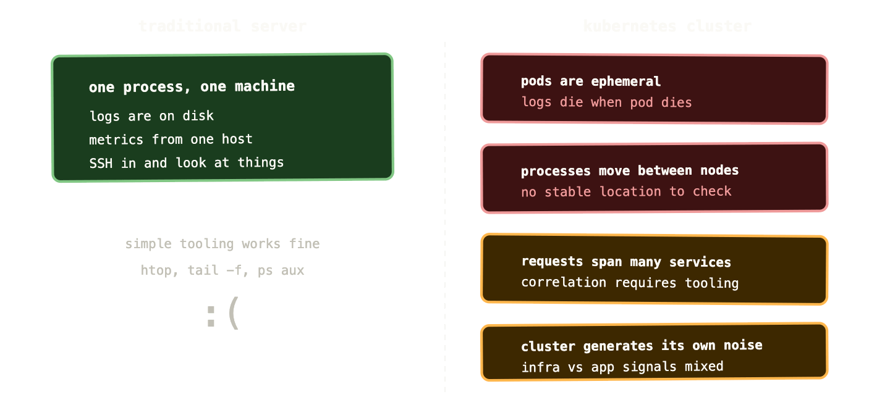

Here’s a scenario. It’s a Tuesday afternoon and your on-call phone goes off. The alert says “RabbitMQ queue depth exceeds 10,000 messages.” You look at your dashboard. Queue depth is definitely high. Memory usage looks elevated. CPU is fine. The alert doesn’t tell you why the queue is backing up — just that it is. You spend the next two hours digging through logs, checking deployment history, and asking colleagues if anything changed recently. Eventually you find it: a downstream service started timing out six hours ago, which caused consumers to slow down, which caused the queue to fill. The alert fired too late. The dashboard told you what but not why. And even finding the “why” required piecing together signals from three different places by hand.

That’s the gap observability is trying to close.

## Monitoring and observability are not the same thing

The terms get used interchangeably, but they describe different things — and understanding the difference is what separates teams that react to incidents from teams that understand their systems.

Monitoring is about watching known failure modes. You define the things you’re worried about — high CPU, full disks, queue depth over a threshold — and you set up alerts to tell you when those things happen. It’s inherently reactive. It catches the problems you thought to look for.

Observability is a property of the system itself. An observable system is one that you can interrogate from the outside to understand what’s happening inside, including problems you didn’t anticipate. You’re not just watching predefined metrics — you’re able to ask arbitrary questions about system state and get meaningful answers.

The practical difference: monitoring tells you that something is wrong. Observability tells you why.

This distinction matters enormously in a Kubernetes environment. On a traditional server, you knew what was running, where, and how it was configured. The failure modes were familiar. In a Kubernetes cluster with hundreds of pods across dozens of nodes, all communicating over a mesh of Services, the failure modes are effectively unbounded. You need to be able to ask questions you haven’t thought of yet — and get useful answers in under five minutes, while you’re on-call at 2am.

## The three pillars

Observability is typically described as resting on three pillars: metrics, logs, and traces. Each one tells you something different. Each one has blind spots the others cover.

**Metrics** are numbers over time. CPU usage at 14:32 was 78%. Request rate dropped from 1,200 to 200 rps at 14:33. Error rate jumped to 4% at 14:35. Metrics are cheap to store, fast to query, and excellent for spotting trends and triggering alerts. Their weakness is that they’re aggregated — they tell you that something happened, but they’ve thrown away the detail of what specifically went wrong.

**Logs** are timestamped records of events. They have the detail that metrics lack — the exact error message, the specific request that failed, the stack trace that tells you which line of code threw the exception. Their weakness is volume and cost. A busy Kubernetes cluster generates millions of log lines per minute. Storing, indexing, and querying all of it is expensive, and finding the relevant lines in a haystack of noise is genuinely hard without good tooling.

**Traces** follow a single request as it travels through multiple services. A user clicks “checkout” — the request hits your API gateway, which calls the payments service, which calls the fraud detection service, which queries the database. A trace records each hop with timing information, so you can see that the total request took 4.2 seconds and 3.8 of those were spent waiting for the fraud detection service. Traces are the hardest pillar to implement because they require instrumentation in every service, but they’re the only thing that can answer “where did that latency come from?” in a microservices system.

The three pillars are complementary, not interchangeable. A mature observability setup uses all three and — crucially — connects them. You see an error rate spike in your metrics. You jump to the logs for that time window to find the error messages. You find a trace ID in the log line and jump to the trace to see which service was responsible. That flow — metrics to logs to traces — is what real incident investigation looks like when observability is working properly.

## Known unknowns vs unknown unknowns

There’s a useful framing from engineering that applies directly here. When you set up a monitoring dashboard, you’re capturing your **known unknowns** — the things you know you don’t know the current value of, and have decided to track. Queue depth. Memory usage. Pod restart count. You’re asking “how much?” for a set of questions you’ve already thought of.

The problems that cause real outages are often **unknown unknowns** — failure modes you hadn’t anticipated, interactions between systems you didn’t know were coupled, load patterns you hadn’t seen before. A monitoring-only approach leaves you blind to these. You can only alert on what you thought to measure.

Observability changes this. When your system emits rich, queryable telemetry — detailed metrics with good label cardinality, structured logs, distributed traces — you can ask questions you didn’t think to ask when you set up your dashboards. “Show me all requests with p99 latency above 2 seconds, broken down by customer tier and region.” “Find all log lines containing ‘connection refused’ in the last 30 minutes, grouped by originating pod.” These questions aren’t answered by pre-built dashboards. They’re answered by having the data and the tools to query it ad hoc.

This is the shift from monitoring to observability. Not better dashboards — better raw material.

## Why Kubernetes makes this harder

On a traditional server, observability was relatively straightforward. The process was on the machine. The logs were on the machine. The metrics came from the machine. You SSH’d in and looked at things.

Kubernetes breaks all of that.

**Pods are ephemeral.** When a pod dies, its logs die with it. By the time you’re investigating an incident, the pod that crashed might have restarted three times. You need centralised log collection that captures output before the pod is gone — not as a nice-to-have, but as a prerequisite for any investigation.

**Processes move.** A pod can be rescheduled to a different node at any time. There’s no stable “this process is on node 3” relationship. Your tooling needs to track pods by identity (namespace, name, labels) rather than by location.

**Everything is distributed.** A single user request might touch ten pods across five nodes. A single service is typically spread across multiple replicas. Metrics need to be aggregated across all replicas. Logs need to be correlated across pods. Traces need to stitch together spans from multiple independent processes.

**The cluster itself generates noise.** Kubernetes control plane components, the scheduler, the CNI plugin, the CSI driver — all of these produce metrics and logs that you sometimes need to inspect and mostly need to filter out. Understanding which signals belong to your applications and which belong to cluster infrastructure is a skill in itself.

**Container networking is opaque.** Service-to-service traffic goes through kube-proxy, possibly through a service mesh, through iptables rules you didn’t write. When a connection fails, the error might appear in either endpoint’s logs, or neither. Tracing network failures requires tooling that understands the Kubernetes networking model.

None of these problems are insurmountable — that’s what the rest of this series is about. But they explain why “just check the server” doesn’t work in Kubernetes and why investing properly in observability is not optional.

## What good observability actually looks like

It’s worth being concrete about what you’re aiming for, because “observability” can sound like an aspirational concept rather than a practical outcome.

Good observability in a Kubernetes cluster means you can answer the following questions, quickly, without having to ask anyone or dig through deployment history:

*Is my application healthy right now?* Not “are the pods running?” — but is it actually serving requests successfully, within acceptable latency, without elevated error rates?

*When did it last not be healthy?* You can reconstruct a timeline of any incident from the signals available, without needing anyone to have been watching at the time.

*What changed?* New deployment, config change, upstream dependency behaviour shift — you can correlate changes in metrics or logs with events in your system.

*Which service is responsible for this latency?* When a request is slow, you can identify which hop in the chain is causing the slowdown, without having to guess or add temporary debug logging.

*What does normal look like?* You have enough historical data to know whether current behaviour is anomalous or within typical range.

None of this is magic. It’s the result of instrumenting your applications properly, running the right collection infrastructure, and knowing which tools to reach for in which situation. The rest of this series covers all of that in detail.

## The cost of getting it wrong

A note before we get into the tooling. Observability infrastructure has real cost — compute, storage, the operational overhead of running Prometheus, Loki, Tempo, and Grafana at any real scale. Teams sometimes treat this as a reason to defer the investment, especially early on.

This is a false economy. The cost of an incident where you spend four hours guessing what went wrong, with no metrics older than the retention window, no centralised logs, and no traces — that cost, multiplied by how often it happens, almost always exceeds the infrastructure cost of a reasonable observability stack.

More practically: your users don’t experience your p50 latency. They experience the tail. And the tail is exactly where observability earns its keep — in the rare, complex, multi-service failures that monitoring dashboards don’t catch and that you can’t debug without the right data.

The teams that invest in observability early find incidents shorter, root cause identification faster, and on-call rotations less miserable. The teams that don’t spend a lot of time in the dark, guessing.

## What’s coming in this series

Parts 02 and 03 go deep on metrics and Prometheus — the data model, the four metric types, PromQL from first principles, and the queries every Kubernetes operator should have in their back pocket.

Part 04 covers Grafana — not just “here’s how to make a dashboard” but the USE and RED methods for designing dashboards that actually communicate system health rather than just displaying numbers.

Part 05 tackles alerting, which most teams get badly wrong. Alert fatigue is real, and the fix isn’t fewer alerts — it’s better-designed ones.

Parts 06 and 07 cover logs and traces respectively — what each pillar uniquely contributes, which tools to use, and how to get value from them without breaking the bank on storage.

Part 08 brings it all together with the Grafana LGTM stack as a cohesive platform, including how to deploy it and how to correlate signals across pillars.

And part 09 works through three real debugging scenarios using all three pillars together — the kind of incidents that happen in real Kubernetes clusters, diagnosed step by step.

---

Next up: Prometheus — what it is, how it scrapes metrics, and why it became the undisputed standard for Kubernetes monitoring.
