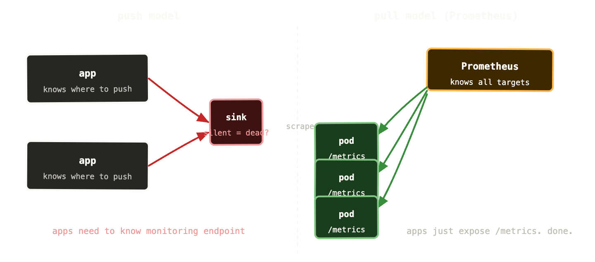
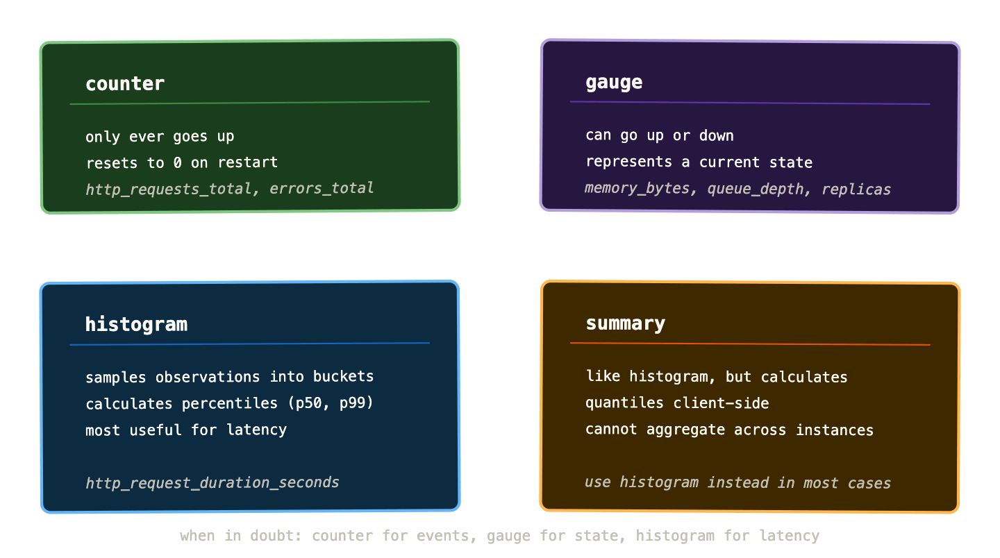
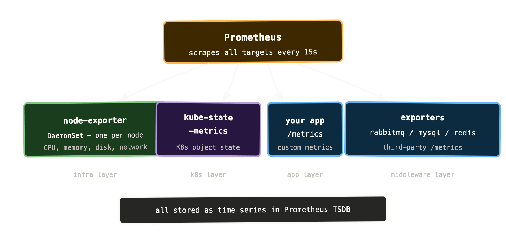

If you’ve spent any time around Kubernetes, you’ve heard of Prometheus. It shows up in helm charts, in monitoring stack recommendations, in job descriptions. It’s become so embedded in the Kubernetes ecosystem that it can be easy to assume you should just install it and move on without understanding what it actually does.

That’s a mistake. Prometheus has a specific data model, a specific way of collecting data, and specific opinions about how metrics should be structured. Understanding those opinions is what makes the difference between a metrics setup that gives you genuine insight and one that generates a lot of noise and the occasional misleading graph.

Let’s start from scratch.

## What Prometheus actually is

Prometheus is a time series database with a built-in metrics collection system. It stores sequences of numbers over time — CPU usage at each second, request count at each second, queue depth at each second — and lets you query them with a purpose-built query language called PromQL.

What makes it unusual compared to most monitoring systems is how it collects data. Most monitoring systems use a **push** model — the thing being monitored sends its metrics to the monitoring system. Prometheus uses a **pull** model — Prometheus itself reaches out and fetches metrics from each target on a schedule.

This sounds like a minor implementation detail but it has real consequences.

With push, you need every application to know where to send its metrics. If the metrics endpoint changes, every application needs to be updated. If an application goes silent — stops sending metrics — you don’t know if it’s healthy and quiet or dead.

With pull, Prometheus maintains a list of targets to scrape. If a target stops responding, Prometheus knows immediately — the scrape fails with an error. Applications don’t need to know anything about the monitoring system. And because Prometheus is doing the scraping, it adds metadata automatically — which pod this metric came from, which node, which namespace — without the application having to include it.



Every application that wants to expose metrics to Prometheus runs an HTTP endpoint — usually `/metrics` on port 9090 or whatever port the application listens on. Prometheus hits that endpoint on a configurable interval (15 seconds is the common default) and stores whatever it finds. The application doesn’t need to know Prometheus exists. It just needs to serve the endpoint.

## The data model: metrics, labels, and time series

This is the most important thing to understand about Prometheus, and the thing that most introductions explain poorly.

A Prometheus metric is not a single number. It’s a family of time series, distinguished by labels.

A time series is exactly what it sounds like: a sequence of (timestamp, value) pairs. `http_requests_total at 14:32:00 = 4521`. `http_requests_total at 14:32:15 = 4534`. And so on.

Labels are key-value pairs attached to a metric that distinguish between different things being measured. `http_requests_total{method="GET", status="200", handler="/api/users"}` is a different time series from `http_requests_total{method="POST", status="500", handler="/api/checkout"}`. Same metric name, different labels, different time series.

This is what makes Prometheus powerful. You can query `http_requests_total` and get all request counts across every method, status code, and handler in a single query. You can filter by `status="500"` to see just errors. You can aggregate by `handler` to see which endpoint gets the most traffic. The label dimensions let you slice the data any way you need.

In practice, the `/metrics` endpoint of a well-instrumented application looks like this:

```
# HELP http_requests_total Total HTTP requests
# TYPE http_requests_total counter
http_requests_total{method="GET",status="200",handler="/health"} 9823
http_requests_total{method="GET",status="200",handler="/api/users"} 4521
http_requests_total{method="POST",status="201",handler="/api/orders"} 1204
http_requests_total{method="POST",status="500",handler="/api/orders"} 43

# HELP process_resident_memory_bytes Resident memory size in bytes
# TYPE process_resident_memory_bytes gauge
process_resident_memory_bytes 4.2e+08
```

Plain text. Human-readable. Scraped by Prometheus every 15 seconds and stored as time series.

## The four metric types

Prometheus defines four metric types. Using the right one matters — not just for correctness, but because PromQL functions behave differently depending on the type.



**Counters** only ever increase. They count things: total requests handled, total errors thrown, total bytes sent. When the process restarts, they reset to zero. You never look at the raw counter value — you look at the rate of change, which PromQL’s `rate()` function calculates for you. “We’re getting 1,200 requests per second” is more useful than “we’ve handled 4,521,003 requests total.”

**Gauges** can go up and down. They represent a snapshot of a current value: memory usage right now, queue depth right now, number of active connections right now. You can read gauge values directly — no `rate()` needed.

**Histograms** are the most powerful and most misunderstood type. They sample observations and bucket them by size. A request duration histogram might have buckets for “under 10ms”, “under 50ms”, “under 100ms”, “under 500ms”, and so on. Prometheus counts how many observations fell into each bucket. From this, you can calculate percentiles — what’s the p99 request duration? The critical difference from a gauge or counter is that histograms let you answer percentile questions across a time range without storing every individual observation.

**Summaries** are similar to histograms but calculate quantiles on the client side. The practical consequence is that you can’t aggregate them across multiple instances — the maths doesn’t work. Since in Kubernetes you almost always have multiple replicas of a service, summaries are rarely the right choice. Reach for histograms instead.

## ServiceMonitors and PodMonitors

In a bare Prometheus setup, you configure scrape targets manually in a YAML file — list every IP and port you want to scrape. In a Kubernetes cluster with hundreds of pods that come and go dynamically, this is unworkable.

The Prometheus Operator (which ships as part of the kube-prometheus-stack Helm chart) solves this with two custom resources: `ServiceMonitor` and `PodMonitor`.

A `ServiceMonitor` tells Prometheus to scrape all pods behind a Kubernetes Service that matches a label selector. You define one ServiceMonitor for your payments API, and Prometheus automatically discovers and scrapes all pods behind the `payments-api` Service — including new pods as they start and excluding dead ones as they terminate.

yaml

```
apiVersion: monitoring.coreos.com/v1
kind: ServiceMonitor
metadata:
  name: payments-api
  namespace: monitoring
spec:
  selector:
    matchLabels:
      app: payments-api
  endpoints:
    - port: metrics
      interval: 15s
      path: /metrics
```

This is the configuration pattern you’ll use for your own applications. Third-party software — RabbitMQ, MySQL, Redis — typically ships with dedicated exporters that expose a `/metrics` endpoint, and you point a ServiceMonitor at those.

`PodMonitor` is similar but targets pods directly rather than going through a Service. Useful for cases where pods don’t have a corresponding Service, or where you need to scrape each pod individually rather than load-balancing across them.

## kube-state-metrics and node-exporter

Your applications expose metrics about themselves. But you also need metrics about the cluster infrastructure — node CPU, memory, disk, and the state of Kubernetes objects like Deployments, Pods, and PersistentVolumeClaims.

Two exporters cover this.

**node-exporter** runs as a DaemonSet — one pod per node — and exposes hardware and OS metrics from each node. CPU usage, memory usage, disk I/O, network throughput, filesystem capacity. Everything you’d want to know about the physical (or virtual) machines your workloads run on.

**kube-state-metrics** runs as a single Deployment and talks to the Kubernetes API server to expose metrics about Kubernetes object state. How many replicas does a Deployment have? How many are ready? Is a PVC bound? How long has a pod been running? This is the bridge between Kubernetes state and Prometheus — it translates Kubernetes API objects into time series.

Between node-exporter, kube-state-metrics, and your application metrics, you have visibility at three levels: the physical infrastructure, the Kubernetes layer, and the application layer.



## Exporters: getting metrics out of things that don’t speak Prometheus

Not everything exposes a `/metrics` endpoint natively. Databases, message brokers, and other middleware typically don’t. Exporters bridge this gap — they’re small processes that connect to a third-party system, query its internal state, and expose the results in Prometheus format.

For a Kubernetes operator the most important exporters to know:

The **RabbitMQ exporter** (or the built-in Prometheus plugin in RabbitMQ 3.8+) exposes queue depths, consumer counts, message rates, channel counts, and memory usage per vhost and queue. This is the thing that finally gives you visibility into why your queues are backing up — you can see exactly which queue, which vhost, and whether consumers are present but slow or absent entirely.

The **mysqld-exporter** exposes InnoDB buffer pool statistics, query execution counts, replication lag, connection counts, and slow query metrics. For Percona XtraDB Cluster it additionally exposes cluster state, SST status, and wsrep metrics.

The **redis-exporter** exposes hit/miss ratios, memory usage, connected clients, keyspace statistics, and replication lag.

Each of these pairs with a community-maintained Grafana dashboard that gives you a solid starting point without building everything from scratch.

## Cardinality: the thing that will bite you later

One warning before we move on, because ignoring this causes real operational pain.

Prometheus stores a separate time series for every unique combination of label values. Labels are powerful but they have a cost: every label you add multiplies the number of time series in your database.

`http_requests_total{method, status, handler}` — three labels, modest cardinality. Maybe a hundred time series for a typical API.

`http_requests_total{method, status, handler, user_id}` — four labels, but now user_id has potentially millions of unique values. Millions of time series. Prometheus falls over. This is called a **cardinality explosion** and it’s one of the most common ways teams accidentally make Prometheus unhealthy.

The rule: never use high-cardinality values as labels. User IDs, request IDs, email addresses, UUIDs — none of these belong in labels. Labels should have a bounded, small set of possible values. Method has ~5 values. Status code has ~20. Handler has however many routes your API has — probably under 100. Those are fine. User ID has millions. That is not fine.

We’ll come back to cardinality in the LGTM stack post when we talk about scaling Prometheus, but it’s worth knowing the rule now before you instrument your first application.

## Getting started: the kube-prometheus-stack

The fastest path to a working Prometheus setup in Kubernetes is the `kube-prometheus-stack` Helm chart. It installs Prometheus, the Prometheus Operator, Alertmanager, Grafana, node-exporter, and kube-state-metrics in one go, pre-configured to scrape the Kubernetes control plane and all the standard cluster components.

```
helm repo add prometheus-community \
  https://prometheus-community.github.io/helm-charts

helm install kube-prometheus-stack \
  prometheus-community/kube-prometheus-stack \
  --namespace monitoring \
  --create-namespace
```

Within a few minutes you have metrics flowing from every node and the Kubernetes control plane, Grafana pre-loaded with cluster dashboards, and Alertmanager ready to be configured. It’s a lot of moving parts but the chart manages the wiring between them.

For your own applications, you add a ServiceMonitor pointing at their `/metrics` endpoint and they start appearing in Prometheus automatically. The first time you query your own application’s metrics in Prometheus and see them alongside cluster infrastructure metrics — all in the same query interface — is when the value of the pull model and the common data model clicks.

## What to remember

Prometheus pulls metrics from targets on a schedule — targets don’t push to it. This makes service discovery simpler and silent failures visible.

The data model is time series with labels. Labels give you dimensions to filter and aggregate on. Never use high-cardinality values as labels.

Four metric types: counter for things that only increase (use `rate()` to query), gauge for current state (read directly), histogram for distributions and percentiles (use for latency), summary for quantiles client-side (usually avoid in favour of histograms).

kube-state-metrics translates Kubernetes object state into metrics. node-exporter exposes hardware and OS metrics from each node. Exporters bridge the gap for third-party systems.

Next up: PromQL — the query language that makes all these time series actually useful.
