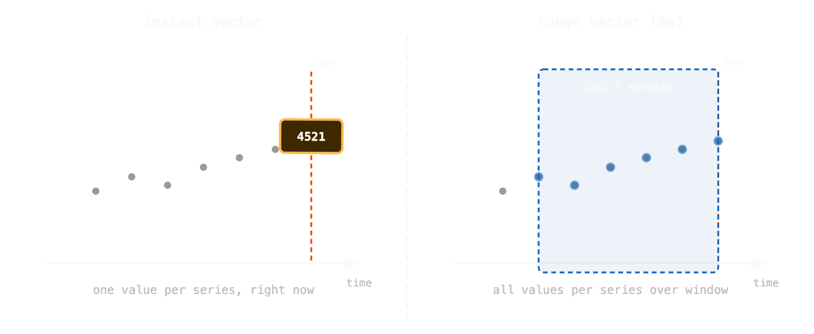
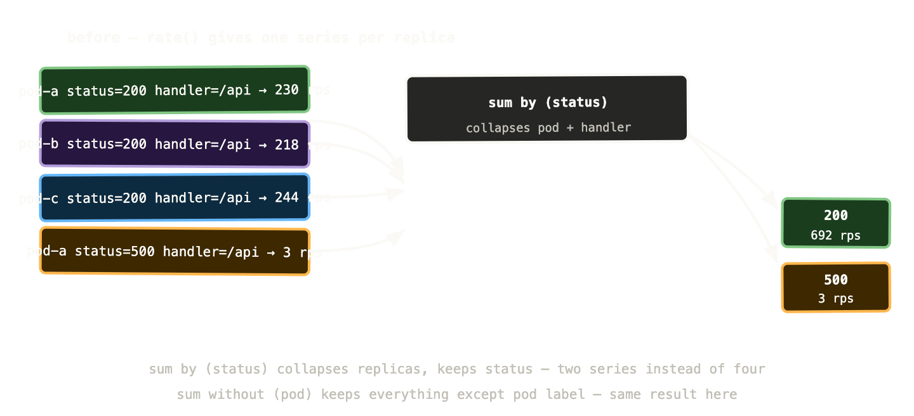

Prometheus without PromQL is a database you can’t read. The metrics are there, the time series are accumulating, but until you can query them meaningfully you’re just storing numbers. PromQL is what turns those numbers into answers.

It has a reputation for being difficult. That reputation is partly deserved — PromQL has some genuinely unintuitive moments — but it’s mostly unearned. The core concepts fit on one page, and once they click, you can write useful queries almost immediately. The complexity people run into is usually from jumping to advanced expressions before understanding the fundamentals.

So let’s build from the ground up.

## The fundamental building block: the instant vector

Every PromQL query returns one of three things: an instant vector, a range vector, or a scalar. Understanding the difference between the first two is the key that unlocks everything else.

An **instant vector** is a snapshot of the current value of every time series matching a metric name and optional label filters. When you type a metric name into the Prometheus query box and hit execute, you get an instant vector — one value per matching time series, all at the same point in time.

```
http_requests_total
```

This returns every time series with that name — one row per unique combination of labels. If you have three pods, each tracking five different routes across four status codes, that’s potentially sixty time series.

You filter with label matchers in curly braces:

```
http_requests_total{status="500"}
```

Now you only get the error time series. Four matchers exist: `=` (exact match), `!=` (not equal), `=~` (regex match), `!~` (regex not match).

```
http_requests_total{status=~"5.."}        # all 5xx errors
http_requests_total{handler!="/health"}    # everything except healthcheck
```

A **range vector** adds a time window. Instead of the current value, you get all the values over the last N minutes for each matching time series.

```
http_requests_total[5m]
```

The `[5m]` suffix means “give me the last 5 minutes of data points for each time series.” You can’t plot a range vector directly — it’s an intermediate step used as input to functions like `rate()`. The time window tells those functions how much history to work with.



The instant vector gives you one dot — where things are right now. The range vector gives you a window of dots — enough history to calculate how things are changing.

## rate() and irate() — the functions you’ll use most

Counters only go up. The raw value of `http_requests_total` right now is some large number that’s been accumulating since the process started — not inherently useful. What you want is the rate of increase: how many requests per second are we getting?

That’s what `rate()` calculates. It takes a range vector, looks at the difference between the first and last values in the window, and divides by the window duration.

```
rate(http_requests_total[5m])
```

“The per-second average rate of HTTP requests over the last 5 minutes.” This is a number you can actually use — it answers “how busy are we right now?”

`irate()` is the instantaneous rate — it uses only the last two data points in the window rather than the full window average. This makes it more responsive to sudden changes but also more noisy.

```
irate(http_requests_total[5m])   # spiky, responsive
rate(http_requests_total[5m])    # smooth, stable
```

The practical rule: use `rate()` for dashboards and alerts — you want stability. Use `irate()` when you’re actively investigating a spike and need to see the exact moment it happened.

One important gotcha: the range window in `rate()` should be at least four times your scrape interval. If Prometheus scrapes every 15 seconds, your minimum useful window is `[1m]`. A `[30s]` window with a 15-second scrape interval will frequently have only two data points — and rate calculations with two points are fragile.

## Aggregation: making sense of many time series

Your payments API has three replicas. Each replica has its own `http_requests_total` time series. If you query `rate(http_requests_total[5m])` you get three separate lines — one per replica. Usually you want to know the total request rate across all replicas, not the rate for each one individually.

Aggregation operators collapse multiple time series into fewer ones.

```
sum(rate(http_requests_total[5m]))
```

This sums all the rates across all replicas, all routes, all status codes — one number. Total requests per second across the entire application. Usually too broad.

```
sum by (status) (rate(http_requests_total[5m]))
```

Now you get one time series per status code — the total request rate for 200s, 500s, and so on, across all replicas and all routes. The `by (status)` clause means “keep the status label, aggregate away everything else.”

```
sum without (pod, instance) (rate(http_requests_total[5m]))
```

`without` is the inverse — keep everything except the listed labels. Useful when you have many labels and want to drop just the ones that distinguish individual replicas.



Other aggregation operators worth knowing: `avg` (average across time series), `max` (highest value), `min` (lowest value), `count` (number of time series), `topk(n, expr)` (the n highest values). All support the same `by` and `without` clauses.

## Recording rules: pre-computing expensive queries

Some PromQL expressions are expensive — they aggregate across many time series, run on long windows, or get evaluated constantly by multiple dashboards and alerts. Running them on demand every time is wasteful and can slow down Prometheus under load.

Recording rules solve this. You define a rule that evaluates a PromQL expression on a schedule and stores the result as a new time series. Dashboards and alerts query the pre-computed result instead of re-running the expensive expression each time.

```
groups:
  - name: request_rates
    interval: 1m
    rules:
      - record: job:http_requests_total:rate5m
        expr: |
          sum by (job, status) (
            rate(http_requests_total[5m])
          )
```

Now `job:http_requests_total:rate5m` is a pre-computed time series. Dashboards that would have been running the full aggregation query on every load now query this instead — instant results, no computation overhead.

The naming convention `level:metric:operation` is the community standard — it makes it obvious at a glance what a recording rule is and where it comes from.

Recording rules also extend your effective retention. If you keep raw metrics for 15 days but pre-computed aggregates for 90 days, you can still answer “what was our p99 latency three months ago?” without storing every raw data point for that long.

## Five PromQL queries every Kubernetes operator should know

These cover the questions you’ll ask most often. Copy them, adapt the label values, and keep them somewhere accessible.

**Request rate per service:**

```
sum by (job) (
  rate(http_requests_total[5m])
)
```

Total requests per second, grouped by service. First thing to check when something feels slow or over-capacity.

**Error rate percentage:**

```
sum by (job) (rate(http_requests_total{status=~"5.."}[5m]))
/
sum by (job) (rate(http_requests_total[5m]))
* 100
```

What percentage of requests are failing? Division in PromQL works on matching time series by label. If error rate goes above 1%, something needs attention. Above 5%, someone’s having a bad day.

**p99 request latency:**

```
histogram_quantile(
  0.99,
  sum by (job, le) (
    rate(http_request_duration_seconds_bucket[5m])
  )
)
```

The 99th percentile request duration. The `le` label is the histogram bucket boundary — you need to keep it when aggregating histograms, otherwise `histogram_quantile` can’t reconstruct the distribution. This is one of the subtler PromQL gotchas and it trips people up regularly.

**Pod memory usage vs limit:**

```
container_memory_working_set_bytes{container!=""}
/
container_spec_memory_limit_bytes{container!=""} > 0
* 100
```

Memory usage as a percentage of the configured limit. If this is consistently above 80% for a container, the limit is probably too tight and you’re at risk of OOMKills. The `> 0` filter excludes containers with no memory limit set (which would cause division by zero).

**Pods not ready:**

```
kube_deployment_status_replicas_unavailable > 0
```

Any Deployment with unavailable replicas. This is the simplest cluster health check — if the answer is zero, your Deployments are all at their desired replica count. If it’s non-zero, something is unhealthy. Combine with `kube_deployment_metadata_generation` vs `kube_deployment_status_observed_generation` to detect stuck rollouts.

## The offset modifier and time comparison

One PromQL feature that’s quietly very useful: `offset`. It shifts a query back in time, letting you compare current values against historical ones.

```
rate(http_requests_total[5m])
  /
rate(http_requests_total[5m] offset 1w)
```

This gives you current request rate divided by request rate one week ago. A ratio above 1.5 means you’re getting 50% more traffic than you were last week. Useful for capacity planning and for detecting unusual traffic patterns without hardcoding thresholds.

```
rate(http_requests_total{status=~"5.."}[5m])
  /
rate(http_requests_total{status=~"5.."}[5m] offset 1d
```

Error rate today vs error rate at the same time yesterday. If your error rate is three times higher than it was 24 hours ago, that’s worth investigating even if the absolute number is small.

## Subqueries: range queries on instant vectors

Sometimes you want to apply a range operation to an expression that doesn’t have a natural range vector form. Subqueries let you do this.

```
max_over_time(
  rate(http_requests_total[5m])[1h:5m]
)[1h]
```

Read from inside out: calculate the 5-minute rate (instant vector). Evaluate it every 5 minutes over the last hour (the `[1h:5m]` subquery range and step). Take the maximum of those values. This gives you the peak request rate over the last hour — useful for capacity headroom calculations.

Subqueries are computationally expensive and should be candidates for recording rules if they appear in production dashboards.

## Common mistakes and how to avoid them

**Forgetting `le` when aggregating histograms.** The `histogram_quantile` function needs the bucket boundaries preserved. Always `sum by (job, le)` — never `sum by (job)` — when aggregating histogram metrics.

**Using `irate()` in alerts.** `irate()` is noisy. An alert using `irate()` will fire and resolve repeatedly as individual data points fluctuate. Use `rate()` with a sensible window for alerts.

**Too-short range windows.** `rate(metric[1m])` with a 15-second scrape interval gives you four data points. One missed scrape and your rate looks like it dropped to zero. Use `[5m]` as a minimum for anything that matters.

**Comparing counters directly.** `http_requests_total > 1000` doesn’t mean “more than 1000 requests per second” — it means “the cumulative total is over 1000,” which is true within the first minute of a running service. Always apply `rate()` before comparing counters to thresholds.

**Label matching in binary operations.** When you divide two expressions — error rate / total rate — Prometheus matches time series by their labels. If the two sides have different label sets, you get no result or unexpected output. Use `on(label1, label2)` to specify which labels to match on, or `ignoring(label)` to exclude labels from matching.

```
# explicit matching to avoid label mismatch surprises
sum by (job) (rate(errors[5m]))
  /
  on(job)
sum by (job) (rate(requests[5m]))
```

## What to remember

Instant vectors are snapshots — one value per time series right now. Range vectors are windows — all data points over the last N minutes, used as input to functions.

`rate()` converts counters into per-second rates. Use it for dashboards and alerts. Use `irate()` only when investigating active spikes.

`sum by (label)` aggregates across replicas while preserving the dimensions you care about. `sum without (label)` does the same by exclusion.

Recording rules pre-compute expensive expressions. Use them for anything that appears in production dashboards or gets evaluated frequently.

The five queries in the middle of this post — request rate, error percentage, p99 latency, memory vs limit, pods not ready — are a solid starting kit. They’ll answer the questions you’ll be asked in every incident, and they work with any standard Kubernetes metrics setup.

Next up: Grafana — turning these queries into dashboards that actually communicate system health, and the USE and RED methods for designing them properly.
