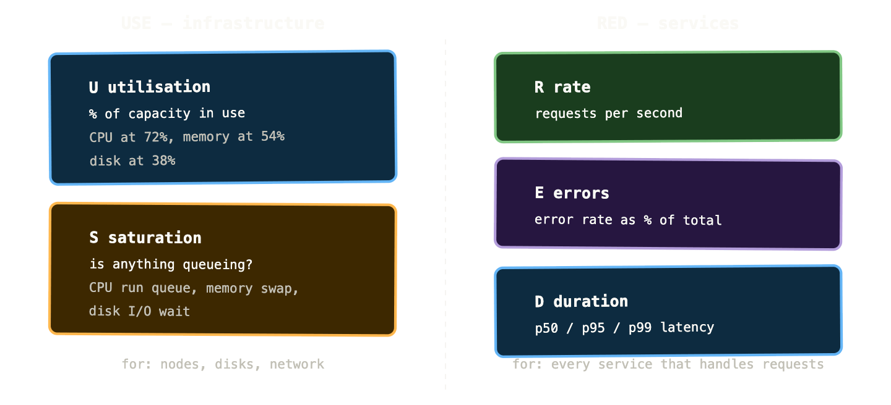
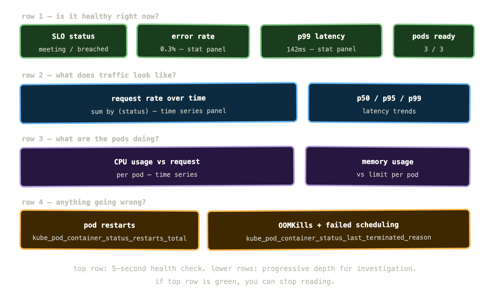

A common failure mode in Kubernetes observability goes like this. The team installs kube-prometheus-stack. They get Grafana. They open the pre-built dashboards and see hundreds of panels showing CPU, memory, network, disk, pod counts, container restarts, API server latency, etcd commit duration, and thirty other things. They feel like they have visibility. They add more panels for their own applications. The dashboard grows. It looks impressive on a monitor in the office.

Then an incident happens. They open the dashboard and don’t know where to look. There’s too much. The signals that matter are buried in a wall of graphs that all look broadly fine. They go back to querying Prometheus directly.

The dashboard was measuring things without communicating anything. There’s a difference, and understanding it is what separates a useful observability setup from an impressive-looking one that doesn’t help when you’re under pressure.

## What Grafana actually is

Grafana is a visualisation and dashboarding tool. It doesn’t store any data — it connects to data sources (Prometheus, Loki, Tempo, and many others) and queries them when you open a dashboard. Its job is to make query results readable.

It does this job well, but it’s a tool that rewards thoughtful use. The defaults are fine. The ceiling is very high. The gap between a dashboard that communicates and one that just displays is almost entirely about how you think about the problem, not about Grafana features.

Connecting Grafana to Prometheus is a one-minute operation — add Prometheus as a data source with its cluster-internal URL (`http://prometheus-operated:9090` in a standard kube-prometheus-stack install) and you’re done. Every panel in every dashboard from that point is a PromQL query under the hood.

## The USE method: infrastructure health

Before building any dashboards, you need a framework for deciding what to measure. Two frameworks cover most situations.

The USE method, from Brendan Gregg, is for infrastructure resources — CPUs, memory, disks, network interfaces, anything with a capacity ceiling. For each resource, you track three things:

**Utilisation** — what percentage of available capacity is being used? A CPU running at 90% utilisation is a different concern from one at 40%.

**Saturation** — is the resource over capacity? Are requests queueing, waiting, or being delayed because the resource can’t keep up? A CPU can be at 100% utilisation without saturation if there’s nothing waiting. The run queue length is what tells you if it’s saturated.

**Errors** — are there error events? Hardware errors, dropped packets, disk read failures.

In PromQL terms:

```
# CPU utilisation per node
1 - avg by (node) (
  rate(node_cpu_seconds_total{mode="idle"}[5m])
)

# Memory saturation (swap usage as proxy)
rate(node_vmstat_pswpin[5m]) + rate(node_vmstat_pswpout[5m])

# Network errors
rate(node_network_receive_errs_total[5m])
+ rate(node_network_transmit_errs_total[5m])
```

The USE method gives you a systematic way to check infrastructure health. If utilisation is high, you might need more capacity. If saturation is present, you definitely need more capacity. If there are errors, you have a problem independent of load.

## The RED method: service health

The RED method, from Tom Wilkie at Grafana Labs, is for services — anything that handles requests. For each service, you track:

**Rate** — how many requests per second is this service handling?

**Errors** — how many of those requests are failing?

**Duration** — how long are requests taking? Specifically, what does the distribution look like — not just average, but p50, p95, p99.

```
# Rate
sum by (job) (rate(http_requests_total[5m]))

# Error rate
sum by (job) (rate(http_requests_total{status=~"5.."}[5m]))
  / sum by (job) (rate(http_requests_total[5m]))

# p99 duration
histogram_quantile(0.99,
  sum by (job, le) (
    rate(http_request_duration_seconds_bucket[5m])
  )
)
```

RED answers the question your users care about: is the service working, and is it fast? USE answers the question your infrastructure cares about: are the resources healthy enough to keep the service working?

A well-designed service dashboard has both. USE panels at the top for the infrastructure the service runs on. RED panels below for the service itself. If your p99 latency spikes, you look up at the USE panels to see if CPU saturation or memory pressure explains it.



These two methods together cover most of the questions you’ll ask during an incident. “Is the service working?” — RED. “Is the infrastructure causing it?” — USE. The sequence is almost always RED first (what are users experiencing?), then USE (what’s causing it?).

## Dashboard design that actually communicates

Here’s the dashboard design principle that improves everything else: a dashboard should answer a question, not display data.

“Is the payments service healthy right now?” is a question. A dashboard that answers it has: current request rate (is traffic flowing?), current error rate (are requests succeeding?), current p99 latency (are they fast?), and maybe pod readiness (is the deployment healthy?). Four panels. Anyone can look at it for five seconds and know if something’s wrong.

“All the metrics about the payments service” is not a question. A dashboard that tries to answer it has fifty panels, most of which are fine most of the time, and it trains operators to ignore it.

A few concrete principles:

**Put the most important thing at the top left.** Eyes go to top-left first. If your service has a single SLO, the panel showing whether you’re meeting it goes in that position. Not CPU. Not pod count.

**Use stat panels for current state, time series for trends.** A single number in a large font tells you where things are right now. A time series tells you how things are changing. Use stat panels for “is error rate above threshold?” and time series for “has error rate been trending up?”

**Colour should encode state, not identity.** Green means healthy, red means broken, yellow means warning. Not “blue is this service, orange is that service.” If a panel is green, operators should be able to ignore it and move on.

**Include a “no data” state.** A Grafana panel that shows nothing when there’s no data is ambiguous — is the service not running, or is the query wrong? Configure `No data` states explicitly and make them visually distinct.

**Add links between related dashboards.** From a service RED dashboard, link to the node USE dashboard for the nodes that service runs on. From the node dashboard, link to the pods currently running on that node. Grafana supports dashboard links and panel data links — use them so investigators can follow the trail without manual navigation.

## The wall-of-graphs antipattern

It’s worth being explicit about what bad looks like, because it’s the default outcome if you don’t think about dashboard design.

The wall-of-graphs antipattern: a dashboard with 40+ panels, each showing a different metric, with no clear hierarchy or narrative. Everything is the same size, the same colour scheme, the same time range. There’s no obvious place to look when something goes wrong. The dashboard exists to demonstrate that metrics are being collected, not to help anyone understand system state.

The signs you have this problem: your on-call engineers don’t open the dashboard during incidents. They go straight to Prometheus and start writing ad-hoc queries. The dashboard is a liability rather than an asset — it creates the illusion of visibility without providing actual visibility.

The fix is not to delete dashboards — it’s to redesign them with a specific question in mind. Take your 40-panel service dashboard and ask: what are the five things I absolutely need to know to determine if this service is healthy? Put those five things on a new dashboard. Bury the 40-panel version as a “detailed diagnostics” link that experts can use when they need more depth.

## Variables: making dashboards reusable

A Grafana variable is a drop-down filter that changes all the queries in a dashboard at once. Instead of one dashboard per service, you have one dashboard with a service variable — switch the drop-down to `payments-api` and every panel filters to that service.

```
Variable: namespace
Query: label_values(kube_pod_info, namespace)

Variable: service  
Query: label_values(kube_service_info{namespace="$namespace"}, service)
```

Chained variables — where the `service` variable depends on the `namespace` selection — are the foundation of reusable Kubernetes dashboards. You define the dashboard once. Every service, every namespace, every cluster uses the same panels, just filtered differently.

Template variables also let operators drill down during incidents without navigating to a different dashboard. They can select the specific pod they’re investigating while keeping the time range and other context intact.

## Alerting in Grafana vs Alertmanager

There are two places you can define alerts in a modern Grafana stack, and the distinction matters.

**Grafana Unified Alerting** defines alert rules directly in Grafana, evaluates them against Prometheus (or Loki, or any other data source), and routes notifications through its own contact points. It supports multi-dimensional alerting — one alert rule fires separately for each matching time series, so an alert on error rate fires independently per service.

**Prometheus Alerting Rules** define alerts in PrometheusRule YAML files, evaluated by Prometheus itself. They fire into Alertmanager, which handles routing, grouping, deduplication, and silencing.

The practical difference:

Prometheus alerting rules are version-controlled alongside your other configuration — they live in Git, get applied via GitOps, and have a clear audit trail. Grafana Unified Alerting lives in the Grafana database and is harder to manage as code (though Grafana’s provisioning API is improving this).

Alertmanager has a richer routing model — it can route different alert types to different channels based on label matchers, with inhibition rules that suppress downstream alerts when a root cause alert is firing. Grafana’s routing is simpler.

The setup most mature teams land on: Prometheus alerting rules for infrastructure and SLO-based alerts, Alertmanager for routing and deduplication, and Grafana Unified Alerting for team-specific or application-level alerts that need quick iteration without YAML.

We’ll go deep on alerting design in post 05. For now the key point is: Grafana is primarily for visualisation. Alerting is possible in Grafana but the serious alerting configuration belongs in Prometheus and Alertmanager, where it can be version-controlled and reviewed.

## A practical Grafana dashboard for a Kubernetes service

Here’s what a well-structured service dashboard looks like in practice. Four rows, each answering a more specific question than the last.



Row 1 is the health check — four stat panels that answer “is this service healthy right now?” in five seconds. If all four are green, you move on. If one is red, you look at row 2 for context.

Row 2 shows traffic patterns over time — what’s the request rate doing, and what does the latency distribution look like? This tells you if the problem correlates with a traffic spike.

Row 3 shows what the pods are consuming — CPU and memory usage per pod. If there’s a problem in row 2, row 3 tells you if it’s resource-related.

Row 4 shows failure events — restarts, OOMKills, scheduling failures. These are the Kubernetes-layer problems that might cause service-layer symptoms visible in rows 1 and 2.

The investigator follows the trail downward. Most of the time they stop at row 1 because it’s green. When something’s wrong they have a clear path: what’s the symptom (row 1), what’s the traffic context (row 2), is it resource-related (row 3), is the cluster causing it (row 4)?

## Useful panels beyond the basics

A few panel types that are particularly valuable in Kubernetes dashboards and less commonly used.

**Heatmaps** are the right visualisation for histogram data. Instead of plotting p99 latency as a single line, a heatmap shows the full distribution of request durations over time — you can see whether latency is uniformly distributed or bimodal (fast requests and some very slow ones), whether the distribution is shifting, and where outliers are hiding. Grafana has native heatmap support for Prometheus histograms.

**Table panels** with per-pod or per-service breakdown are useful for identifying which specific instance is misbehaving. A time series shows you that average CPU is elevated. A table panel sorted by CPU usage tells you which pod is responsible.

**State timeline** panels show the history of a binary or enum state over time — was this pod running or crashed? Was this PVC bound or pending? Useful for post-incident timeline reconstruction.

**Candlestick/range panels** show min, max, and median in a single panel. For latency, this is often more informative than a single percentile line — you can see both the typical experience and the worst case in one view.

## The Explore view: ad-hoc investigation without dashboards

Grafana’s Explore view is where you go when you’re investigating something that doesn’t fit your existing dashboards. It’s a query scratchpad — type PromQL, see the result, iterate. No panel configuration, no dashboard, just data.

During an active incident, the workflow is typically: check the relevant dashboard to establish what’s wrong, then switch to Explore to ask specific questions the dashboard doesn’t answer. Explore also lets you switch between data sources — run a PromQL query to identify which pod is misbehaving, then switch to Loki and query logs for that specific pod, then switch to Tempo and find traces from that pod. All in the same interface, with shared time range context.

This cross-pillar investigation workflow — metrics to logs to traces — is what the full LGTM stack enables, and we’ll cover it properly in post 08.

## Getting the most out of pre-built dashboards

The kube-prometheus-stack comes with dashboards for the Kubernetes cluster, the control plane, nodes, pods, namespaces, and more. The Grafana dashboard library at grafana.com has community-maintained dashboards for RabbitMQ, MySQL, Redis, nginx, and most other common infrastructure components.

These are good starting points, not endpoints. The common problems:

They’re too comprehensive. Community dashboards often show everything the exporter exposes. Fork them, remove the panels you never look at, promote the panels that matter to the top.

Their alert thresholds are placeholders. A dashboard might come with a red threshold on CPU at 90% — but your workload might routinely hit 85% under normal load. Calibrate thresholds to your actual baseline.

They don’t have service-level context. A community RabbitMQ dashboard shows cluster metrics but doesn’t know which queues are business-critical. Add panels for your specific queues with thresholds that reflect your actual SLOs.

The approach: import the community dashboard, use it for a few weeks to understand what metrics exist and which ones you actually look at, then build a service-specific dashboard that incorporates the most useful panels alongside your application context.

## What to remember

Use the RED method for services — rate, errors, duration. Use the USE method for infrastructure — utilisation, saturation, errors. Design dashboards around one of these frameworks rather than “all the metrics.”

Dashboards should answer a question, not display data. The top row should give a five-second health check. Lower rows add depth for investigation. If the top row is green, operators should be able to stop reading.

Variables make dashboards reusable across services and namespaces. One well-designed parameterised dashboard beats twenty service-specific copies.

Grafana is primarily a visualisation tool. Define alerts in Prometheus alerting rules and route them through Alertmanager for anything that matters. Use Grafana Unified Alerting for team-specific or experimental alerts that need quick iteration.

The Explore view is your incident investigation scratchpad — it’s where you go when the dashboard doesn’t answer the specific question you’re asking.

Next up: alerting — the part of observability most teams get badly wrong, and how to fix it.
