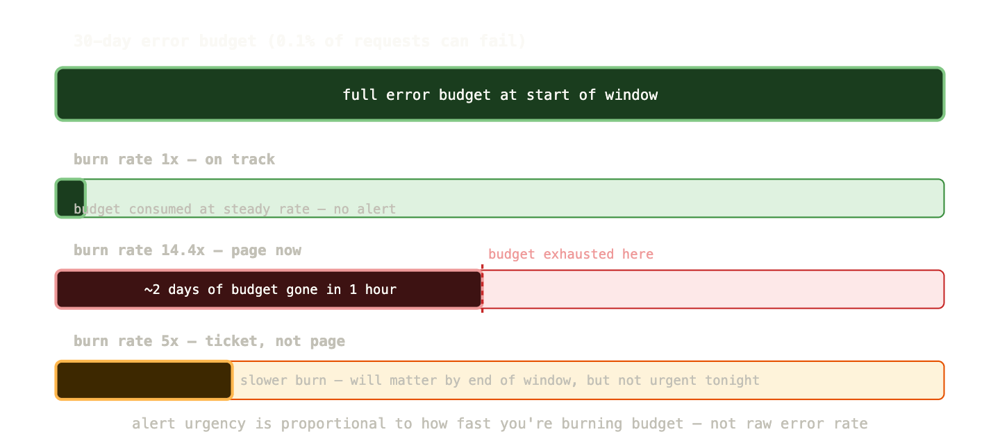
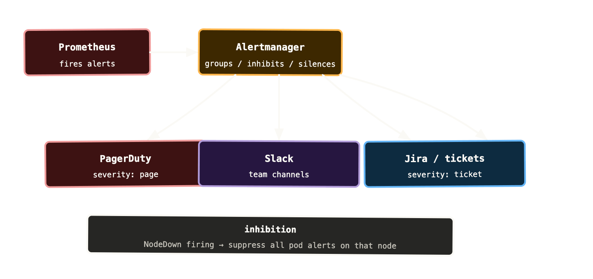

There’s a reliable way to tell if a team’s alerting is working well. Ask them how they feel about their on-call rotation. If the answer involves words like “exhausting,” “constant noise,” or “I stopped looking at alerts because most of them are false alarms” — the alerting is broken. Not broken in the sense of technically malfunctioning. Broken in the sense that it’s no longer doing its job.

Good alerting has one purpose: to notify a human when something requires human attention that can’t be handled automatically. Everything else — metrics collection, dashboards, tracing — can be left to machines. Alerts exist for the cases where a person needs to act.

Most alerting setups fail this test. They alert on causes instead of symptoms, on thresholds that were guessed rather than measured, on conditions that self-resolve before anyone has time to look. The result is a team that’s desensitised to their own alerts — which is arguably worse than having no alerts at all, because it creates a false sense of coverage.

This post is about designing alerts that earn their place.

## Why most alerting is backwards

The instinctive approach to alerting goes like this. You have a system with some components. Each component has metrics. You set thresholds on those metrics. CPU above 80%: alert. Memory above 70%: alert. Queue depth above 1000: alert. Disk above 85%: alert. Done — you’ve got coverage.

This approach alerts on causes, not symptoms. The problem is that causes don’t always produce symptoms, and symptoms don’t always have obvious causes. CPU at 85% might be totally fine — maybe you have a batch job running that always does this. Maybe the workload just increased. CPU at 85% is not inherently a problem; a degraded user experience is a problem.

The same queue depth that triggers an alert at 11pm on a Tuesday (something’s wrong) might be completely normal at 9am on a Monday (processing the overnight backlog). A fixed threshold treats both situations identically.

Symptom-based alerting flips this. Instead of “alert when CPU is high,” you ask “what do users actually experience when something is wrong?” The answer is almost always one of: requests are failing, requests are slow, or the service is unavailable. Those are the things worth alerting on.

```
cause-based:    CPU > 80%       → wake someone up
symptom-based:  error rate > 1% → wake someone up
```

The second alert might be triggered by high CPU. Or by a bad deployment. Or by a dependency failing. Or by a configuration error. You don’t care at alert time what caused it — you care that users are experiencing errors. The investigation happens after you’re awake.

## The four properties of a good alert

Before looking at how to configure alerts, it’s worth establishing what you’re aiming for. A good alert has four properties.

**It’s actionable.** When the alert fires, there’s something a human can do about it. An alert that fires and resolves on its own before the on-call engineer has finished reading it is not actionable. An alert that fires because of a known issue with no available fix is not actionable. If you can’t write a runbook for what to do when an alert fires, it shouldn’t be an alert.

**It’s about user impact.** The alert describes something users are experiencing, not something the infrastructure is doing. “p99 latency above 2 seconds” describes user experience. “API server request duration above 200ms” describes infrastructure. Users don’t care about the API server; they care about whether their checkout works.

**It has a meaningful threshold.** The threshold is based on your SLO or on observed normal behaviour, not on a round number someone picked. “Error rate above 1%” is meaningful if your SLO is 99.9% success rate. “Memory above 70%” is arbitrary.

**It fires infrequently.** If an alert fires multiple times per week for reasons that turn out not to require action, the threshold is wrong or the alert shouldn’t exist. Every false alarm trains your team to ignore alerts.

## SLOs and error budgets as an alerting foundation

The most principled approach to alerting is to base it on Service Level Objectives — commitments about the level of service you’ll provide to users.

An SLO might be: “99.9% of requests to the payments API succeed within 500ms, measured over a rolling 30-day window.”

From that SLO you derive an error budget: 0.1% of requests can fail or be slow in a 30-day window before you breach your SLO. That’s about 43 minutes of complete outage, or a much longer period of partial degradation.

The alerting insight from SLOs is this: you should be woken up when you’re burning through your error budget faster than expected, not when you cross an arbitrary threshold. If your error rate is 1% for 5 minutes, that’s concerning but not necessarily urgent — you might still have plenty of budget left. If your error rate is 50% for 5 minutes, you’ve burned a day’s worth of budget and need to act now.

This is called **burn rate alerting**, and it’s the most sophisticated approach to alert design. Rather than alerting on the raw error rate, you alert when the current rate of budget consumption means you’ll exhaust the budget before the window ends.

```
# burn rate over 1 hour window
# 14.4x burn rate = budget exhausted in ~2 days
(
  sum(rate(http_requests_total{status=~"5.."}[1h]))
  /
  sum(rate(http_requests_total[1h]))
)
/
0.001  # 1 - SLO = error budget fraction
```

A burn rate of 1 means you’re consuming your budget at exactly the rate that would exhaust it by the end of the window. A burn rate of 14.4 means you’re consuming it 14.4x faster — at that rate, a 30-day budget is exhausted in about 2 days.



The Google SRE workbook recommends a tiered approach: a high burn rate (14.4x over 1 hour) triggers a page — something needs immediate attention. A moderate burn rate (5x over 6 hours) creates a ticket for next-business-day attention — it’s a real problem but not urgent enough to wake someone up at 3am.

This approach means you only page when the situation genuinely justifies it, and the severity of the page reflects how urgently it needs to be addressed.

## Prometheus alerting rules

Alerts in Prometheus are defined as PrometheusRule resources — YAML that lives in Git, gets applied via GitOps, and is version-controlled like everything else.

```
apiVersion: monitoring.coreos.com/v1
kind: PrometheusRule
metadata:
  name: payments-api-alerts
  namespace: monitoring
spec:
  groups:
    - name: payments-api
      rules:
        - alert: PaymentsHighErrorRate
          expr: |
            sum(rate(http_requests_total{
              job="payments-api",
              status=~"5.."
            }[5m]))
            /
            sum(rate(http_requests_total{
              job="payments-api"
            }[5m]))
            > 0.01
          for: 5m
          labels:
            severity: page
            team: payments
          annotations:
            summary: "Payments API error rate above 1%"
            description: >
              Error rate is {{ $value | humanizePercentage }}.
              Check recent deployments and downstream dependencies.
            runbook_url: "https://runbooks.myorg.com/payments-high-error-rate"
```

A few fields worth understanding:

The `for` clause is critical and frequently misconfigured. It says “the expression must be true for this duration before the alert fires.” Without `for`, an alert fires on the first evaluation where the expression is true — which means a 15-second metric spike fires a page. With `for: 5m`, the condition must persist for 5 minutes. This eliminates a huge number of false alarms from transient spikes.

The `labels` block adds labels to the alert — used by Alertmanager for routing. `severity: page` vs `severity: ticket` is the standard way to distinguish urgent from non-urgent alerts. `team: payments` routes the alert to the right team’s channel.

The `annotations` block is what humans read. `summary` is one line — the subject line of your alert. `description` is the context — current values, what to look at first. `runbook_url` is the link to the document that tells the on-call engineer what to actually do. Every production alert should have a runbook URL. If you can’t write a runbook for an alert, the alert shouldn’t exist.

## Alertmanager: routing, grouping, and silencing

Alertmanager receives alerts from Prometheus and decides what to do with them. Its job is not to decide whether something is a problem — that’s Prometheus’ job. Alertmanager handles the operational mechanics: who gets notified, how, when, and in what combination.

**Routing** sends alerts to different destinations based on label matchers. The payments team’s alerts go to the `#payments-alerts` Slack channel. Severity `page` alerts go to PagerDuty. Severity `ticket` alerts create Jira tickets.

```
route:
  group_by: [alertname, cluster, namespace]
  group_wait: 30s
  group_interval: 5m
  repeat_interval: 4h
  receiver: default-slack

  routes:
    - match:
        severity: page
      receiver: pagerduty
    - match:
        team: payments
      receiver: payments-slack
```

**Grouping** batches related alerts into a single notification. If ten pods all start failing their readiness probes at the same time — perhaps because of a bad deployment — you want one alert saying “ten pods are unhealthy” rather than ten separate pages. `group_by: [alertname, namespace]` means alerts with the same name in the same namespace get batched together.

`group_wait` is how long Alertmanager waits before sending the first notification for a new group — giving time for related alerts to arrive and be batched together. `group_interval` is how long to wait before sending a notification when new alerts join an existing group. `repeat_interval` is how often to re-notify if an alert is still firing.

**Inhibition** suppresses downstream alerts when a root cause alert is already firing. If a node is completely unreachable, every pod on that node will fail its health checks and fire alerts. With inhibition, you can configure “if NodeDown is firing for node X, suppress all pod alerts from node X.” The operator sees one alert (the node is down) instead of thirty (every pod on the node).

```
inhibit_rules:
  - source_match:
      alertname: NodeDown
    target_match_re:
      alertname: Pod.*
    equal: [node]
```

**Silences** suppress alerts during known maintenance windows. Draining a node for upgrades? Silence the node-level alerts for that node for the next hour. The silence is time-limited, recorded with a reason and author, and visible in the Alertmanager UI — it’s not the same as deleting the alert rule.



## The dead man’s switch

Here’s a failure mode that’s easy to miss: your alerting infrastructure itself goes down, and nobody notices because there are no alerts firing. Prometheus crashes. Alertmanager loses its configuration. The Slack webhook expires. Everything looks fine — there are just no notifications happening.

The dead man’s switch pattern addresses this. You configure an alert that always fires — a condition that is permanently true:

```
- alert: Watchdog
  expr: vector(1)
  labels:
    severity: none
  annotations:
    summary: "Alerting pipeline is working"
```

`vector(1)` always evaluates to 1, so this alert fires constantly. You configure a receiver in Alertmanager that sends a notification for this alert to a dedicated dead man’s switch service — either a commercial one (Dead Man’s Snitch, Cronitor) or a self-hosted equivalent. That service expects a ping every few minutes. If it stops receiving pings, it notifies you through an independent channel (email, a different messaging platform, SMS).

If Prometheus or Alertmanager go silent — for any reason — the watchdog stops pinging, and you get an out-of-band notification that your alerting pipeline is broken.

The kube-prometheus-stack ships with a `Watchdog` alert pre-configured. If you’re using PagerDuty or a similar service, connect it up. If you’re not receiving a periodic ping from your cluster, something is wrong.

## Alert fatigue: diagnosing and fixing it

Alert fatigue is the state where your team has stopped taking alerts seriously because too many of them are noise. It’s one of the most dangerous operational conditions you can be in — because when a real incident happens, it looks exactly like the noise your team has learned to ignore.

Signs you have alert fatigue: engineers acknowledge alerts without reading them. Alerts get silenced “temporarily” and the silence is never lifted. The on-call rotation is dreaded rather than just inconvenient. Post-incident reviews regularly find that an alert fired but wasn’t actioned because it “usually resolves itself.”

Fixing alert fatigue requires auditing every alert against three questions:

Did this alert fire in the last 30 days? If not, it either has a threshold that’s never breached (too high — remove or lower it) or a condition that genuinely never occurs (maybe it’s not needed).

When it fired, did it require action? If the most common response to an alert is “wait and it resolves” or “acknowledge and ignore,” the alert shouldn’t exist or the threshold needs raising.

Can you write a runbook for it? If you can’t describe what to do when this alert fires, it’s not actionable and shouldn’t be a page.

A useful exercise: go through every alert with your team and force a thumbs-up or thumbs-down vote. “If this woke you up at 3am, would you be grateful or annoyed?” Anything that gets thumbs-down doesn’t belong in your paging tier.

## Common Kubernetes-specific alerts worth having

Beyond your application-level SLO alerts, a small set of Kubernetes infrastructure alerts belong in every cluster.

**Deployment unavailable replicas:**

```
kube_deployment_status_replicas_unavailable > 0
```

Any Deployment with pods not ready. Add `for: 5m` to avoid alerting on normal rolling update transients.

**PersistentVolumeClaim not bound:**

```
kube_persistentvolumeclaim_status_phase{phase!="Bound"} == 1
```

A PVC stuck in Pending or Lost state. Pods that depend on it won’t start. Usually indicates a storage provisioner problem.

**Container OOMKilled:**

```
increase(
  kube_pod_container_status_restarts_total[15m]
) > 3
```

Combined with checking the last termination reason:

```
kube_pod_container_status_last_terminated_reason{reason="OOMKilled"} == 1
```

A container being OOMKilled repeatedly means the memory limit is too low for the workload. Needs either a limit increase or a memory leak investigation.

**Node not ready:**

```
kube_node_status_condition{condition="Ready", status="true"} == 0
```

A node that’s not in the Ready state. Pods won’t be scheduled here and existing pods may be evicted if it stays NotReady.

**etcd high commit latency** (if you manage your own control plane):

```
histogram_quantile(0.99,
  rate(etcd_disk_wal_fsync_duration_seconds_bucket[5m])
) > 0.01
```

etcd commit latency above 10ms p99 indicates disk pressure on the control plane nodes — which affects all cluster operations.

## Alert annotation templates: making alerts useful at 2am

The content of an alert notification is often an afterthought. It shouldn’t be. When an alert fires at 2am, the engineer reading it has been woken up, is not fully alert, and needs to understand the situation as quickly as possible.

Good annotations answer three questions immediately: what is broken, how bad is it, and where do I start?

```
annotations:
  summary: "{{ $labels.job }} error rate above SLO"
  description: >
    {{ $labels.job }} in namespace {{ $labels.namespace }}
    has error rate of {{ $value | humanizePercentage }}
    (SLO: 1%). This has been elevated for {{ $labels.for }}.
    Recent deployments: check ArgoCD for changes in the last hour.
    Upstream dependencies: check payments-gateway and fraud-detection status.
  runbook_url: "https://runbooks/{{ $labels.job }}-high-errors"
  dashboard_url: "https://grafana/d/service-red?var-job={{ $labels.job }}"
```

The `dashboard_url` annotation is particularly valuable — a direct link to the relevant Grafana dashboard, pre-filtered to the affected service, saves five minutes of navigation while groggy at 3am. If your alerting platform supports it (PagerDuty and Opsgenie both do), embed the dashboard link directly in the alert.

The `runbook_url` is not optional for production alerts. A runbook doesn’t need to be long — it needs to tell the engineer: what does this alert mean, what’s the most likely cause, what are the first three things to check, and who to escalate to if those don’t resolve it. An alert without a runbook is an alert that relies on institutional knowledge surviving on-call rotations and team changes. It won’t.

## What to remember

Alert on symptoms, not causes. Users experience errors and latency, not CPU percentage. Build your primary alerts around what users feel.

The `for` clause prevents false alarms from transient spikes. Use it on every alert. Five minutes is a reasonable default for most service-level alerts.

Alertmanager handles routing, grouping, inhibition, and silencing. Define severity labels on your alerts and route accordingly — pages for urgent, tickets for non-urgent. Use inhibition to suppress downstream noise when a root cause is already firing.

The dead man’s switch pattern ensures your alerting infrastructure itself is monitored. If your Watchdog stops firing, something is broken upstream.

Every production alert needs a runbook. If you can’t write what to do when the alert fires, it shouldn’t be a page.

Audit your alerts regularly. Any alert that fires without requiring action, or that engineers routinely ignore, is actively harmful — it contributes to the alert fatigue that makes real incidents more dangerous.

Next up: logs — why pod logs are ephemeral, how to collect and centralise them, and how to query them effectively when you’re mid-incident.
