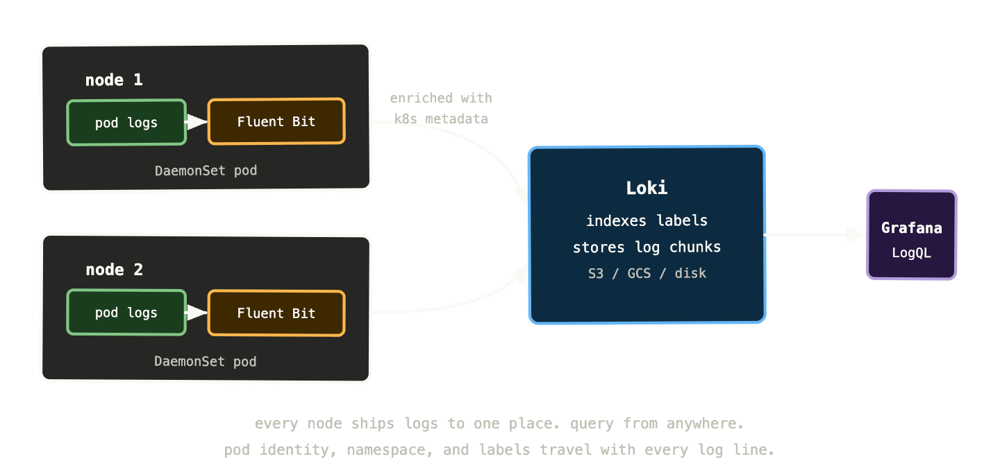

Metrics tell you something is wrong. Alerts wake you up about it. Then you need to understand what actually happened — and for that, you almost always end up in logs.

Logs are the detailed record of what your application was doing at the time things went wrong. The error message. The stack trace. The specific request that triggered the failure. The sequence of events that led up to it. Metrics can tell you that error rate spiked at 14:32. Logs can tell you that at 14:32:07, pod `payments-api-6d8f9-xk2p` started throwing `connection refused` errors trying to reach `fraud-detection-svc:8080`, and here are the request IDs of the forty-three affected transactions.

The challenge in Kubernetes is that accessing those logs is not straightforward. Pod logs are ephemeral. Collection is your responsibility. Volume is significant. And querying them effectively requires tooling that most teams underinvest in until they really need it.

## The Kubernetes logging model

Kubernetes has a deliberately simple approach to logs: applications write to stdout and stderr, and Kubernetes captures those streams.

That’s it. No log files, no log directories, no syslog integration. Your application writes to standard output, the container runtime captures it, and Kubernetes makes it available via `kubectl logs`. Simple, portable, works the same everywhere.

The problem is retention. By default, Kubernetes keeps logs on the node’s filesystem in `/var/log/pods/`, rotated when they hit a configurable size limit (typically 10MB per container, with a small number of rotated files kept). When a pod is deleted — or evicted, or rescheduled — its logs are eventually cleaned up. When a node runs out of disk, old logs are deleted to make room.

This means `kubectl logs` only shows you what’s currently on the node. If the pod that crashed has already been replaced by a new pod, the logs from the crashed pod might still be accessible via `kubectl logs --previous` — but only if the replacement landed on the same node and the rotation hasn’t discarded them yet.

For any serious incident investigation, this isn’t good enough. You need logs centralised somewhere external to the cluster, retained for long enough to be useful, and queryable without SSH access to individual nodes.

## Fluent Bit: collecting from every node

The standard collection pattern is a DaemonSet running a log shipping agent on every node. The agent reads from the node’s log directory, parses and enriches the log lines, and ships them to a central store.

Fluent Bit is the most common choice — it’s lightweight, fast, and has native Kubernetes support. It runs as a DaemonSet (one pod per node), reads the log files from `/var/log/pods/` via a hostPath volume mount, enriches each log line with Kubernetes metadata (namespace, pod name, container name, labels), and forwards to whatever backend you’ve configured.

The Kubernetes metadata enrichment is what makes centralised logs useful rather than just central. Without it, you have a stream of log lines with no context about where they came from. With it, every log line knows its namespace, its pod, its deployment, and its labels — so you can filter by any of those dimensions when investigating.

```
apiVersion: apps/v1
kind: DaemonSet
metadata:
  name: fluent-bit
  namespace: logging
spec:
  selector:
    matchLabels:
      app: fluent-bit
  template:
    spec:
      containers:
        - name: fluent-bit
          image: fluent/fluent-bit:latest
          volumeMounts:
            - name: varlog
              mountPath: /var/log
            - name: varlibdockercontainers
              mountPath: /var/lib/docker/containers
              readOnly: true
      volumes:
        - name: varlog
          hostPath:
            path: /var/log
        - name: varlibdockercontainers
          hostPath:
            path: /var/lib/docker/containers
```

Fluentd is the heavier alternative — more plugins, more flexibility, more memory usage. For most Kubernetes setups Fluent Bit is the right choice. Use Fluentd if you need complex log transformation pipelines or integrations Fluent Bit doesn’t support.



## Loki: log aggregation without the Elasticsearch overhead

There are several places logs can go after Fluent Bit collects them — Elasticsearch, Splunk, Datadog, CloudWatch. But if you’re already running a Grafana stack for metrics, Loki is the natural fit. It integrates directly into Grafana’s Explore view and shares the same label-based mental model as Prometheus.

Loki was designed with one explicit constraint: don’t index log content, only index labels. Elasticsearch indexes every word in every log line, which makes full-text search fast but storage expensive. Loki only indexes the labels attached to each log stream — namespace, pod name, container name, and whatever custom labels you add. The log content itself is stored compressed in chunks, and Loki grep-searches those chunks when you query specific content.

This trade-off makes Loki dramatically cheaper to run than Elasticsearch — often 10x less storage for the same volume of logs — at the cost of slower full-text search. For most operational use cases, this is exactly the right trade-off. You’re almost always filtering by label first (show me logs from the payments namespace, from the last 30 minutes, for pods matching `app=payments-api`) and then searching within those filtered results. The label filtering is instant; the content search is fast enough.

The storage backend for Loki is object storage — S3, GCS, Azure Blob — which makes it cheap to retain logs for months rather than days. Running Elasticsearch with months of retention is expensive enough that many teams set aggressive retention policies and throw away logs they’d benefit from keeping. Loki’s cost structure changes that calculus.

## LogQL: querying logs with a familiar mental model

LogQL is Loki’s query language. If you’ve learned PromQL, LogQL will feel immediately familiar — it uses the same label selector syntax and a similar approach to filtering and aggregation.

Every LogQL query starts with a log stream selector in curly braces — the same syntax as Prometheus label matchers:

```
{namespace="payments", app="payments-api"}
```

This selects all log streams from pods with those labels. You get back every log line from those pods.

From there you add filter expressions to narrow down the content:

```
{namespace="payments", app="payments-api"}
  |= "error"
  |= "connection refused"
```

`|=` means “line contains this string.” `!=` means “line does not contain.” `|~` for regex match, `!~` for regex not match. These are chained — each filter narrows the results of the previous one.

For structured JSON logs, you can parse and filter on field values:

```
{namespace="payments", app="payments-api"}
  | json
  | level="error"
  | status_code >= 500
```

The `| json` parser extracts JSON fields as labels, and then you can filter on those fields exactly as you would on original stream labels. This is why structured logging matters — it makes LogQL filtering dramatically more powerful.

Metric queries compute aggregations over log data, similar to how PromQL works on time series:

```
sum by (pod) (
  count_over_time(
    {namespace="payments"}
    |= "error"
    [5m]
  )
)
```

“Count of log lines containing ‘error’, per pod, in 5-minute windows.” This gives you a metric-style view of error rates derived from log content — useful for building Grafana panels that show error frequency from logs rather than from instrumented metrics.

## Structured logging: why JSON logs are better than strings

Most application logs look something like this:  
  
2024-01-15 14:32:07 ERROR Failed to process payment for order 8721: connection refused to fraud-detection-svc:8080 (timeout after 3000ms)

This is human-readable but machine-unfriendly. Parsing it requires regex. Extracting the order ID, the error type, the service name, and the timeout duration requires knowing the exact format of the string — which breaks whenever someone changes the log message slightly.

Structured logging emits JSON instead:

```
{
  "timestamp": "2024-01-15T14:32:07Z",
  "level": "error",
  "message": "Failed to process payment",
  "order_id": "8721",
  "error": "connection refused",
  "upstream": "fraud-detection-svc:8080",
  "timeout_ms": 3000,
  "trace_id": "abc123def456"
}
```

Every field is named and typed. Loki’s JSON parser extracts all of them as filterable labels. You can now query:

```
{app="payments-api"} | json | upstream="fraud-detection-svc:8080" | error="connection refused"
```

You can find every failed payment for a specific order:

```
{app="payments-api"} | json | order_id="8721"
```

You can count connection failures by upstream service:

```
sum by (upstream) (
  count_over_time(
    {app="payments-api"}
    | json
    | error="connection refused"
    [15m]
  )
)
```

And — critically — the `trace_id` field means you can jump directly from a log line to the distributed trace for that specific request. That cross-pillar link is one of the most powerful investigation tools in the full observability stack.

The practical implication: if you’re starting a new service, use a structured logging library from day one. If you have existing services with unstructured logs, the Fluent Bit pipeline can apply regex parsers to extract fields — but it’s fragile and requires maintenance. Structured logging at the source is always preferable.

## Retention, cost, and what to actually keep

Log volume in a busy Kubernetes cluster is substantial. A single pod writing verbose logs might produce hundreds of megabytes per day. Multiply that across hundreds of pods and you’re looking at significant storage costs if you keep everything.

The practical approach is tiered retention with different policies for different log levels and sources.

Application error and warning logs: keep for 90 days. These are what you need for incident investigation and post-mortems. The volume is relatively low because errors should be rare.

Application info logs: keep for 30 days. Useful for recent investigation but not worth the cost of long-term retention.

Debug logs: don’t ship to centralised storage at all under normal conditions. Debug logging at scale is extraordinarily expensive. Use dynamic log level adjustment — the ability to temporarily increase the log level for a specific pod when you’re actively investigating — rather than keeping verbose logs running all the time.

Kubernetes system component logs (kubelet, kube-proxy, scheduler): keep for 30 days. You occasionally need these for cluster-level debugging but they’re high volume and rarely referenced.

Audit logs (Kubernetes API audit trail): keep for 90-180 days depending on compliance requirements. These are invaluable for security investigations and compliance but need specific tooling to parse and query usefully.

Loki supports per-stream retention policies, so you can express these rules in configuration rather than having to filter before ingestion.

## Common log investigation patterns

A few patterns that come up in nearly every incident investigation.

**Find all errors from a service in a time window:**

```
{namespace="payments", app="payments-api"}
  | json
  | level="error"
```

Set the Grafana time range to the incident window. This is almost always the first query.

**Find what a specific pod was doing before it crashed:**

```
{namespace="payments", pod="payments-api-6d8f9-xk2p"}
```

Select the pod by name, scroll back to just before the crash timestamp. The last few log lines before a crash often tell you exactly what triggered it.

**Count errors by type to find the dominant failure:**

```
sum by (error) (
  count_over_time(
    {namespace="payments"}
    | json
    | level="error"
    [5m]
  )
)
```

This tells you whether you have one type of error at high volume (probably a systematic failure) or many types at low volume (probably unrelated issues).

**Find all requests affected by a specific upstream failure:**

```
{namespace="payments"}
  | json
  | upstream="fraud-detection-svc:8080"
  | error=~"(connection refused|timeout)"
```

Extract every log line where the fraud detection service failed. Combined with order IDs or user IDs from those lines, you can tell affected customers which transactions to retry.

**Correlate with a trace ID:**

```
{namespace="payments"} | json | trace_id="abc123def456"
```

If you have a trace ID from an error report or from a Tempo trace, this finds every log line associated with that specific request across all services. Enormously powerful for understanding exactly what happened during one specific slow or failing request.

## The Loki label cardinality problem

Loki has the same cardinality concern as Prometheus, but it manifests differently. Loki indexes labels — the label values you attach to log streams are what get indexed. If you use high-cardinality values as Loki labels, you create an explosion of log streams that degrades query performance.

The typical mistake: adding `pod` or `instance` as a Loki label when Fluent Bit is configured to attach pod names. Every unique pod name creates a new Loki stream. In a cluster with hundreds of pods turning over regularly, this creates thousands of streams, many of which exist for only a few minutes.

The correct approach: use only low-cardinality labels at the stream level — `namespace`, `app`, `container`, `node`. These have bounded sets of values and create a manageable number of streams. Pod-level granularity is achievable via the log content itself, which Loki searches without indexing.

The Fluent Bit Kubernetes filter has a `labels` configuration that lets you specify exactly which pod labels to propagate as Loki labels. Be selective. More labels means more streams means worse performance.

## What to remember

Kubernetes logs are ephemeral by default. Without centralised collection, logs die when pods die. This makes post-incident investigation dependent on luck — whether the pod that crashed happened to stay on the same node long enough for you to read its logs.

Fluent Bit as a DaemonSet is the standard collection pattern. It reads from every node’s log directory, enriches with Kubernetes metadata, and ships to a central backend. Every log line carries its namespace, pod, container, and labels.

Loki stores and queries logs cheaply by indexing only labels, not content. Object storage backend means long retention without Elasticsearch-level costs. LogQL shares Prometheus’ label selector syntax — if you know PromQL, LogQL is immediately approachable.

Structured logging — JSON output from your applications — makes log querying dramatically more powerful. Parse, filter, and aggregate on named fields rather than regex-matching against string messages. Include trace IDs in every log line that handles a request — they’re the bridge between logs and traces.

Watch Loki label cardinality. Keep stream-level labels low-cardinality. Pod-level granularity comes from the log content, not from labels.

Next up: distributed tracing — the hardest pillar to implement and the one that answers the question metrics and logs can’t: where exactly did that latency come from?
