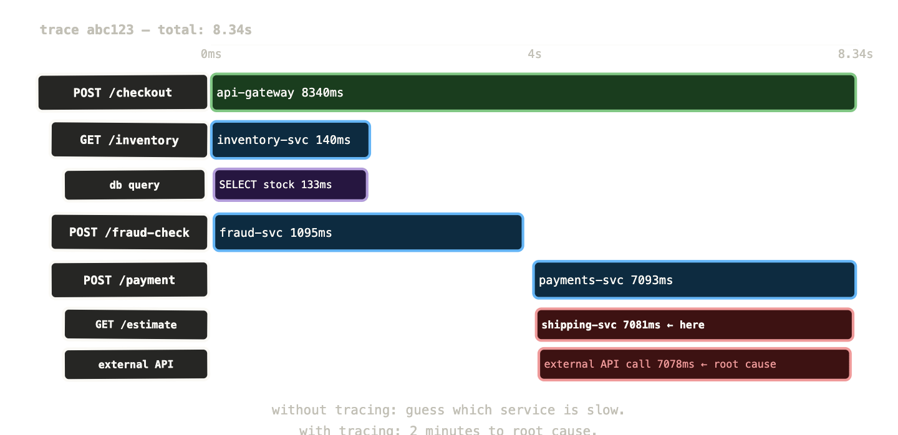
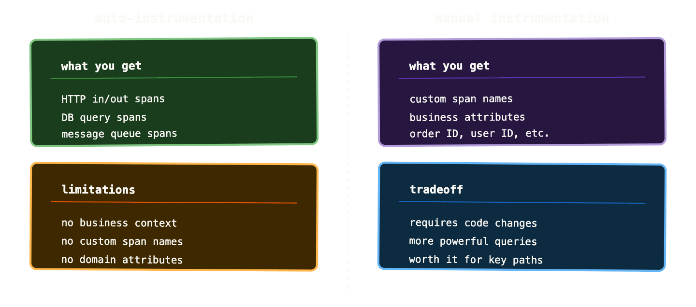

Here’s the scenario that distributed tracing exists to solve. A user reports that checkout is slow — sometimes five seconds, sometimes twelve. Your error rate is fine. Your metrics look normal. CPU is healthy. Memory is healthy. Everything on every dashboard is green except that users are clearly experiencing something bad.

You go looking for the cause. Is it the API gateway? The payments service? The inventory check? The fraud detection call? The database query? The response from the shipping estimator? Any of these could be responsible. Without tracing, your options are: add timing logs to each service and redeploy everything, or make educated guesses and hope.

With tracing, you open Grafana, find a slow checkout request, and see a waterfall diagram showing exactly where the 8.3 seconds went. The inventory service took 7.1 seconds on a database query. Everything else was fine. You have your answer in two minutes.

That’s what distributed tracing is for.

## The problem traces solve

Metrics and logs are both local to a single service. A metric tells you that the payments service handled 200 requests per second with a p99 of 340ms. A log line tells you what the payments service was doing at a specific moment. Neither tells you what happened to the request before it arrived at the payments service or after it left.

In a monolith, this doesn’t matter — there’s nowhere else for the request to go. In a microservices architecture, a single user-facing request might touch ten services before a response is returned. The total response time the user experiences is the sum of all those hops, plus network time, plus any serial waiting between them. Figuring out where time was spent requires stitching together timing data from each service into a coherent picture.

That’s a trace: a complete record of a single request’s journey through your system, with timing for each step.

## Spans, traces, and context propagation

A **span** is the basic unit of tracing. It represents one unit of work — a function call, a database query, an HTTP request to an upstream service. A span has a start time, an end time, a name, and a set of attributes (key-value pairs describing what happened).

A **trace** is a collection of spans that share a common trace ID. Every span in a trace is connected by parent-child relationships: the root span represents the original incoming request, child spans represent the operations it triggered, and grandchild spans represent operations those triggered in turn.

```
Trace abc123
│
├─ [0ms - 8340ms]  POST /checkout  (API gateway)
│   ├─ [2ms - 140ms]   GET /inventory (inventory-svc)
│   │   └─ [5ms - 138ms]  db query: SELECT stock...
│   ├─ [145ms - 1240ms]  POST /fraud-check (fraud-svc)
│   └─ [1245ms - 8338ms] POST /payment (payments-svc)
│       └─ [1248ms - 8335ms]  GET /estimate (shipping-svc)
│           └─ [1252ms - 8330ms] external API call
```

Reading this waterfall, the problem is immediately obvious: the shipping estimator is calling an external API that’s taking 7 seconds. The payment service is waiting for it. Everything else is fast.

**Context propagation** is what connects spans across service boundaries. When the API gateway makes an HTTP call to the inventory service, it adds HTTP headers containing the trace ID and the current span ID. The inventory service reads those headers, creates a new child span with the same trace ID, and continues the trace. When the inventory service calls the database, it creates another child span.

The trace only works if every service in the chain participates — reads the incoming context headers, creates its spans with the right parent, and passes the context to the next hop. One non-participating service breaks the chain.

```
API gateway → [injects trace headers] → inventory-svc
                                        [reads headers, creates child span]
                                        [calls database with span context]
```



## OpenTelemetry: the standard that ended the vendor wars

For most of the history of distributed tracing, every vendor had their own instrumentation library. If you used Jaeger, you imported the Jaeger client. If you switched to Zipkin, you reimplemented instrumentation with the Zipkin client. If you wanted to try a commercial APM tool, you reimplemented it again. Changing your tracing backend meant touching every service.

OpenTelemetry (OTel) ended this. It’s a vendor-neutral, CNCF-graduated standard for telemetry data — metrics, logs, and traces. You instrument your service once using the OTel SDK. That instrumentation exports data in the OpenTelemetry Protocol (OTLP) format, which every major backend (Tempo, Jaeger, Zipkin, Datadog, Honeycomb, New Relic, and dozens more) can receive. Changing your backend means changing one configuration line, not reimplementing instrumentation across your entire service fleet.

OpenTelemetry also standardised the context propagation format via the W3C TraceContext header specification. Any service that supports OTel will correctly propagate context to any other service that supports OTel, regardless of what language each is written in. A Go service can propagate context to a Python service to a Java service to a Node.js service. The trace is complete as long as everyone speaks OTel.

The OTel project provides SDKs for every major language. It’s the right default for any new instrumentation work — there’s no longer a reason to use a vendor-specific SDK unless you have very specific requirements that OTel doesn’t meet.

## Auto-instrumentation vs manual instrumentation

This is the question that comes up immediately when teams start implementing tracing: do we have to instrument every function call manually, or can we get traces automatically?

**Auto-instrumentation** uses language-level interception — bytecode manipulation in Java, monkey-patching in Python, eBPF at the kernel level — to automatically create spans for incoming and outgoing HTTP calls, database queries, message queue operations, and other common patterns. You don’t change your application code at all. You add a sidecar container or configure the OTel operator, and traces start appearing.

The OTel Operator for Kubernetes can inject auto-instrumentation into pods automatically based on annotations:

```
metadata:
  annotations:
    instrumentation.opentelemetry.io/inject-python: "true"
```

This injects the OTel Python agent into every Python pod with that annotation. Incoming and outgoing HTTP calls are automatically traced. No code changes.

**Manual instrumentation** is where you add OTel SDK calls directly to your code to create custom spans, add attributes, and record events that auto-instrumentation can’t capture — business logic, custom operations, contextual data specific to your domain.

```
ctx, span := tracer.Start(ctx, "process-payment")
defer span.End()

span.SetAttributes(
    attribute.String("order.id", order.ID),
    attribute.Float64("order.amount", order.Amount),
    attribute.String("payment.method", order.PaymentMethod),
)

if err := processCard(ctx, order); err != nil {
    span.RecordError(err)
    span.SetStatus(codes.Error, err.Error())
    return err
}
```

This span will appear in your trace with the order ID, amount, and payment method as searchable attributes. You can query Tempo for “all traces where payment.method=credit_card and order.amount > 500” — which is impossible with auto-instrumentation alone.

In practice: start with auto-instrumentation to get traces flowing immediately. Add manual instrumentation progressively for the operations that matter most for debugging.



## The OTel Collector: the hub your telemetry flows through

Before we get to storage backends, there’s one more component worth understanding: the OpenTelemetry Collector.

The Collector is a standalone service that receives telemetry data from your applications, processes it, and exports it to one or more backends. It sits between your services and your storage layer.

```
your app → OTel Collector → Tempo (traces)
                          → Prometheus (metrics)
                          → Loki (logs)
```

This architecture has several advantages. Your application only needs to know one endpoint — the Collector. The Collector handles routing, batching, sampling, and format conversion. If you want to send traces to two different backends simultaneously (say, Tempo for day-to-day use and a commercial APM for long-term analysis), you change the Collector configuration without touching your applications.

Sampling is the most important function the Collector performs. In a busy system, tracing every single request is prohibitively expensive. A service handling 5,000 requests per second would generate millions of spans per minute. You don’t need all of them — you need a representative sample plus 100% of interesting cases (errors, slow requests).

**Head-based sampling** makes the sampling decision at the start of a trace, before you know how it ends. Simple and cheap — you just probabilistically drop a fraction of traces. The downside is you’ll drop traces that turned out to be interesting.

**Tail-based sampling** makes the sampling decision after the entire trace has completed, so you can always keep 100% of errors and slow traces while sampling down normal, fast ones. More useful but more expensive — the Collector needs to buffer spans until the trace is complete before deciding.

A typical tail-based sampling configuration:

```
processors:
  tail_sampling:
    policies:
      - name: errors-policy
        type: status_code
        status_code: {status_codes: [ERROR]}
      - name: slow-traces-policy
        type: latency
        latency: {threshold_ms: 1000}
      - name: probabilistic-policy
        type: probabilistic
        probabilistic: {sampling_percentage: 10}
```

Keep 100% of error traces. Keep 100% of traces over 1 second. Sample 10% of everything else. This gives you full visibility into problems while keeping storage costs manageable.

## Tempo and Jaeger: storing and querying traces

**Tempo** is Grafana’s trace storage backend. Like Loki for logs, it’s designed with object storage as the backend — S3, GCS, or Azure Blob. This makes it cheap to retain traces for weeks without the cost of a columnar database.

Tempo’s design philosophy mirrors Loki’s: don’t index trace content, only index trace IDs. You find a trace by its ID (from a log line, from an error report, from a Grafana link in a metric panel), and Tempo retrieves the full trace. Searching by attributes — “find all traces where payment.method=credit_card” — requires TraceQL, Tempo’s query language, which does a scan rather than an index lookup and is consequently slower.

```
// Find traces with errors in the payments service
{ resource.service.name = "payments-api" && status = error }

// Find slow traces above 2 seconds
{ resource.service.name = "payments-api" && duration > 2s }

// Find traces with specific business attributes
{ span.order.id = "8721" }
```

**Jaeger** is the CNCF-native trace storage system, originally from Uber. It has richer query capabilities than Tempo’s default mode — you can search by service, by operation name, by duration range, by tags. The trade-off is that it needs a columnar storage backend (Cassandra or Elasticsearch) which is more expensive to operate than object storage.

If you’re building on the Grafana LGTM stack, Tempo is the natural choice — same deployment model as Loki, same integration with Grafana, and TraceQL is increasingly capable. If you need richer search capabilities and are already running Elasticsearch, Jaeger is worth considering.

## The sampling problem in practice

One of the real operational challenges with tracing is that the traces you most want to keep are often the ones most likely to be sampled away. A 10% sampling rate means you’re keeping 1 in 10 traces. If a rare bug affects 0.5% of requests, you might see zero traces of it after sampling.

The solution is to ensure your sampling policy always keeps traces that show errors, high latency, or specific business conditions. Tail-based sampling with an error policy gets you there for errors. For business conditions — a specific customer, a specific payment method, a specific code path — you need to add sampling hints at the application level.

The OTel SDK allows you to set sampling hints on spans:

```
span.SetAttributes(
    attribute.Bool("sampling.priority", true),  // always keep this trace
)
```

The Collector’s tail sampling processor can then include a policy that keeps all traces where this attribute is set. This gives you targeted visibility into specific scenarios without keeping everything.

In production Kubernetes environments at any real scale — thousands of requests per second across dozens of services — tail-based sampling with a well-designed policy is not optional. Head-based sampling with a fixed percentage will leave you blind to important events. The initial setup investment is worth it.

## Connecting traces to metrics and logs

Traces are most powerful when they connect to the other two pillars. A trace ID in a log line means one click takes you from the log to the full trace. A slow metric in a Grafana panel can link to a Tempo query for traces from that time window. An error in a trace links back to the application logs for that span.

This is called **exemplars** in the Prometheus context. An exemplar is a specific example attached to a metric observation — “this is the trace ID for the request that contributed to this histogram bucket.” When Prometheus stores a histogram observation, it can optionally store an exemplar with it:  
“`  
http_request_duration_seconds_bucket{le=”1.0″} 1234 # {traceID=”abc123″} 0.832

In Grafana, when you’re looking at a latency histogram, you can click on a data point to jump directly to the trace for a specific request that contributed to that metric. Without exemplars, you’d have to manually search Tempo for traces from the same time window and hope you find the right one. With exemplars, it’s one click.

Enabling exemplars requires both your application (to include trace IDs in histogram observations) and Prometheus (to store them). The OTel SDK handles the application side automatically when you have tracing and metrics configured together. Prometheus needs `--enable-feature=exemplar-storage` in its startup flags.

## Why traces are the hardest pillar to implement

Metrics are easy to add — a few lines of instrumentation, a ServiceMonitor, done. Logs are even easier — your application probably already writes them. Traces require all your services to participate.

If you have ten services and eight of them are instrumented, the two uninstrumented services break the chain. Traces stop at the boundary of an uninstrumented service and restart on the other side — you can’t connect the upstream and downstream behaviour. The trace is only as complete as your least-instrumented service.

This means getting value from tracing requires a coordinated effort across teams. For organisations with many services owned by different teams, this is genuinely difficult. Standardising on OTel and providing shared instrumentation libraries that teams can adopt reduces the friction significantly — but it still requires buy-in.

The path that works in practice: instrument your critical user-facing paths first. Get traces flowing for checkout, login, payment, and search — whatever your users care about most. Build the habit and the tooling around those paths. Expand coverage incrementally as teams see the value and adopt the standard.

## What to remember

A trace is a collection of spans, connected by a shared trace ID, showing the complete journey of a single request through your system. Each span represents one unit of work, with a start time, end time, and attributes.

Context propagation is what connects spans across service boundaries — trace ID and span ID travel in HTTP headers. One non-participating service breaks the chain.

OpenTelemetry is the vendor-neutral standard. Instrument once, export to any backend. Auto-instrumentation gets you HTTP and database spans for free. Manual instrumentation adds business context that makes traces queryable by domain attributes.

The OTel Collector sits between your services and your backends, handling routing, batching, and — critically — tail-based sampling. Tail-based sampling keeps 100% of errors and slow traces while sampling down normal traffic. Always configure this before going to production scale.

Tempo is the Grafana-native trace backend — cheap object storage, integrates with the rest of the LGTM stack. Exemplars connect traces to metrics, enabling one-click navigation from a latency spike to the specific trace that caused it.

Tracing is the hardest pillar because it requires all services to participate. Start with your critical paths, use OTel to reduce the instrumentation burden, and expand coverage incrementally.

Next up: putting it all together — the full LGTM stack, how to correlate across all three pillars, and what it looks like when observability is actually working.
