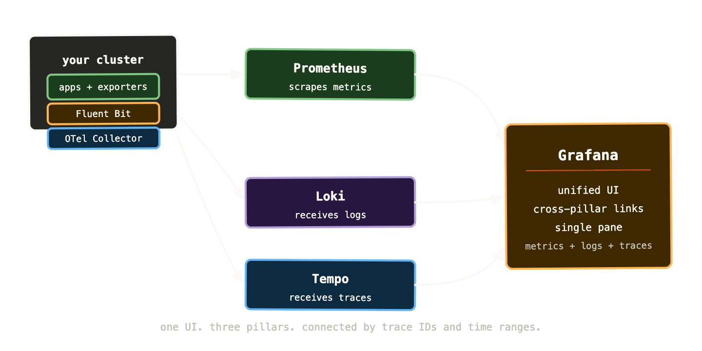
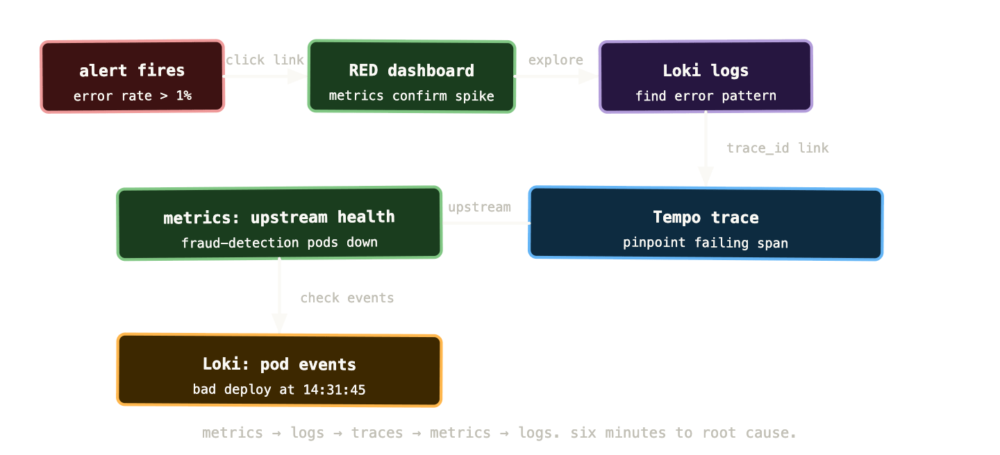

The last six posts have covered the three pillars individually — Prometheus for metrics, Loki for logs, Tempo for traces. Each one is useful on its own. But the real leverage comes from using them together, connected in a way that lets you move fluidly between signals during an investigation without losing context.

This post is about the full stack: what the components are, how they connect, how to deploy them, and what the experience of a properly integrated observability platform actually feels like in practice.

## The LGTM stack

Grafana Labs uses the acronym LGTM to describe their observability platform. It stands for Loki, Grafana, Tempo, and Mimir — where Mimir is their scalable long-term metrics storage layer that extends Prometheus. You’ll sometimes see it written as LGTM+ or PLG (Prometheus, Loki, Grafana) depending on which components are included.

For most Kubernetes teams, the practical stack is:

**Prometheus** scrapes and stores metrics for the short term (15-30 days). For longer retention or high-availability, Mimir or Thanos extends Prometheus with object storage backend and horizontal scaling. We’ll come back to the scale question at the end of this post.

**Loki** receives, indexes, and stores logs shipped by Fluent Bit from every node.

**Tempo** receives traces from the OTel Collector and stores them in object storage.

**Grafana** is the single pane of glass — it connects to all three backends and lets you query, visualise, and navigate between them.



Grafana connects to all three backends as data sources. When you’re in the Explore view, you can switch between them mid-investigation using the same time range and the same labels. A trace ID you find in a log line is a clickable link to Tempo. A metric spike in a Grafana panel can link to Loki logs from the same time window. An exemplar on a histogram data point takes you directly to the trace for that specific request.

This is what integrated observability looks like — not three separate tools that happen to be installed in the same cluster, but three interconnected systems that you navigate between fluidly.

## Deploying the stack: kube-prometheus-stack plus Loki and Tempo

The fastest path to a working full stack is three Helm chart installations, each from the Grafana Helm repository.

```
helm repo add grafana https://grafana.github.io/helm-charts
helm repo add prometheus-community \
  https://prometheus-community.github.io/helm-charts
helm repo update
```

### Step 1: Prometheus, Grafana, and Alertmanager

```
helm install kube-prometheus-stack \
  prometheus-community/kube-prometheus-stack \
  --namespace monitoring \
  --create-namespace \
  --set grafana.enabled=true \
  --set prometheus.prometheusSpec.retention=15d
```

This gives you Prometheus, Grafana, Alertmanager, node-exporter, kube-state-metrics, and a full set of default dashboards and alert rules. A working metrics and alerting stack in one command.

### Step 2: Loki

```
helm install loki grafana/loki-stack \
  --namespace monitoring \
  --set fluent-bit.enabled=true \
  --set promtail.enabled=false \
  --set loki.persistence.enabled=true \
  --set loki.persistence.size=20Gi
```

`loki-stack` installs both Loki and Fluent Bit together. For production use you’d configure an S3 backend for Loki storage rather than a PVC — but this gets you started with log collection immediately.

### Step 3: Tempo

```
helm install tempo grafana/tempo \
  --namespace monitoring \
  --set tempo.storage.trace.backend=local
```

Again, `local` storage for getting started. In production, configure an S3 or GCS backend.

### Step 4: Wire Loki and Tempo into Grafana

Grafana provisioning via ConfigMap lets you add data sources declaratively rather than through the UI:

```
apiVersion: v1
kind: ConfigMap
metadata:
  name: grafana-datasources-extra
  namespace: monitoring
  labels:
    grafana_datasource: "1"
data:
  datasources.yaml: |
    apiVersion: 1
    datasources:
      - name: Loki
        type: loki
        url: http://loki:3100
        jsonData:
          derivedFields:
            - datasourceUid: tempo
              matcherRegex: '"trace_id":"(\w+)"'
              name: TraceID
              url: '$${__value.raw}'
      - name: Tempo
        type: tempo
        uid: tempo
        url: http://tempo:3100
        jsonData:
          lokiSearch:
            datasourceUid: loki
```

The `derivedFields` configuration in the Loki datasource is important — it tells Grafana to look for a `trace_id` field in every log line and turn it into a clickable link that opens the trace in Tempo. This is the cross-pillar connection that makes the stack feel integrated rather than just co-located.

## Correlating signals: the investigation workflow

With the full stack connected, an incident investigation has a natural flow. Let’s walk through it concretely.

You receive an alert: payment error rate above 1% for the last 5 minutes. You click the dashboard link in the alert. The RED dashboard for the payments service shows the error spike, starting at 14:32:07.

You look at the request rate panel — traffic is normal. The errors started suddenly, not as a gradual ramp. That rules out a load-related issue.

You click the error rate panel to open it in Explore, zoom in on the spike window, and switch the data source to Loki. The derived query appears automatically: logs from the payments namespace, filtered by the time range from the alert.

```
{namespace="payments", app="payments-api"} | json | level="error"
```

Log lines start appearing. They all contain the same error: `upstream connect error or disconnect/reset before headers. retried and the latest reset reason: connection failure, transport failure reason: delayed connect error: 111`. That’s a connection refused error — something downstream of the payments service is unreachable.

You scan the log lines. Each one has a `trace_id` field. You click one. Tempo opens with the full trace for that specific failed request.

The trace waterfall shows the problem immediately: the payments service is calling `fraud-detection-svc`, creating a span, and that span is failing after 3 seconds with a connection error. The fraud detection service itself has no spans in the trace — it never received the request.

You switch back to the metrics dashboard and add a panel for fraud detection: `up{job="fraud-detection"}`. The metric shows the fraud detection pods went down at 14:31:52 — fifteen seconds before the alert fired on the payments error rate. The payments service is failing because fraud detection is unavailable.

You check kube-state-metrics: `kube_deployment_status_replicas_unavailable{deployment="fraud-detection"}` shows 3 unavailable replicas. You look at recent deployments in ArgoCD. A deploy of fraud detection happened at 14:31:45. The new pods are failing their readiness probe.

Total time from alert to root cause: six minutes. Without the connected stack, you’d have been digging through kubectl, SSH sessions, and scattered dashboards for considerably longer.



The flow isn’t linear — you move back and forth between pillars as the investigation develops. What makes this possible is shared context: the same time range, the same labels, and trace IDs that bridge the gap between structured log lines and distributed traces.

## Cardinality: the silent killer of Prometheus performance

We introduced cardinality as a concept back in post 02. It’s worth addressing in more depth here because it’s the most common reason Prometheus installations degrade over time and the one most teams don’t anticipate until they’re dealing with the consequences.

Cardinality is the number of unique time series in your Prometheus instance. Every unique combination of metric name and label values is one time series. A metric with three labels, each with ten possible values, has at most 1,000 time series. A metric with five labels, two of which have unbounded values, can have millions.

High cardinality causes two problems. First, memory: Prometheus stores its working set in RAM, and each time series consumes memory. A well-tuned Prometheus instance might handle 5-10 million active time series. Beyond that, you need horizontal scaling or a remote write setup. Second, query performance: queries that scan large numbers of time series are slow, and slow queries degrade the UI, slow down alert evaluation, and cause cascading problems.

The usual culprits:

```
# BAD - user_id creates one series per user
http_requests_total{user_id="12345", status="200"}

# BAD - request_id creates one series per request  
http_requests_total{request_id="abc-123-def", status="200"}

# BAD - url_path with dynamic segments
http_requests_total{path="/api/users/12345/orders/67890"}

# GOOD - bounded set of values
http_requests_total{handler="/api/users/{id}/orders/{order_id}", status="200"}
```

High cardinality often sneaks in gradually. A developer adds a label that seems reasonable. At low traffic volume it’s fine. At high traffic volume it creates tens of thousands of series. Six months later, Prometheus is struggling and nobody remembers why.

Tools to diagnose cardinality problems: the Prometheus TSDB status page at `/tsdb-status` shows the top cardinality contributors by metric name and by label name. The `prometheus_tsdb_head_series` metric tells you the total active series count. Set an alert when this exceeds a threshold appropriate for your hardware.

## Long-term storage: Thanos and Mimir

Default Prometheus retains data locally for 15 days. For most teams that’s insufficient — post-incident reviews often need data older than two weeks, capacity planning needs months of history, and compliance requirements sometimes need years.

Two options extend Prometheus retention:

**Thanos** wraps around your existing Prometheus instances. It uses a sidecar component alongside each Prometheus pod that uploads blocks of data to object storage (S3, GCS) as they’re created. A Thanos Query component provides a unified query interface across multiple Prometheus instances and the object storage backend, with deduplication for HA setups.

**Mimir** is Grafana’s newer, fully distributed metrics backend. Rather than extending Prometheus, it replaces it as the storage layer — you configure Prometheus to remote-write to Mimir rather than storing data locally. Mimir handles sharding, replication, long-term storage, and horizontal scaling natively. It’s the right choice for very high cardinality or very high ingestion rates where a single Prometheus instance is the bottleneck.

For most Kubernetes operators, the choice is:

Single cluster, moderate traffic, 90-day retention needs: Thanos sidecar. Simple to add to an existing setup, proven at scale, well-documented.

Multiple clusters, high cardinality, long retention, or you want a managed experience: Mimir, or the managed Grafana Cloud alternative if self-hosted complexity isn’t worth it.

Both integrate directly with Grafana — you add them as Prometheus-compatible data sources and existing dashboards and alerts work without modification.

## The kube-prometheus-stack: what you get and how to tune it

The kube-prometheus-stack Helm chart is the fastest path to a working metrics and alerting stack, but it comes with defaults that need tuning for production use.

**Alert rules**: the stack ships with a large set of default alerts — over a hundred rules covering Kubernetes components, node resources, and common failure modes. Many of them will fire in a new cluster and need tuning. Go through them systematically: disable the ones that don’t apply to your environment, adjust thresholds based on your actual baselines, and add runbook URLs to the ones you keep.

**Storage**: by default Prometheus uses an ephemeral volume. In production you want a PVC:

```
prometheus:
  prometheusSpec:
    retention: 30d
    storageSpec:
      volumeClaimTemplate:
        spec:
          storageClassName: fast
          resources:
            requests:
              storage: 100Gi
```

**Resource limits**: the defaults are conservative. A busy cluster with high cardinality needs more memory:

```
prometheus:
  prometheusSpec:
    resources:
      requests:
        memory: 4Gi
        cpu: 500m
      limits:
        memory: 8Gi
```

**Scrape intervals**: the default 15-second scrape interval is appropriate for most workloads. For high-cardinality environments, increasing to 30 or 60 seconds reduces load at the cost of metric resolution. Don’t decrease below 15 seconds without understanding the storage and memory implications.

**Grafana persistence**: Grafana stores dashboards, data sources, and users in a SQLite database by default. For anything beyond a test environment, configure an external PostgreSQL or MySQL database:

```
grafana:
  database:
    type: postgres
    host: postgres.monitoring:5432
    name: grafana
    user: grafana
    password: ${GRAFANA_DB_PASSWORD}
```

## Practical Grafana configuration worth knowing

**Provisioned dashboards**: rather than importing dashboards through the UI, provision them via ConfigMaps. They’re version-controlled, applied automatically, and survive Grafana restarts:

```
apiVersion: v1
kind: ConfigMap
metadata:
  name: payments-dashboard
  labels:
    grafana_dashboard: "1"
data:
  payments.json: |
    { ... dashboard JSON ... }
```

**Alert contact points**: configure notification channels in Grafana’s provisioning rather than through the UI. This makes them reproducible and auditable:

```
apiVersion: 1
contactPoints:
  - orgId: 1
    name: payments-slack
    receivers:
      - uid: payments-slack
        type: slack
        settings:
          url: ${SLACK_WEBHOOK_URL}
          channel: "#payments-alerts"
```

**Unified alerting vs Prometheus rules**: use Prometheus PrometheusRule resources for your primary SLO-based alerts — they’re version-controlled and evaluated by Prometheus. Use Grafana Unified Alerting for multi-datasource alerts (combining a metric threshold with a log query, for example) or for team-specific alerts that need rapid iteration without YAML.

**Organisation and teams**: for multi-team clusters, use Grafana’s team feature to control who can see and edit which dashboards. The payments team should own the payments service dashboards. The platform team should own the cluster infrastructure dashboards. Access controls prevent teams from accidentally modifying dashboards they don’t own.

## When to consider managed observability

Self-hosting the full LGTM stack is manageable and appropriate for most organisations. But at certain scales — or with certain constraints — managed observability makes more sense.

Grafana Cloud provides hosted versions of Loki, Tempo, Mimir, and Grafana as a service. You configure remote write and log shipping from your cluster; Grafana Cloud handles the storage, scaling, retention, and uptime. The generous free tier is appropriate for small clusters. The cost scales with ingestion volume.

Other managed options: Datadog has excellent Kubernetes integration and a more polished out-of-the-box experience. New Relic and Dynatrace both provide comprehensive APM with Kubernetes support. The trade-off with all of them is cost and vendor lock-in versus operational simplicity.

The practical decision for an infrastructure engineer: if you’re already running Kubernetes at scale and comfortable with Helm charts and operator patterns, self-hosted LGTM is the right call — it’s cheaper, more flexible, and you understand what it’s doing. If your team is smaller or observability isn’t your core competency, managed services eliminate a non-trivial operational burden.

## What a mature observability stack actually feels like

It’s worth being concrete about what you’re aiming for, because the journey to a well-integrated observability platform can feel open-ended.

A mature setup has the following properties:

You never need to SSH into a node to investigate an incident. Everything you need is in Grafana — metrics, logs, traces, events. `kubectl logs` and `kubectl describe` are debugging tools of last resort, not first resort.

Every alert links directly to the relevant dashboard and runbook. The time between receiving an alert and starting investigation is seconds, not minutes spent navigating to the right place.

You can answer “what was p99 latency six weeks ago?” without it being a major undertaking. Long-term storage via Thanos or Mimir makes historical analysis routine.

New services automatically have metrics collected (via ServiceMonitor), logs shipped (via DaemonSet Fluent Bit), and basic RED dashboards available without any configuration by the application team. The platform provides observability by default; teams opt in to deeper instrumentation.

Incidents have structured post-mortems that reference specific metrics, log queries, and traces as evidence. The observability data is detailed enough to reconstruct exactly what happened, when, and in what order.

Getting to this state is a journey of months, not a one-time installation. The stack described in this post is the foundation. The work is calibrating alert thresholds, building service-level dashboards, instrumenting applications for traces, and establishing the habits and processes that make the tooling actually useful.

## What to remember

The LGTM stack — Prometheus, Loki, Tempo, Grafana — gives you a unified observability platform where all three pillars are connected and queryable from a single interface. The connection points are trace IDs in log lines, exemplars in histogram metrics, and shared time range context in Grafana’s Explore view.

Deploy with Helm — kube-prometheus-stack for metrics and alerting, loki-stack for logs and collection, tempo for traces. Provision data sources and dashboards as code rather than through the UI.

Cardinality is the primary operational risk for Prometheus. Monitor active series counts, audit metrics for high-cardinality labels, and plan for Thanos or Mimir if you need horizontal scaling or long-term retention.

The investigation workflow — alert to RED dashboard to Loki logs to Tempo trace to upstream metrics — is what the full stack enables. Practice it before incidents, not during.

Next up: the final post — debugging real incidents using all three pillars together. Three scenarios, step by step, with the actual queries.
