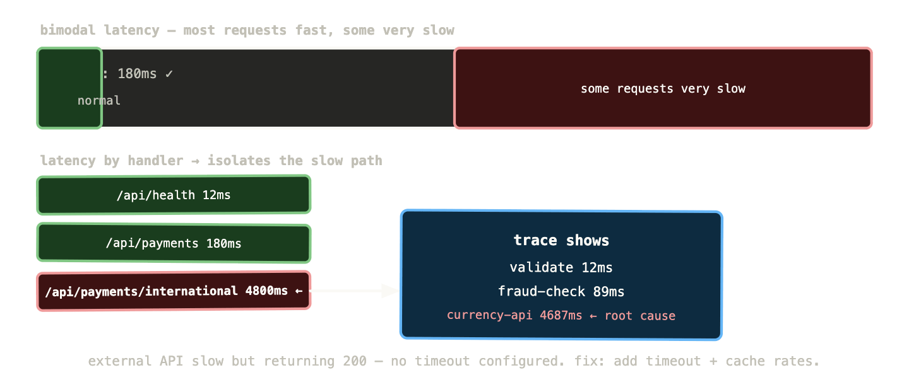
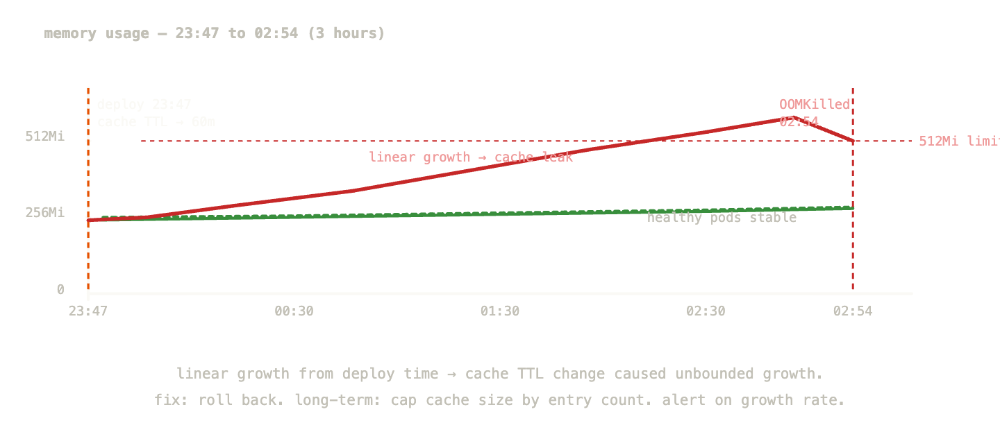
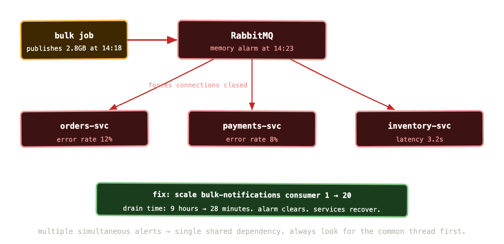

Everything in this series has been building to this. You have Prometheus scraping metrics, Loki collecting logs, Tempo storing traces, and Grafana connecting them. You have dashboards, alerts, and runbooks. Now let’s use them.

This post works through three real incident scenarios — the kind that happen in actual Kubernetes clusters, not contrived tutorial examples. Each one demonstrates the investigation workflow from first alert to root cause, using the actual queries you’d run. The scenarios get progressively more complex: a latency spike with no obvious cause, a slow memory leak leading to an OOMKill, and a cascading failure across multiple services.

The goal isn’t just to show the tools. It’s to show the *process* — how you think through an incident systematically, which signal you look at first and why, and how you avoid the trap of chasing the wrong thing while users are suffering.

## The debugging mindset

Before the scenarios, one framing that shapes everything else.

When something breaks, the instinct is to jump to causes. “The deployment happened right before this — that must be it.” “CPU is high — it must be a resource problem.” Jumping to causes feels productive but it’s often wrong. You’ve anchored on a hypothesis before you understand the symptoms, and confirmation bias does the rest.

The better approach is to start with symptoms and work backwards. What are users experiencing? When did it start? Is it getting worse, better, or steady? Is it affecting all users or a subset? All requests or specific ones? Only then do you start forming hypotheses about causes.

This sounds slow. It’s actually faster, because you don’t spend thirty minutes chasing the wrong cause before going back to look at what was actually happening.

The sequence: symptoms first (RED metrics), then scope (which service, which pods, which users), then mechanism (logs and traces tell you what’s happening), then cause (what changed, what failed, what’s upstream).

## Scenario 1: latency spike with no obvious error rate change

Monday morning. An alert fires: `PaymentsHighP99Latency` — p99 request duration above 2 seconds for 5 minutes. You open the dashboard.

### Step 1: establish the symptom scope

```sql
histogram_quantile(0.99,
  sum by (job, le) (
    rate(http_request_duration_seconds_bucket{
      job="payments-api"
    }[5m])
  )
)
```

The p99 is at 4.2 seconds. p50 is at 180ms — completely normal. The latency distribution has split: most requests are fast, a subset are very slow. This pattern — bimodal latency — is a specific clue. It means some requests are hitting a slow code path or a slow dependency, while others are not.

Error rate:

```sql
sum(rate(http_requests_total{job="payments-api", status=~"5.."}[5m]))
/
sum(rate(http_requests_total{job="payments-api"}[5m]))
```

0.2% — within normal range. Requests are slow but not failing. This eliminates a complete downstream outage.

### Step 2: narrow the scope

Which requests are slow? Add the handler dimension:

```sql
histogram_quantile(0.99,
  sum by (handler, le) (
    rate(http_request_duration_seconds_bucket{
      job="payments-api"
    }[5m])
  )
)
```

Three handlers come back. `/api/health` is 12ms. `/api/payments` is 180ms. `/api/payments/international` is 4.8 seconds. The slow path is isolated to international payments.

### Step 3: find the mechanism in logs

Switch to Loki, time range set to the last 15 minutes, filter to the slow handler:

```
{namespace="payments", app="payments-api"}
  | json
  | handler="/api/payments/international"
  | duration_ms > 2000
```

Log lines appear. They all contain: `upstream_service="currency-exchange-api" duration_ms=4621 status=200`. The international payments handler is calling an external currency exchange API that’s returning slowly. Not failing — returning 200 — but taking 4-5 seconds.

### Step 4: confirm with a trace

Click a `trace_id` from one of the slow log lines. Tempo opens with the full trace:

`POST /api/payments/international 4832ms├─ validate-request 12ms├─ check-fraud 89ms├─ call currency-exchange-api 4687ms ← external API└─ process-payment 44ms`

The trace confirms it. The currency exchange API is slow. Everything else in the payments service is healthy.

**Root cause**: external currency exchange API experiencing latency. Not a Kubernetes problem, not a deployment problem. Impact is limited to international payments. Resolution: add a timeout to the currency exchange API call (it currently has none — it waits indefinitely), cache exchange rates with a short TTL to reduce external call frequency, and alert the external API provider.

**What the investigation taught**: the bimodal latency pattern was the key diagnostic clue. High p99 with normal p50 always means a subset of requests is hitting something different. Handler-level breakdown in PromQL isolated the affected code path in under two minutes. The log query with `duration_ms > 2000` filtered immediately to the slow requests. The trace confirmed the mechanism without any guessing.



## Scenario 2: slow memory leak leading to OOMKill

Wednesday, 3am. PagerDuty fires: `PaymentsHighErrorRate` — error rate jumped to 8% in the last 5 minutes. You’ve been asleep. This needs to be fast.

### Step 1: quick triage

Open the RED dashboard. Error rate at 8% started 6 minutes ago. p99 latency also elevated — 800ms when baseline is 150ms. Request rate is normal. This isn’t a traffic spike.

```sql
kube_deployment_status_replicas_unavailable{
  deployment="payments-api"
}
```

Returns 1. One of three pods is unavailable.

```sql
kube_pod_container_status_last_terminated_reason{
  namespace="payments",
  container="payments-api"
}
```

Returns `OOMKilled`. A pod was killed for exceeding its memory limit. The other two pods are handling the traffic but they’re overloaded — hence the elevated error rate and latency. The third pod is in a restart loop.

### Step 2: understand the memory pattern

This pod was OOMKilled — but was it a sudden spike or a slow leak? Check the memory trend:

```sql
container_memory_working_set_bytes{
  namespace="payments",
  container="payments-api"
}
```

The time series shows three pods. Two are stable at around 380MB. The third — `payments-api-6d8f9-xk2p` — shows a steady linear climb from 380MB at midnight to 512MB (its limit) at 2:54am, when it was killed. Classic memory leak profile.

```sql
container_memory_working_set_bytes{
  namespace="payments",
  container="payments-api"
} / container_spec_memory_limit_bytes{
  namespace="payments",
  container="payments-api"
}
```

This confirms it: the two healthy pods are at 74% of their limit. The recently restarted pod is climbing again — already at 12% and rising.

### Step 3: find what’s leaking in logs

Switch to Loki. Time range: midnight to 2:54am for the affected pod only.

````
{namespace="payments", pod="payments-api-6d8f9-xk2p"}
  | json
  | level != "debug"
```

Scanning for patterns over the three hours. One log line appears repeatedly, increasing in frequency:
```
{"level":"warn","message":"cache eviction threshold reached","cache_size_mb":48,"entries":12847}
````

At midnight: `cache_size_mb: 8`. At 1am: `cache_size_mb: 22`. At 2am: `cache_size_mb: 41`. At 2:50am: `cache_size_mb: 48`. The in-memory cache is growing without bound.

### Step 4: verify with a metric if available

If the application exposes cache size as a gauge (it should):

```sql
payments_cache_size_bytes{
  namespace="payments",
  pod="payments-api-6d8f9-xk2p"
}
```

The metric confirms the log pattern — linear growth since midnight. Cross-referencing with the deployment history in ArgoCD: a release went out at 23:47, twelve minutes before midnight. The release notes mention “increased cache TTL from 5 minutes to 60 minutes.” There it is.

**Immediate mitigation**: roll back the deployment. The cache TTL change caused cached entries to accumulate six times longer before eviction, growing the cache six times larger. At the new TTL, memory usage under normal load exceeds the container limit.

**Long-term fix**: add a maximum cache size by entry count in addition to TTL. Add `payments_cache_size_bytes` to the RED dashboard and add an alert for sustained growth — this should have been caught before it caused an OOMKill.

**What the investigation taught**: OOMKills with a linear memory growth pattern are almost always leaks or misconfigured caches. The `kube_pod_container_status_last_terminated_reason` metric is the fastest way to identify what killed a pod. Cross-correlating the memory growth start time with deployment history is the standard way to find the causal change. A metric for cache size would have allowed an alert to fire before the pod was killed — catch the growth before it becomes an OOMKill.



## Scenario 3: cascading failure across three services

Friday afternoon. Multiple alerts fire simultaneously: `OrdersHighErrorRate`, `PaymentsHighErrorRate`, `InventoryHighLatency`. Three services degraded at the same time. This is either a shared dependency failing or a systemic cluster problem.

Multiple simultaneous alerts are almost always a single root cause. Start there.

### Step 1: find the common thread

When multiple services fail simultaneously, check the things they all share: the database, the message broker, the shared cache, the network, the cluster itself.

```sql
up{job=~"mysql-exporter|rabbitmq-exporter|redis-exporter"}
```

All exporters are up. The exporters themselves are reachable.

```sql
kube_node_status_condition{condition="Ready", status="true"}
```

All nodes are ready.

Check RabbitMQ queue depths — this cluster uses RabbitMQ for async communication between services:

```sql
rabbitmq_queue_messages{vhost="/"}
```

The orders queue: 47,000 messages and growing. The payments queue: 12,000 messages. Normal is under 100 for both. RabbitMQ queues are backing up rapidly.

```sql
rabbitmq_queue_consumers{vhost="/"}
```

Orders queue: 0 consumers. Payments queue: 0 consumers. Every consumer has disconnected.

### Step 2: find why consumers disconnected

Switch to Loki. Query for errors across all three affected services:

```sql
{namespace="orders"}
  | json
  | level="error"
  | line_format "{{.message}}"
```

The log lines are dominated by one error: `AMQP connection error: Exception (320) Reason: "CONNECTION_FORCED - broker forced connection closure with reason 'shutdown'"`. The RabbitMQ broker forced all connections closed.

Check RabbitMQ logs directly:

```sql
{namespace="rabbitmq", app="rabbitmq"}
  | json
  | level != "debug"
```

At 14:23:07: `Discarding message from publisher. Channel closed because of a memory alerm`. At 14:23:08: `vm_memory_high_watermark set. Memory alarm active`. At 14:23:09 through 14:23:15: dozens of `Connection closing due to memory alarm`.

RabbitMQ hit its memory high-watermark and activated the memory alarm. When this happens, RabbitMQ stops accepting new publishes and starts closing connections. All service connections to RabbitMQ were terminated simultaneously.

### Step 3: understand why RabbitMQ hit the memory alarm

```sql
container_memory_working_set_bytes{
  namespace="rabbitmq",
  container="rabbitmq"
} / container_spec_memory_limit_bytes{
  namespace="rabbitmq",
  container="rabbitmq"
}
```

RabbitMQ is at 94% of its memory limit. The high-watermark is configured at 40% of available memory — which in a container is 40% of the limit.

```sql
rabbitmq_queue_messages_bytes{vhost="/", queue="bulk-notifications"}
```

One queue — `bulk-notifications` — contains 2.8GB of messages. This queue normally has near-zero depth. Someone published a bulk notification job at 14:18 that generated 2.8GB of messages faster than consumers could process them. The messages accumulated in memory, hit the watermark, and RabbitMQ shut everything down.

### Step 4: scope the blast radius and triage

The orders, payments, and inventory services all use RabbitMQ for async tasks. Their synchronous HTTP paths still work — the error rate is high because they’re trying to publish to RabbitMQ (which is in alarm state, rejecting all publishes) and failing those operations.

Immediate mitigation options:

Option A: purge the bulk-notifications queue. This loses the bulk job messages but restores RabbitMQ immediately.

Option B: increase RabbitMQ’s memory limit temporarily to give it headroom while consumers drain the queue.

Option C: identify the consumer for bulk-notifications and scale it up to drain the queue faster.

You check how long it would take consumers to drain the queue at the current rate:

```sql
rabbitmq_queue_messages{queue="bulk-notifications"}
/
rabbitmq_queue_messages_ack_rate{queue="bulk-notifications"}
```

At the current ack rate (5 messages/second with 1 consumer), draining 2.8GB takes 9 hours. Not acceptable.

You scale the bulk-notifications consumer Deployment from 1 to 20 replicas. After 2 minutes:

```sql
rabbitmq_queue_messages_ack_rate{queue="bulk-notifications"}
```

Processing rate jumps to 95 messages/second. Estimated drain time: 28 minutes. RabbitMQ memory starts declining. At 14:41, memory drops below the high-watermark. The alarm clears. All three services reconnect automatically. Error rates drop back to baseline within 30 seconds of reconnection.

**Root cause**: unbounded message publishing to a queue without consumer capacity planning. The bulk notification job published 2.8GB of messages faster than the single consumer could process them, causing RabbitMQ memory exhaustion that cascade-disconnected all services.

**Long-term fixes**: rate-limit bulk publishing jobs. Add a `rabbitmq_queue_messages_bytes` alert that fires before a single queue can grow large enough to threaten cluster stability. Scale consumers proportionally to queue depth using KEDA’s RabbitMQ scaler. Add a per-queue memory quota policy in RabbitMQ.



## Building runbooks that actually help at 2am

Each of these scenarios produced a runbook entry. A good runbook doesn’t try to document every possible cause — it documents the specific investigation steps that this alert is most likely to require.

For the OOMKill scenario, the runbook entry looks like this:

```
Alert: ContainerOOMKilled
Severity: page (if replicas < desired)
         ticket (if replicas meeting desired)

Immediate check:
  1. kubectl describe pod -n <namespace> <pod>
     Look for: OOMKilled in Last State
  2. Check memory growth rate:
     container_memory_working_set_bytes{pod="<pod>"} over last 6h
     - Linear growth = likely leak or misconfigured cache
     - Sudden spike = likely load-related or input-triggered

If linear growth:
  3. Check recent deployments in ArgoCD for config changes
  4. Query Loki for cache/memory warnings:
     {namespace="<ns>"} | json | level="warn" | message=~"cache|memory"
  5. If cache-related: roll back the deployment
  6. Temporary: increase memory limit by 50% to buy time

If sudden spike:
  3. Check request volume at time of spike
  4. Look for large payload processing in logs
  5. Add heap profiling if recurring

Escalate to: backend team lead
SLO impact: yes if more than 1 replica affected
```

The key properties: it starts with the fastest diagnostic step (kubectl describe takes 10 seconds), branches on the most common patterns, gives concrete PromQL and LogQL queries to run, and ends with escalation guidance. An engineer who has never seen this specific failure can follow this runbook and make progress.

## The queries worth keeping

Across these three scenarios, a set of queries did most of the diagnostic work. Worth having these accessible during on-call:

**Identify why pods are terminating:**

```sql
kube_pod_container_status_last_terminated_reason{
  namespace="<ns>"
}
```

**Find pods not meeting their replica count:**

```sql
kube_deployment_status_replicas_unavailable > 0
```

**Memory usage trend over time per pod:**

```sql
container_memory_working_set_bytes{
  namespace="<ns>",
  container!=""
}
```

**RabbitMQ consumer count per queue:**

```sql
rabbitmq_queue_consumers{vhost="/"}
```

**Rate of change of queue depth (is it growing or draining?):**

```sql
deriv(rabbitmq_queue_messages{vhost="/"}[10m])
```

Positive = growing. Negative = draining. The magnitude tells you how fast.

**Find all error log lines in a namespace for the last 15 minutes:**

```sql
{namespace="<ns>"} | json | level="error"
```

**Find errors grouped by message to identify the dominant failure:**

```sql
sum by (message) (
  count_over_time(
    {namespace="<ns>"}
    | json
    | level="error"
    [15m]
  )
)
```

**Identify which pod is responsible for elevated resource usage:**

```sql
topk(3,
  container_memory_working_set_bytes{
    namespace="<ns>",
    container!=""
  }
)
```

## The patterns that emerge

After working through enough incidents, patterns emerge in how the investigation unfolds.

**Simultaneous multi-service degradation almost always has one root cause.** The first question is always “what do these services share?” — shared database, shared cache, shared message broker, shared network path. Find the shared dependency before investigating individual service behaviour.

**Bimodal latency means a code path problem, not a resource problem.** When p99 is much higher than p50, look at which requests are slow — they’re hitting something specific. Handler breakdown, user segment breakdown, or geography breakdown will isolate it.

**Linear memory growth means a misconfiguration or a leak, not a load problem.** Load-driven memory issues show correlation with traffic. Time-driven issues (linear growth regardless of traffic) are almost always caches with no eviction, connection pools that don’t release, or accumulating in-memory queues.

**OOMKills that happen every N hours on a regular schedule are almost always a periodic job filling memory.** Check for cron jobs, batch processors, or scheduled tasks running at the interval that matches the restart cycle.

**Connection refused errors at the application layer are almost always Kubernetes-level problems** — pod not ready, service endpoint not updated, network policy blocking traffic. Check pod readiness and endpoint status before assuming an application problem.

## What to remember

Start with symptoms, not causes. What are users experiencing? How severe? How broad? Then scope, then mechanism, then cause. Jumping to causes before understanding symptoms is the most reliable way to waste time during an incident.

The investigation workflow — alert to RED metrics to logs to traces to upstream metrics — is a loop, not a straight line. You’ll cycle through it several times in a complex incident as each signal points you towards the next.

Multiple simultaneous alerts almost always share a single root cause. Find the shared dependency first.

Runbooks are the most valuable artifact you produce during post-incident review. Write them immediately, while the investigation is fresh. The runbook that helps your colleague at 3am is worth more than the prettiest dashboard.

The three scenarios in this post — slow external dependency, memory leak, cascading queue failure — represent a significant fraction of the real incidents you’ll face in a Kubernetes environment. The specific tools and queries shown here will transfer directly to similar situations you encounter.
