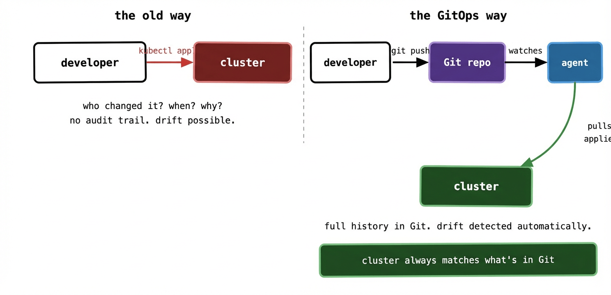

If you’ve been running Kubernetes for a while, you’ve probably settled into a deployment workflow that looks something like this. A developer finishes a feature. CI builds and pushes a new image. Someone — maybe a script, maybe a human — runs `kubectl apply` against the cluster. The new pods roll out. Everyone moves on.

It works. Until it doesn’t.

## The problem with “just applying things”

Here’s a scenario that will be familiar to anyone who’s been on-call for a Kubernetes cluster. Something breaks in production at 11pm. You SSH into your bastion, poke around, find the problem — a misconfigured environment variable — and fix it with a quick `kubectl edit`. The incident resolves. You go to bed.

Three weeks later, someone runs a deployment pipeline that overwrites your manual edit. The same incident happens again. Nobody knows why, because nobody wrote down what you did that night. The cluster state and the state in your deployment scripts have silently diverged, and nobody noticed until production broke.

This is called **drift** — the gap that opens up between what you think is running in your cluster and what’s actually running. It’s the natural consequence of treating your cluster as something you interact with directly, imperatively, on the fly.

The audit trail problem is related but distinct. Even if you’re disciplined about never making manual edits, answering “who changed this, when, and why?” in a traditional setup requires digging through CI logs, Slack threads, and the fading memories of your teammates. There’s no single place that tells you the history of your cluster’s configuration.

## The core GitOps idea

GitOps is a simple reframe: Git is the source of truth for your cluster, not the cluster itself.

Instead of applying changes directly to the cluster, you commit them to a Git repository. An agent running inside the cluster watches that repository and continuously reconciles the cluster state to match what’s in Git. You never push to the cluster — you push to Git, and the cluster pulls.

That’s it. That’s the whole idea. Everything else in GitOps is a consequence of that one shift.

The benefits fall out naturally. Want to know what changed and when? Look at the Git history — it’s a perfect audit log with author, timestamp, and a diff of exactly what changed. Want to roll back a bad deploy? `git revert` and push. Want a new engineer to understand your production setup? Hand them the repo. Want to spin up a new environment that looks identical to production? Point an agent at the same repo and a new target cluster.

The traditional model puts the cluster at the end of a push. Someone — a human or a CI script — reaches out and changes it. In the GitOps model, the cluster is always pulling towards Git. Nobody pushes to the cluster directly. The agent is the only thing that modifies cluster state, and it only does so to match what’s in Git.

## Push-based vs pull-based: why it matters more than you’d think

Most CI/CD pipelines are push-based. Your pipeline builds an image, then uses `kubectl` or Helm to push the changes out to the cluster. This requires your CI system to have credentials to reach the cluster — often fairly broad ones. Every tool in your pipeline chain is a potential vector for someone to modify production.

Pull-based GitOps flips this. The agent runs *inside* the cluster and reaches *out* to Git. Your CI system never touches the cluster directly. It only writes to the Git repository. The blast radius of a compromised CI system shrinks dramatically — the worst it can do is commit bad YAML to Git, which will either fail validation or be caught in a pull request review before it’s merged.

This is a meaningful security improvement, not just an architectural preference. At scale — multiple clusters, multiple teams, many CI pipelines — the push model means handing out cluster credentials to a lot of systems. The pull model means cluster credentials never leave the cluster.

## What drift actually looks like in practice

Drift is insidious because it’s silent. Your cluster doesn’t tell you it’s diverged from your deployment scripts. You only find out when something goes wrong, or when someone audits the cluster and finds things that don’t match the repo.

Common drift sources:

A developer edits a ConfigMap directly with `kubectl edit` to fix an urgent issue, intending to “update the repo later.” They don’t.

An autoscaler changes the replica count on a Deployment. The next deploy resets it to whatever’s in the pipeline script.

Someone patches a running pod to temporarily increase its memory limit during an incident. The pod eventually restarts and goes back to the old limit.

In a GitOps setup, none of these stick. The agent continuously compares what’s running against what’s in Git and corrects any divergence automatically. If you want a change to persist, it has to go through Git. There’s no other path.

## What GitOps is not

It’s worth clearing up a few common misconceptions before they take root.

GitOps is not just “storing your Kubernetes manifests in Git.” Lots of teams do that and still deploy by running `kubectl apply` from a pipeline. That gives you version history but not the continuous reconciliation loop that makes GitOps genuinely powerful. If you’re not running an agent that watches Git and corrects drift, you’re not doing GitOps — you’re just doing source control.

GitOps is not a specific tool. ArgoCD and Flux are the most popular implementations, but the principles apply regardless of the software. The principles matter more than the tool.

GitOps is not a silver bullet for application configuration management. It handles infrastructure and deployment configuration brilliantly. It doesn’t directly solve application-level concerns like feature flags, A/B testing, or runtime configuration changes — those need additional tooling.

And GitOps is not only for Kubernetes. The principles apply anywhere you can describe desired state declaratively and have an agent enforce it. But Kubernetes is by far the most common context you’ll see it applied, and that’s the focus of this series.

## The mental shift

The hardest part of adopting GitOps isn’t the tooling. It’s breaking the habit of reaching for `kubectl` when something needs to change.

For teams used to imperative deployments, the initial instinct in an incident is still to fix things directly in the cluster. GitOps demands a different reflex: make the change in Git, let the agent apply it, observe the result. That feels slower at first. With practice it becomes second nature — and the payoff is that every change is auditable, reversible, and reproducible.

The clusters that are easiest to operate are the ones where nobody is surprised by what’s running, because what’s running is always exactly what’s in the repo. That’s the promise GitOps makes, and when it’s working well, it delivers.

---

In the next post, we’ll get into the four formal principles of GitOps — declarative, versioned, pulled, and continuously reconciled — and look at what each one actually means in a running system.
