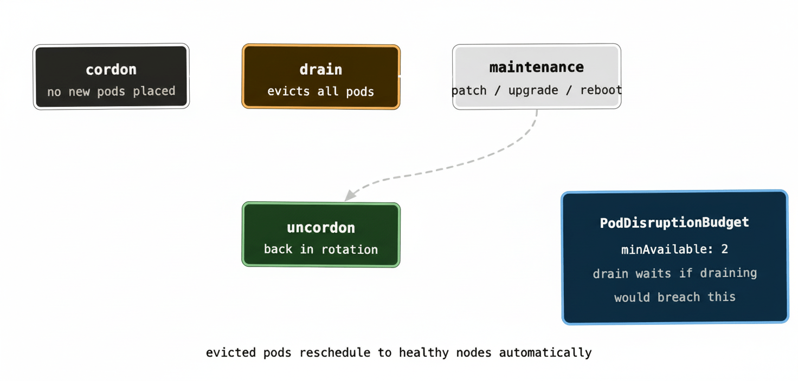

The first nine posts in this series covered the building blocks — pods, deployments, services, storage, health checks. If you’ve followed along, you have a solid mental model of how Kubernetes works. But there’s a gap between understanding the platform and actually running it in production, and that gap is where most of the real operational complexity lives.

Day-2 is the industry term for everything that happens after “it’s deployed and working.” Upgrades, scaling, access control, observability, incident response. The stuff that doesn’t show up in getting-started tutorials but accounts for the majority of time spent running a Kubernetes platform at any serious scale.

This post covers the most important day-2 concerns — not exhaustively, but enough to know what you’re walking into.

## Namespaces and multi-tenancy

Namespaces are Kubernetes’ mechanism for dividing a single cluster into logical partitions. Every object — pods, services, deployments, configmaps — lives in a namespace. The default namespace is called, helpfully, `default`, but in any real cluster you’ll create your own.

The most common pattern is one namespace per team or per application, sometimes both. The `payments` team gets a `payments` namespace. The `platform` team gets `platform-system`. Staging and production might live in separate clusters entirely, or in separate namespaces on a shared cluster depending on your isolation requirements.

Namespaces give you several things. Resource quotas can be applied per namespace — the `team-payments` namespace gets 32 cores and 64Gi of memory, and can’t consume more regardless of what else is happening on the cluster. RBAC policies scope to namespaces — the payments team has full access to the `payments` namespace and no access to anything else. And names only need to be unique within a namespace, so `api-service` in `payments` and `api-service` in `orders` coexist happily.

What namespaces don’t give you is hard network isolation. By default, pods in any namespace can talk to pods in any other namespace. For real network isolation you need NetworkPolicy objects — something worth adding to your security posture once the basics are in place.

## RBAC: who can do what

Role-Based Access Control is how you control who (or what) can interact with which Kubernetes resources. It’s built around four objects: Roles, ClusterRoles, RoleBindings, and ClusterRoleBindings.

A **Role** defines a set of permissions within a namespace — “can read pods, can list services, can create deployments.” A **ClusterRole** is the same idea but applies cluster-wide or can be bound into specific namespaces. A **RoleBinding** attaches a Role to a user, group, or service account. A **ClusterRoleBinding** does the same for ClusterRoles.

```yaml
apiVersion: rbac.authorization.k8s.io/v1
kind: Role
metadata:
  namespace: payments
  name: developer
rules:
  - apiGroups: ["apps"]
    resources: ["deployments"]
    verbs: ["get", "list", "watch", "create", "update"]
  - apiGroups: [""]
    resources: ["pods", "pods/logs"]
    verbs: ["get", "list", "watch"]
```

In practice, RBAC tends to evolve from “everyone gets cluster-admin because it’s easier” to “we had a production incident caused by someone deleting the wrong thing and now we’re fixing it.” Starting with least-privilege from day one is considerably less painful.

Service accounts matter here too — every pod runs as a service account, and that service account’s RBAC permissions determine what the pod can do against the Kubernetes API. A pod that needs to watch ConfigMap changes needs read access to ConfigMaps. A pod that dynamically provisions resources needs broader permissions. Giving every pod the default service account with no thought is a common security gap.

## Horizontal Pod Autoscaler

Manual scaling — updating `replicas: 3` to `replicas: 10` when traffic spikes — works but it requires a human in the loop. The Horizontal Pod Autoscaler (HPA) automates this based on metrics.

The classic setup scales on CPU utilisation:

```yaml
apiVersion: autoscaling/v2
kind: HorizontalPodAutoscaler
metadata:
  name: api-hpa
spec:
  scaleTargetRef:
    apiVersion: apps/v1
    kind: Deployment
    name: my-api
  minReplicas: 3
  maxReplicas: 20
  metrics:
    - type: Resource
      resource:
        name: cpu
        target:
          type: Utilization
          averageUtilization: 70
```

When average CPU across the pods exceeds 70%, the HPA adds replicas. When it drops back down, it removes them. The `minReplicas` floor ensures you always have enough capacity for baseline traffic; `maxReplicas` puts a ceiling on cost and prevents runaway scaling from a buggy metric.

HPA can also scale on custom metrics — queue depth, request latency, active connections. This is where it gets genuinely powerful. An HPA that scales your queue consumers based on RabbitMQ queue depth means your processing capacity automatically tracks your workload without any human involvement. KEDA (Kubernetes Event-Driven Autoscaling) extends this further, with pre-built scalers for dozens of sources including RabbitMQ, Kafka, and cloud provider queues.

The catch: HPA only works well if your resource requests are accurate. It calculates utilisation as actual usage divided by requested amount. If your requests are set too low, the HPA thinks everything is fine right up until the node runs out of memory. Back to post 08.

## Node upgrades: drain and cordon

Kubernetes nodes need maintenance. OS patches, kernel upgrades, Kubernetes version bumps. The mechanism for taking a node out of service gracefully is drain and cordon.

**Cordon** marks a node as unschedulable — the scheduler stops placing new pods on it, but existing pods keep running. This is your first step before any maintenance: `kubectl cordon node-3`.

**Drain** goes further — it evicts all the pods currently running on the node (respecting PodDisruptionBudgets, which we’ll get to) and marks it unschedulable. Once drained, the node has no running workloads and can be safely upgraded, rebooted, or replaced.

```shell
kubectl cordon node-3
kubectl drain node-3 --ignore-daemonsets --delete-emptydir-data
```

The `--ignore-daemonsets` flag is necessary because DaemonSet pods can’t be evicted — they’re supposed to run on every node. The `--delete-emptydir-data` flag allows eviction of pods using ephemeral `emptyDir` volumes, with the understanding that data will be lost.

Once maintenance is complete: `kubectl uncordon node-3` brings the node back into rotation.

**PodDisruptionBudgets (PDBs)** are the safety mechanism that makes drain civilised. A PDB specifies how much disruption a Deployment can tolerate during voluntary operations like drains. `minAvailable: 2` means at least 2 replicas must be running at all times — if draining a node would take you below that, the drain waits until other nodes have room to accept the evicted pods.

```yaml
apiVersion: policy/v1
kind: PodDisruptionBudget
metadata:
  name: api-pdb
spec:
  minAvailable: 2
  selector:
    matchLabels:
      app: my-api
```

Without PDBs, a drain could evict all replicas of a service simultaneously if they happened to all be on the same node. PDBs are a cheap, powerful way to ensure that cluster maintenance operations don’t cause unexpected downtime.



At scale — running 20+ clusters with rolling Kubernetes version upgrades — the drain/cordon workflow becomes something you automate entirely. Tools like Cluster Autoscaler can handle node replacement automatically: spin up a new node on the newer version, drain an old node, let it terminate. Done across hundreds of nodes without manual intervention.

## Observability: metrics, logs, and traces

Kubernetes itself exposes a lot of operational data, but it doesn’t come with a full observability stack out of the box. You build one.

**Metrics** are the foundation. The de facto standard is Prometheus, which scrapes metrics from your pods and from Kubernetes system components. Grafana visualises them. The `kube-state-metrics` exporter translates Kubernetes object state (deployment replica counts, pod status, PVC binding state) into Prometheus metrics. Between these three you get dashboards for everything from cluster-level resource utilisation down to individual pod health.

A quick sanity check during any incident:

```shell
kubectl top nodes          # actual node resource usage
kubectl top pods -n mynamespace   # actual pod resource usage
kubectl get events -n mynamespace --sort-by='.lastTimestamp'
```

`kubectl top` gives you actual usage (from the metrics-server, not from requests). Events show you what Kubernetes has been doing — pod evictions, failed scheduling, image pull failures. Events are time-limited and roll off after an hour by default, so checking them early in an incident is important.

**Logs** in Kubernetes are ephemeral by the same logic as pods — when a pod dies, its logs die with it. A central log aggregation pipeline is therefore not optional for production. Fluent Bit or Fluentd as a DaemonSet, shipping logs to Elasticsearch, Loki, Splunk, or your cloud provider’s logging service, is the standard pattern. The DaemonSet ensures log collection runs on every node automatically, including new nodes as they join.

**Distributed tracing** becomes important once you have enough microservices that understanding a request’s path through the system matters. OpenTelemetry is the emerging standard — instrumentation libraries for most languages, exporters to Jaeger, Tempo, or commercial APM tools. At the scale where you have dozens of services talking to each other, tracing is the only practical way to understand why a particular request took 4 seconds.

## Where to go next

Three technologies are worth knowing about once the fundamentals are solid.

**Helm** is the package manager for Kubernetes. Instead of maintaining raw YAML files for every service, Helm lets you define parameterised templates — charts — that can be installed, upgraded, and rolled back as versioned units. Most open-source software that runs on Kubernetes ships a Helm chart. It’s almost universally used in production environments and worth learning early.

**Operators** extend Kubernetes with custom resources and controllers that encode operational knowledge about a specific piece of software. A RabbitMQ Operator, for example, knows how to bootstrap a cluster, handle node failures, perform rolling upgrades, and scale the cluster — all expressed as Kubernetes-native objects you manage with `kubectl`. Operators are what make running complex stateful systems in Kubernetes viable at scale without requiring the people running them to be deep experts in every system they operate.

**GitOps** is an operational model where your desired cluster state lives in Git, and a tool like ArgoCD or Flux continuously reconciles the live cluster state against what’s in the repository. Pull requests become the mechanism for all cluster changes. The audit trail is your Git history. Drift between what’s in Git and what’s running gets detected and corrected automatically. At the scale of many clusters and many teams, GitOps is the only approach that stays manageable — trying to track what’s running across 20 clusters without a source of truth is a losing proposition.

## The honest picture

Running Kubernetes in production is genuinely complex. There are a lot of moving parts, the failure modes are subtle, and the operational surface area is large. Teams new to it routinely underestimate the investment required — not just in setting it up, but in developing the operational muscle memory to run it confidently.

That said, the complexity is mostly upfront. Once you’ve established your RBAC policies, your observability stack, your autoscaling configuration, and your GitOps workflow, day-to-day operations become surprisingly routine. The platform handles the toil — restarting crashed pods, rescheduling from failed nodes, scaling with traffic — and your job shifts from firefighting to tuning.

The teams that struggle with Kubernetes long-term are usually the ones who treated it as a deployment detail rather than a platform investment. Getting the fundamentals right — the things covered across this series — is what makes the difference between a cluster that’s a constant source of pain and one that quietly does its job.
