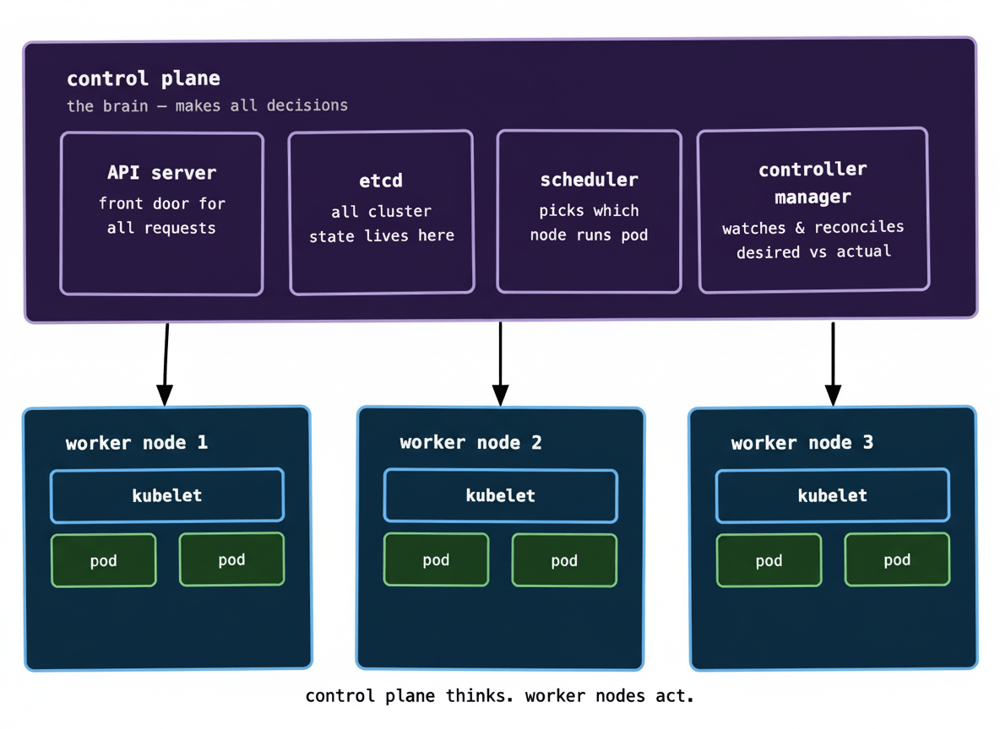
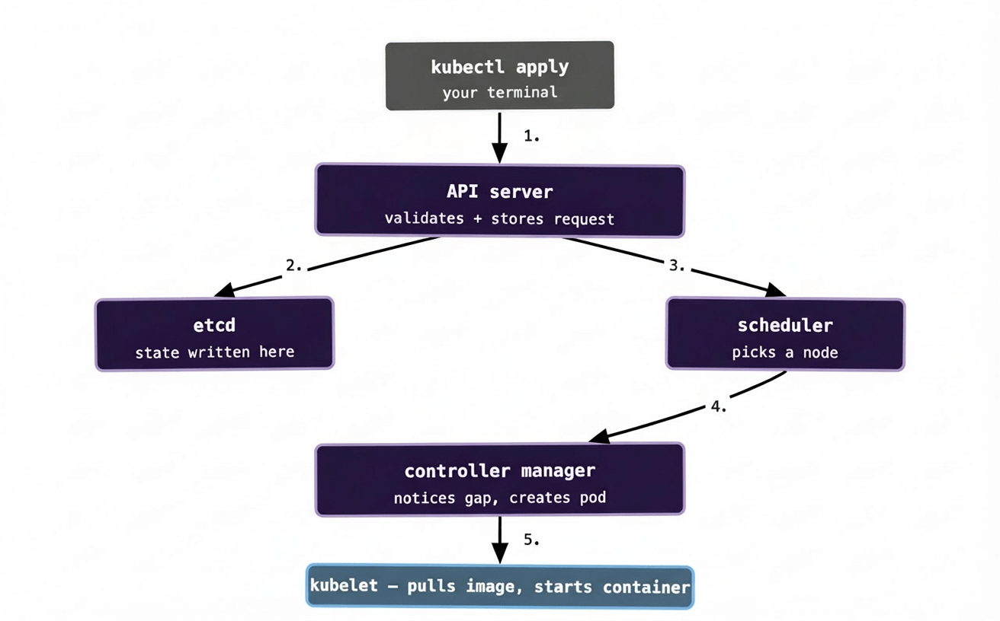

In the last post we talked about *why* Kubernetes exists — the bin-packing chaos that happens when you’re running a lot of containers across a lot of servers without any coordination layer. Now let’s look at how Kubernetes is actually built, because understanding the structure helps enormously when something goes wrong at 2am and you’re trying to figure out which part of the system is misbehaving.

The mental model is simple: Kubernetes has a brain and it has muscle. The brain is called the **control plane**. The muscle is called the **worker nodes**. They have completely different jobs and they run on different machines.

## The control plane: the brain

The control plane is where all the decisions get made. It doesn’t run your application code — it just thinks. It tracks what’s running, decides where new things should run, and constantly watches for anything that doesn’t match what you asked for.

It’s made up of four main components. You don’t need to memorise these on day one, but knowing roughly what each one does will save you a lot of confusion when you’re reading logs or docs.

**The API server** is the front door to everything. Every request — whether it comes from you running `kubectl get pods`, a CI pipeline deploying a new version, or an internal Kubernetes component checking in — goes through the API server first. Nothing in the cluster talks to anything else directly. It all goes through the API server. Think of it like the reception desk at a very organised company.

**etcd** is a key-value store that holds the entire state of your cluster. Every piece of information Kubernetes knows — what’s running, what’s supposed to be running, what configuration exists — lives in etcd. This is also why etcd is the thing you most want to make sure you’re backing up. If your cluster disappears but your etcd data survives, you can rebuild. If etcd goes, the cluster’s memory of itself goes with it.

**The scheduler** watches for newly created workloads that haven’t been assigned to a node yet, and picks where they should go. It factors in how much CPU and memory each node has available, whether the workload has any constraints (like “only run on nodes in this availability zone”), and a handful of other rules. The scheduler doesn’t start containers — it just makes the assignment decision and writes it into etcd.

**The controller manager** is a collection of control loops running continuously in the background. Each controller watches one specific thing and tries to reconcile it. The deployment controller watches for deployments that need updating. The node controller watches for nodes that go offline. The replica controller watches for pods that have crashed and need replacing. They all work the same way: observe the current state, compare it to the desired state, do whatever’s needed to close the gap.

That last pattern — observe, compare, reconcile — is the fundamental loop that Kubernetes runs on. Once it clicks, a lot of the platform’s behaviour becomes much more intuitive.

## Worker nodes: the muscle

Worker nodes are where your actual application containers run. They could be physical servers, VMs in a cloud provider, or even a Raspberry Pi if you’re feeling adventurous. From Kubernetes’ perspective, they’re just a pool of compute capacity.

Every worker node runs one critical process: the **kubelet**. The kubelet is the agent that keeps the control plane and the node in sync. It registers the node with the API server (“I’m here, I have 4 CPU cores and 16GB of RAM”), receives instructions for which containers to run, starts them, and reports their health back up to the control plane.

The kubelet doesn’t make decisions — it just executes them. The control plane decides what should run; the kubelet makes it happen on its node.

Worker nodes also run **kube-proxy**, which handles networking and makes sure traffic can reach the right containers — but we’ll get into networking properly when we talk about Services in post 05.

## How a request actually flows

Here’s where it gets interesting. Let’s trace what actually happens when you run `kubectl apply -f deployment.yaml`:

Walking through it step by step:

Your `kubectl apply` command sends a request to the API server with your YAML describing what you want. The API server validates it (is this valid Kubernetes syntax? do you have permission to do this?) and writes it into etcd. At this point, Kubernetes has *recorded* your desired state — but nothing is actually running yet.

The scheduler is watching etcd for newly-created workloads that haven’t been assigned to a node. It sees your new workload, evaluates the available nodes, picks the best fit, and writes the assignment back into etcd.

The controller manager is also watching etcd. The deployment controller notices that your deployment now specifies 3 running pods but 0 actually exist — that gap triggers it to create the pods. It writes those pod definitions into etcd.

The kubelet on the assigned node is polling the API server constantly. It notices it has a new pod to run, pulls the container image, starts the container, and begins reporting its status back. Within a few seconds, your container is running.

The whole thing feels instantaneous from your perspective, but there are five distinct steps happening in sequence, each involving a different component. Understanding this is genuinely useful — when a deployment hangs, knowing which step it’s stuck on tells you immediately where to look.

## What happens when the control plane goes down?

This is a question worth asking early. If the control plane dies — say the nodes running it lose power — your existing workloads keep running. The containers already on the worker nodes don’t disappear. The kubelets keep them alive.

What you *can’t* do is make any changes. No new deployments. No scaling. No rollbacks. The cluster is effectively frozen in its last known good state until the control plane recovers. This is why production clusters run the control plane in a highly available configuration — typically three control plane nodes, so one can die without the others losing quorum.

At enterprise scale, with hundreds of clusters across 20+ Kubernetes environments, this distinction matters enormously. A control plane blip during a deployment window is a very different situation from one that happens at idle — in the first case, you might have half-deployed workloads stuck mid-rollout. In the second, your users probably notice nothing.

## A note on managed Kubernetes

If you’re using EKS (AWS), GKE (Google Cloud), or AKS (Azure), you never actually interact with the control plane directly. The cloud provider runs it, maintains it, upgrades it, and keeps it highly available for you. You just get the API endpoint and the worker nodes. This is one of the big reasons managed Kubernetes has become the default — running your own control plane adds real operational burden that most teams don’t need.

## The important bit to carry forward

Before we move on to pods in the next post, hold onto these two ideas:

The control plane thinks, the worker nodes act. No component reaches out and starts doing work on its own initiative — everything flows through the API server and gets written into etcd first.

And: Kubernetes is always trying to make reality match what you asked for. Every component in the control plane is doing some version of “look at the desired state, look at the actual state, close the gap.” That loop runs constantly, which is why Kubernetes can recover from failures automatically — it doesn’t need a human to notice something went wrong. It already noticed.

Next up: pods — the smallest unit of work in Kubernetes, and why they’re slightly more interesting than “just a container.”
