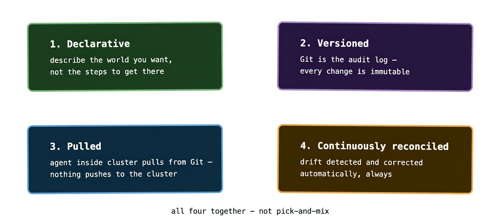
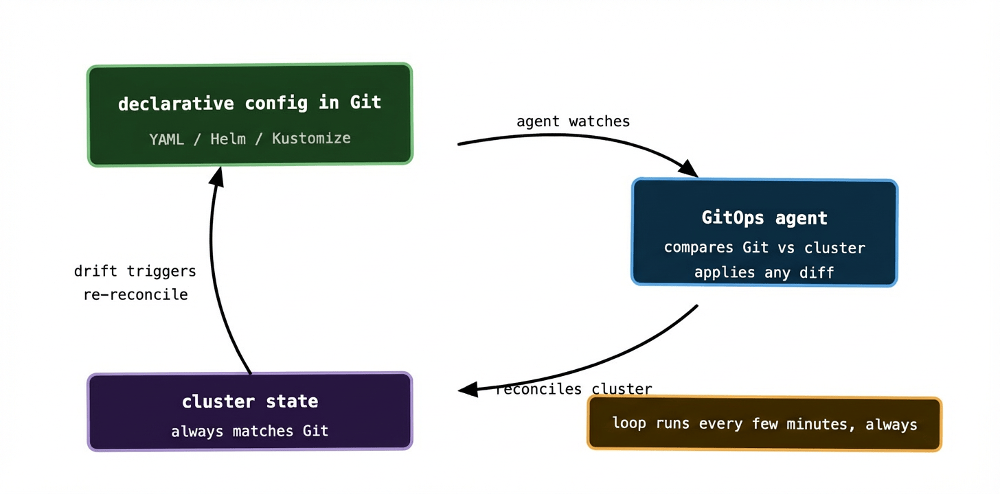

GitOps gets thrown around a lot as a buzzword, which means it gets applied to a lot of things that aren’t quite it. “We store our manifests in Git” — not quite. “Our CI pipeline runs kubectl apply” — closer, but still no. “We use ArgoCD” — probably, but not automatically.

The OpenGitOps project — the group that’s tried to formalise what GitOps actually means — defines it around four principles. They’re worth understanding properly, because they’re the difference between a team that’s doing GitOps and a team that’s doing source-controlled imperative deployments and calling it GitOps.

## Principle 1: Declarative

A GitOps system must describe the desired state of the system declaratively, not imperatively.

The distinction is important. An imperative instruction says *how* to get somewhere: “delete the old pods, pull the new image, start three new pods, wait for them to be healthy.” A declarative instruction says *where* you want to end up: “I want three pods running image v2.4.1.”

Kubernetes YAML is declarative. You describe the world you want, not the steps to create it. Helm charts are declarative. Kustomize overlays are declarative. A bash script that calls `kubectl` commands in sequence is not — it’s imperative, even if it lives in Git.

The reason declarative matters for GitOps is that it enables the reconciliation loop. If you’ve described desired state, an agent can compare it to actual state and close the gap. If you’ve written imperative steps, an agent can’t meaningfully “reconcile” them — it can only run them again, which might have unintended side effects.

This principle also means you need to be thoughtful about what goes in your Git repo. Raw `kubectl` commands, shell scripts, and Helm hooks that run arbitrary code are all leaking imperative thinking into what should be a declarative system. The goal is a repo where every file is a description of what should exist, not a set of instructions for how to create it.

## Principle 2: Versioned and immutable

The desired state must be stored in a way that enforces immutability and retains a complete version history. In practice: Git.

Git gives you three things that matter here. Every commit is immutable — you can’t rewrite history without leaving a trace. Every change has an author, a timestamp, and a message. And every previous state is reachable — you can check out any commit and see exactly what the cluster configuration looked like at that moment.

This turns Git into your audit log. Not a separate audit log that you have to remember to write to — the actual log, automatically maintained, with cryptographic integrity. When your security team asks “who changed the replica count on the payments service last Tuesday?”, the answer is a `git log` away.

The immutability principle is also what makes rollbacks trivially easy. A bad deploy isn’t a crisis that requires careful manual intervention — it’s a `git revert` followed by a push. The agent sees the revert, reconciles the cluster back to the previous state, and you’re done. No runbook required.

## Principle 3: Pulled automatically

Changes must be applied by an agent that pulls from Git — not pushed by an external system.

This is the principle that most cleanly separates GitOps from “CI/CD that happens to use Git.” A traditional pipeline pushes changes to the cluster: the pipeline runs, authenticates to Kubernetes, and applies manifests. A GitOps agent pulls changes from Git: it runs inside the cluster, watches the repository, and applies anything that’s changed.

The pull model has two consequences that compound nicely. First, as covered in the last post, cluster credentials never leave the cluster — your CI system doesn’t need them. Second, the agent applies changes continuously, not just when a pipeline runs. If someone manually edits a resource in the cluster, the agent notices the divergence from Git and corrects it — even if no pipeline has run since the manual edit.

The “automatically” part matters too. The agent doesn’t wait to be told to reconcile — it polls Git on a schedule (typically every few minutes) or uses webhooks to be notified of changes immediately. The cluster is always working its way towards Git, not just when you remember to trigger a deploy.

## Principle 4: Continuously reconciled

Software agents must continuously observe the actual state of the system and attempt to apply the desired state.

This is the reconciliation loop from Kubernetes post 02, applied at the deployment level. The agent observes what’s running, compares it to what’s in Git, and closes any gap it finds. It does this forever, on a loop, not just once at deploy time.

The word “continuously” does a lot of work here. It means the system is self-healing at the configuration level, not just the pod level. Kubernetes restarts a crashed pod — that’s runtime self-healing. GitOps corrects a drifted Deployment spec — that’s configuration self-healing. Together they cover a much larger surface area of failure modes than either does alone.

It also means the desired state in Git is always authoritative. If you want to understand what’s running in your cluster, you don’t need to query the cluster — you read the Git repo. The two should always match, and if they don’t, the system is actively working to fix that.

## How the four principles work together

They’re designed to be applied together, not picked individually. A system that’s declarative and versioned but pushes imperatively isn’t GitOps — it’s a well-organised CI/CD pipeline. A system that pulls automatically but doesn’t store history immutably loses the audit trail. A system that reconciles continuously but allows imperative patches will eventually drift.

The four principles form a closed loop:

You commit declarative config to Git (principle 1). That commit is immutable and versioned (principle 2). An agent running inside the cluster watches Git and pulls any changes (principle 3). The agent continuously compares what’s in Git to what’s running and corrects any divergence (principle 4). If something drifts — a manual edit, a node failure, a runaway autoscaler — the loop catches it on the next reconciliation pass and corrects it.

The loop doesn’t stop. It runs every few minutes whether anything has changed or not. Most of the time it finds nothing to do. Occasionally it finds drift and fixes it silently. Rarely it finds a change you just pushed and applies it. From the outside it looks like magic — the cluster just always matches what you put in Git.

## Where teams trip up

Understanding the principles in theory is one thing. Applying them consistently is another. A few common places where teams fall short:

**Partial adoption.** They set up ArgoCD for their main application but keep deploying shared infrastructure (CRDs, namespaces, cluster-level RBAC) imperatively. These imperative changes accumulate outside of Git and become invisible drift. The fix is to be ruthless: everything goes through Git, or the model breaks down.

**Escape hatches.** Under pressure — an incident, a tight deadline — the instinct is to patch the cluster directly. “I’ll update Git afterwards.” Afterwards rarely comes. The way to prevent this is to treat direct cluster access as a break-glass procedure with actual process around it, not a casual option.

**Treating Git like a deployment trigger rather than the source of truth.** If your pipeline writes to Git and immediately runs a deploy rather than letting the agent reconcile, you’ve still got a push-based model with Git in the middle. The point is that Git is authoritative — what’s in Git at any point in time should match what’s in the cluster, not what a pipeline last ran.

**Not closing the drift detection loop.** Running an agent that applies changes is only half of principle 4. The other half is alerting when reconciliation fails or when the agent detects drift it can’t automatically fix. If nobody knows drift is happening, the self-healing value is largely lost. Both ArgoCD and Flux expose metrics and status that should be wired into your alerting stack.

## What “done” looks like

A team operating on all four principles has a codebase where:

Every piece of cluster configuration is in a Git repository. There is no “source of truth” in anyone’s head, on a shared drive, or in a wiki. Pull requests are how configuration changes happen. The Git history is the deployment history. When something breaks, the first question is “what changed in Git?” not “who ran what command?” And when you need to spin up a new cluster or recover from a disaster, you point an agent at the repo and wait.

That last point is where the investment pays off most clearly. A cluster that’s fully managed by GitOps is reproducible almost by definition. The repo is the recipe. Any cluster that applies it ends up in the same state.

---

Next up: ArgoCD — the most widely-used GitOps controller, how it’s built, and how to set up your first Application.
