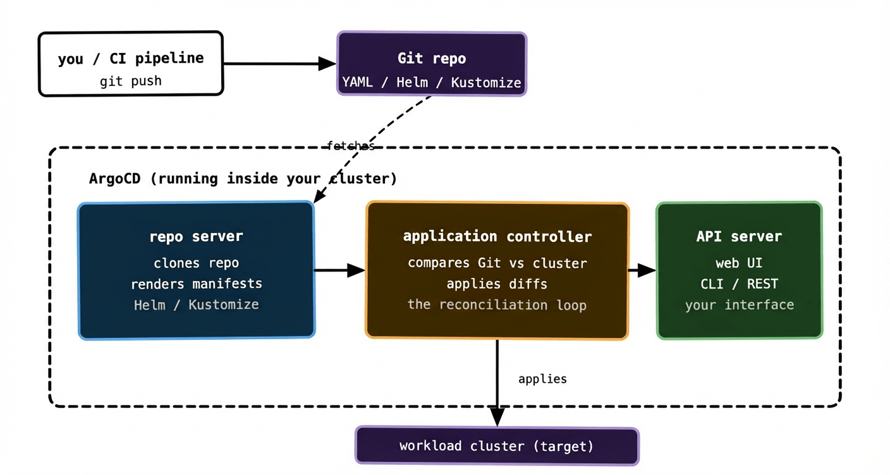
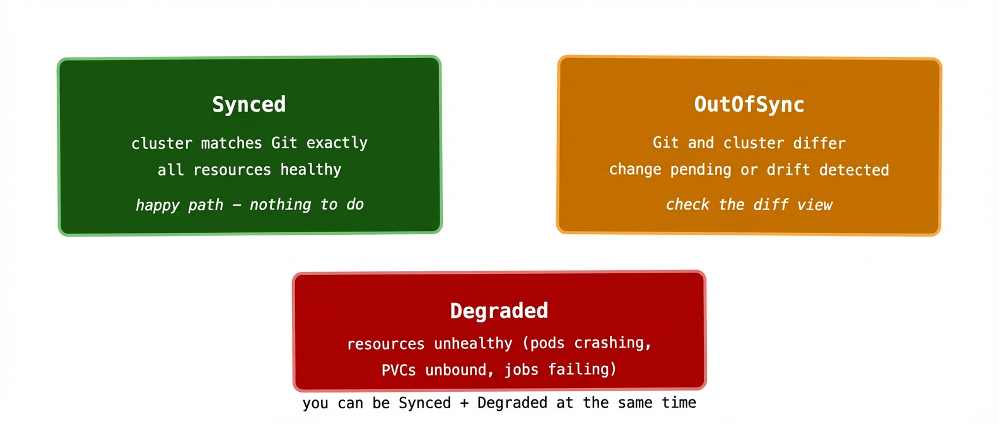

The last two posts covered the theory. GitOps is a good idea. The four principles make sense. Now let’s talk about the software that actually implements it.

ArgoCD is the most widely used GitOps controller for Kubernetes. It watches a Git repository, compares what’s there to what’s running in your cluster, and continuously reconciles the two. It also comes with a genuinely useful web UI — which, in a world of Kubernetes tooling that’s often CLI-only, is a pleasant surprise.

This post covers how ArgoCD is built, what the core objects look like, and how to read its status when something isn’t right.

## How ArgoCD is structured

ArgoCD runs inside your Kubernetes cluster as a set of components. Three are worth knowing about.

The **repository server** is responsible for fetching and rendering your Git repository content. It clones the repo, runs Helm or Kustomize if needed, and produces the final set of Kubernetes manifests that should be applied. It caches rendered manifests so it isn’t re-cloning on every reconciliation cycle.

The **application controller** is the heart of the system. It watches both the Git repository (via the repo server) and the live cluster state, compares the two, and applies any differences. This is the reconciliation loop running continuously. It’s also what detects drift — if someone manually edits a resource in the cluster, the application controller notices immediately.

The **API server** exposes the ArgoCD interface — both the web UI and the CLI (`argocd` CLI tool). It’s how you interact with ArgoCD: creating Applications, triggering syncs, checking status, managing access.



One thing worth noting: ArgoCD can manage multiple clusters from a single installation. The ArgoCD components run in one cluster — often called the management cluster — and the application controller reaches out to apply manifests to one or more target clusters. In a simple setup the management cluster and the target cluster are the same. At scale they’re often separate.

## The Application object

The core ArgoCD resource is the `Application`. It’s a Kubernetes custom resource that connects a Git source to a cluster destination. Here’s a minimal example:

yaml

```
apiVersion: argoproj.io/v1alpha1
kind: Application
metadata:
  name: payments-api
  namespace: argocd
spec:
  project: default
  source:
    repoURL: https://github.com/my-org/my-config-repo
    targetRevision: HEAD
    path: apps/payments-api/overlays/production
  destination:
    server: https://kubernetes.default.svc
    namespace: payments
  syncPolicy:
    automated:
      prune: true
      selfHeal: true
```

Read through it in plain English: “Watch the `apps/payments-api/overlays/production` directory in this Git repo, always at HEAD. Apply whatever’s there to the `payments` namespace on this cluster. Do it automatically, remove any resources that disappear from Git, and correct any drift.”

That’s an entire deployment pipeline in about 20 lines of YAML.

The `source` block is where you point ArgoCD at your Git repo and tell it which path within the repo to care about. A single repo can have many paths, each managed by a different Application. This is the foundation of the monorepo pattern we’ll cover in post 04.

The `destination` block tells ArgoCD which cluster and namespace to deploy into. `https://kubernetes.default.svc` is shorthand for “the cluster ArgoCD itself is running in.”

The `syncPolicy` block is where things get interesting.

## Sync policies: manual vs automatic

ArgoCD gives you a choice about how and when changes are applied.

**Manual sync** means ArgoCD watches Git and detects drift, but it doesn’t apply anything until you tell it to — either by clicking “Sync” in the UI, running `argocd app sync`, or triggering it via the API. This is the safer starting point for teams new to GitOps. You get all the drift detection and visibility benefits without the system automatically applying every Git commit to production.

**Automatic sync** means ArgoCD applies changes as soon as it detects them in Git, without human intervention. This is the full GitOps model. It requires you to trust your Git workflow — pull request reviews, branch protection, CI checks — to be the gate that keeps bad changes out. If those controls are solid, automatic sync is where you want to be.

Two flags on automatic sync are worth understanding:

`prune: true` means that if a resource exists in the cluster but no longer exists in Git, ArgoCD deletes it. Without this, deleted resources accumulate in the cluster silently. With it, Git is truly the source of truth — something exists in the cluster if and only if it exists in Git.

`selfHeal: true` means that if someone manually edits a resource in the cluster, ArgoCD reverts it to match Git within a few minutes. This enforces the GitOps discipline mechanically — the cluster can’t drift even if someone tries to make it. Somewhat controversial for teams in the middle of adopting GitOps, because it removes the escape hatch of quick manual fixes. Which is, of course, precisely the point.

## Reading ArgoCD status

Once you have Applications running, you’ll spend time reading their status. There are three states to know.

**Synced** means the cluster matches Git. Everything is as it should be. This is the happy path — the green state in the UI.

**OutOfSync** means ArgoCD has detected a difference between what’s in Git and what’s running in the cluster. This might be because you’ve just pushed a change and the sync hasn’t happened yet. Or it might mean someone has manually edited a resource. Or it might mean a resource was deleted from Git but not yet pruned from the cluster. ArgoCD’s diff view shows you exactly what the difference is — which fields, and what changed.

**Degraded** means something is wrong with the application’s health, not just its sync state. ArgoCD evaluates the health of Kubernetes resources — are Deployments healthy, are PVCs bound, are Jobs complete — and surfaces a Degraded status if something isn’t right. You can be Synced and Degraded simultaneously: the cluster matches Git, but what Git describes is itself broken.



The Synced + Degraded combination is the one that confuses people most. It means “what you asked for is applied, but what you asked for is broken.” The fix is in Git — update the manifests to describe something that actually works — not in the cluster directly.

There’s also a sync **health** vs **status** split worth knowing: sync status (Synced/OutOfSync) tracks whether Git and the cluster match. Health status (Healthy/Degraded/Progressing/Missing) tracks whether the resources themselves are in a good state. Both matter and they’re shown separately in the UI.

## Flux: the other major option

Any honest ArgoCD post has to mention Flux, because it’s the other widely-used GitOps controller and it makes different design choices.

Flux is more modular — it’s built from a set of composable controllers (source controller, kustomize controller, helm controller, notification controller) that you can mix and match. ArgoCD is more monolithic — a single opinionated system with the UI bundled in.

Flux has no built-in web UI. You interact with it via CLI and by reading Kubernetes resources directly. For teams that live in the terminal and prefer GitOps-native workflows this is fine, but for teams that want visibility without kubectl-ing around, ArgoCD’s UI is a real advantage.

Flux is generally considered more Kubernetes-native — its resources follow standard Kubernetes conventions more closely, and it integrates more naturally with tools like Crossplane. ArgoCD has a richer ecosystem of plugins and a more established UI workflow.

The honest answer to “which should I use” is: if you’re starting fresh and want good visibility from day one, start with ArgoCD. If you’re building a platform for other teams and want maximum composability, look hard at Flux. Both implement the GitOps principles correctly. Both are production-ready at serious scale.

## Getting started in practice

Installing ArgoCD is a single kubectl apply:

```
kubectl create namespace argocd
kubectl apply -n argocd -f \
  https://raw.githubusercontent.com/argoproj/argo-cd/stable/manifests/install.yaml
```

Then port-forward to reach the UI:

```
kubectl port-forward svc/argocd-server -n argocd 8080:443
```

The initial admin password is stored in a secret:

```
kubectl get secret argocd-initial-admin-secret \
  -n argocd -o jsonpath="{.data.password}" | base64 -d
```

Log in, create your first Application pointing at a Git repo, and watch ArgoCD sync it. The first time you see the UI go from OutOfSync to Synced — with a live diff showing exactly what changed — the whole model clicks into place in a way that reading about it doesn’t quite capture.

## What to remember

ArgoCD is three components: the repo server fetches and renders Git content, the application controller runs the reconciliation loop, and the API server is your interface to the whole thing.

The `Application` resource is the glue — it connects a Git source to a cluster destination and defines how aggressively to sync. Start with manual sync, graduate to automatic once your Git workflow is solid.

Three statuses matter: Synced (all good), OutOfSync (something differs from Git), Degraded (something is unhealthy). You can be Synced and Degraded at the same time, which means the problem is in what Git describes, not how it’s being applied.

Next up: structuring your Git repository — monorepo vs multi-repo, how to lay out environments, and how a change flows from dev to production without everything becoming a mess.
