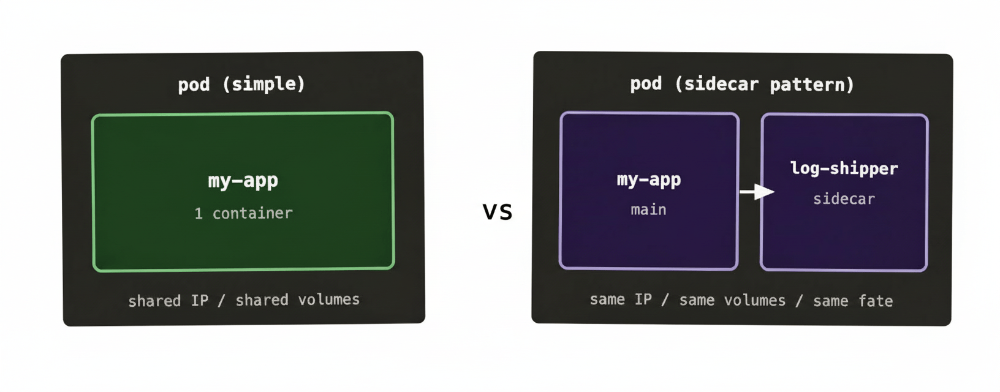
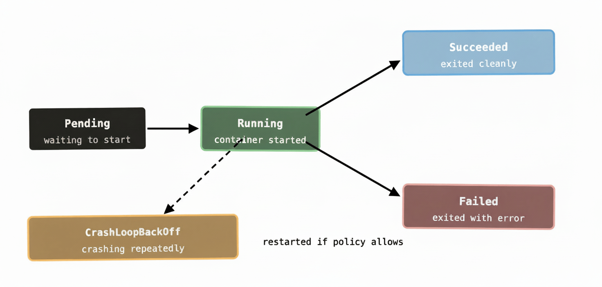

If you’ve spent any time around Kubernetes documentation, you’ve seen the word “pod” used constantly — often without a great explanation of what it actually is or why it exists. Most people assume a pod is just a fancy word for a container. It’s not quite, and the difference matters more than you’d think.

Let’s clear it up.

## Why Kubernetes doesn’t run containers directly

Docker runs containers. You’d be forgiven for assuming Kubernetes does too. But Kubernetes has never actually dealt in raw containers — it deals in pods, and pods *contain* containers.

The reason comes down to a practical reality: some workloads need more than one process to function. An application might need a helper process running alongside it — something that ships its logs to a central collector, rotates its certificates, or proxies its network traffic. These processes are tightly coupled to the main application. They need to run on the same machine. They need to share the same network. They might even need to share the same filesystem.

If Kubernetes scheduled containers individually, keeping tightly-coupled processes together would be extremely awkward. You’d have to build complex affinity rules just to say “this log shipper must always live next to this API server.” Instead, Kubernetes groups them. A pod is the group.

A pod is a wrapper around one or more containers that are meant to live and die together, share a network namespace, and optionally share storage volumes. They’re always scheduled as a unit — if the pod lands on node 2, all the containers in it land on node 2.

## What a pod actually looks like

In the simplest case — which covers the vast majority of real-world pods — a pod contains exactly one container. Your API service. Your worker process. Your database. One container, one pod.

The multi-container case is called the **sidecar pattern**. The sidecar is a helper container that runs alongside your main application — same pod, same node, same shared network. Because they share a network namespace, the main app can talk to the sidecar over `localhost` rather than going out over the network. Cheap, simple, no service discovery needed.

Common sidecar examples you’ll encounter in the wild: log shippers (Fluentd, Fluent Bit), Envoy proxies in service meshes, certificate rotators, and config reloaders. Anywhere you have a concern that’s genuinely orthogonal to your application but tightly coupled to its lifecycle, a sidecar is often the right answer.

## The pod lifecycle

Pods move through a defined set of states from creation to termination. Knowing these saves you a lot of confusion when you’re watching `kubectl get pods` and trying to work out what’s going on.

**Pending** means Kubernetes has accepted the pod and written it into etcd, but the container hasn’t started yet. It could be waiting for the scheduler to assign it to a node, or waiting for the node to pull the container image, or waiting for a resource (like a volume) to become available.

**Running** means at least one container in the pod is running. Note it doesn’t necessarily mean your application is actually healthy — it just means the container process has started.

**Succeeded** means all containers in the pod exited with a success code and won’t be restarted. You typically see this with one-shot Jobs.

**Failed** means all containers have terminated and at least one exited with an error. Whether Kubernetes tries to restart depends on the pod’s restart policy.

**Unknown** usually means the node the pod was running on has gone quiet — the control plane can’t reach the kubelet, so it doesn’t know what’s happening to the pod.

There’s also **CrashLoopBackOff**, which isn’t technically a phase but is a condition you’ll see constantly. It means the container is crashing repeatedly and Kubernetes is backing off exponentially between restart attempts — starting at a few seconds, doubling each time, capping at five minutes. If you see it, your container is starting, doing something, and dying. Check your logs.

One thing worth noting: pods are **ephemeral by design**. When a pod dies, it doesn’t come back as the same pod with the same identity. Kubernetes creates a new pod in its place. This is intentional — pods are meant to be disposable. If you need stable identity across restarts (say, for a database cluster where node 1 is always node 1), there’s a different object called a StatefulSet for that. But for the vast majority of stateless workloads, disposable pods are exactly what you want.

## Pods share a network — and that matters

Every container in a pod shares the same IP address and the same port space. That means if container A in a pod is listening on port 8080, container B in the same pod can’t also listen on port 8080. Port conflicts within a pod are a real thing to be aware of when you’re designing multi-container pods.

The flip side is useful: containers in the same pod can reach each other over `localhost`. The log shipper sidecar doesn’t need to know the main app’s IP address — it just reads from `localhost` or a shared volume. No service discovery overhead, no DNS lookup, nothing. It’s the networking equivalent of two people sitting at the same desk.

## Why you almost never create a pod directly

This is the bit that trips most beginners up. You’ve learned what a pod is, you know how to write a pod spec, so you’d naturally try to create one directly with `kubectl apply`. And it’ll work. But you almost certainly shouldn’t do it this way in practice.

The problem is that a bare pod has no self-healing. If it crashes, it stays dead. If the node it was running on dies, it’s gone. Nobody’s watching it. You’ve described a thing you want to run, not a thing you want to *keep* running.

That’s what higher-level objects are for. A **Deployment** wraps your pod spec and says “I want 3 of these running at all times, and if any of them die, replace them.” A **Job** says “run this once and make sure it completes successfully.” A **DaemonSet** says “run one of these on every node in the cluster.”

These objects all ultimately create pods — but they manage the pod lifecycle on your behalf. When you create a Deployment and one of its pods crashes, the controller manager notices the gap between desired state (3 pods) and actual state (2 pods) and creates a replacement. You don’t have to do anything.

In day-to-day Kubernetes work you’ll spend almost all your time working with Deployments, StatefulSets, Jobs, and DaemonSets. Pods are the foundation — but you’ll interact with them mostly through the objects that manage them.

## What to remember

A pod is the basic unit of scheduling in Kubernetes — the thing that lands on a node and runs. It wraps one or more containers that share a network and storage, and it lives and dies as a unit.

Most pods have one container. When they have more, it’s usually the sidecar pattern — a helper that needs to be tightly coupled to the main app.

Pods are ephemeral. When they die, they’re replaced by fresh ones. Design your apps accordingly.

And almost always, let a higher-level object manage your pods rather than creating them directly. That way, Kubernetes can do what it’s good at: keeping the thing running even when bits of your infrastructure are misbehaving.

Next up: Deployments — the workhorse of Kubernetes, and how rolling updates actually work.
