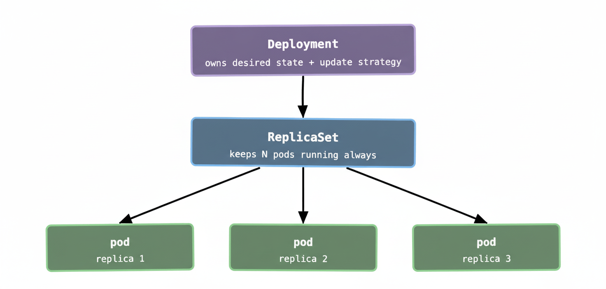
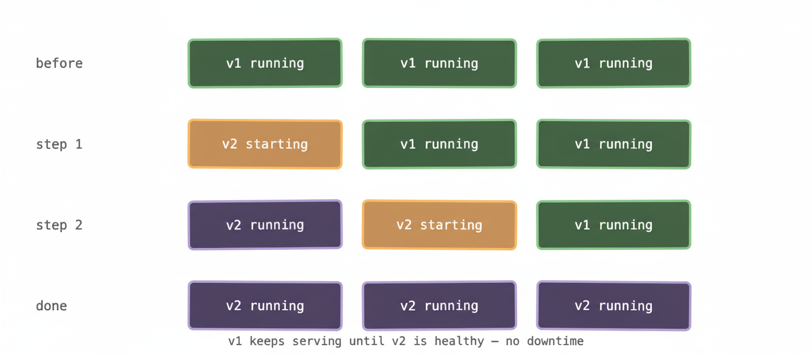

In the last post we established that bare pods are fragile — if one dies, it stays dead. Nobody’s watching it. You’d have to notice the problem yourself and fix it manually, which is exactly the kind of toil Kubernetes is supposed to eliminate.

Deployments are the answer to that. They’re the most commonly used object in Kubernetes by a significant margin, and once you understand how they work you’ll understand a huge chunk of day-to-day cluster operations.

## The reconciliation loop, again

Before we get into Deployments specifically, it’s worth revisiting the idea from post 02: Kubernetes is constantly comparing what you asked for (desired state) with what’s actually running (actual state), and working to close any gap between the two.

A Deployment is just a formal way of expressing desired state for a group of pods. You say: “I want three replicas of this container image, with these environment variables, with this much memory.” Kubernetes writes that down and then works — continuously — to make it true.

Crash one pod? Kubernetes creates a new one. Kill a node? Kubernetes reschedules the pods that were on it. Change the image version in your Deployment? Kubernetes rolls the update out gradually. You describe the outcome; the control plane does the work.

## What a Deployment actually does

A Deployment doesn’t manage pods directly. Instead it creates and manages a **ReplicaSet**, which in turn manages the pods. The hierarchy looks like this:



In practice you rarely interact with ReplicaSets directly. You create and update Deployments, and Kubernetes manages the ReplicaSets behind the scenes. The reason the indirection exists will make sense in a moment when we talk about rolling updates — it’s the mechanism that makes zero-downtime deploys possible.

## A minimal Deployment spec

Here’s the smallest sensible Deployment you’d write in real life:

```yaml
apiVersion: apps/v1
kind: Deployment
metadata:
  name: my-api
spec:
  replicas: 3
  selector:
    matchLabels:
      app: my-api
  template:
    metadata:
      labels:
        app: my-api
    spec:
      containers:
        - name: my-api
          image: my-org/my-api:v1.4.2
          resources:
            requests:
              memory: "256Mi"
              cpu: "250m"
            limits:
              memory: "512Mi"
```

A few things worth noting. The `selector` and the `labels` on the pod template have to match — this is how the ReplicaSet knows which pods it’s responsible for. If you get this wrong, Kubernetes will tell you. The `replicas: 3` line is the core of the desired state declaration. The `resources` block is something we’ll cover in depth in post 08, but briefly: `requests` is what the scheduler uses to find a node with enough capacity, and `limits` is the hard ceiling the container can’t exceed.

## Rolling updates: how deploys actually work

This is the part most people find genuinely satisfying once they see it. When you update a Deployment — changing the image tag, tweaking an environment variable, adjusting resource limits — Kubernetes doesn’t take all your pods down and bring new ones up. It does a rolling update.

Here’s what happens:



Kubernetes creates a new ReplicaSet for the new version. It starts spinning up new pods from that ReplicaSet while simultaneously winding down pods from the old ReplicaSet — one (or a few) at a time. At no point is your service fully down. Throughout the rollout, some pods are running v1 and some are running v2, but there’s always capacity serving traffic.

You can tune this behaviour with two fields in your Deployment spec: `maxUnavailable` (how many pods can be down at once during the update) and `maxSurge` (how many extra pods above your desired count are allowed temporarily). The defaults are usually fine, but at scale — say, a cluster running hundreds of pods for a single service — tuning these can meaningfully speed up deployments or reduce the blast radius of a bad rollout.

This is also why the old ReplicaSet sticks around after a deploy rather than being deleted immediately. Kubernetes keeps a configurable number of old ReplicaSets as rollback targets. If your new version turns out to be broken, a rollback is a single command:

```shell
kubectl rollout undo deployment/my-api
```

Kubernetes flips back to the previous ReplicaSet and the same rolling update process runs in reverse. No manual intervention, no restoring from a snapshot — just a pointer change and the reconciliation loop doing its thing.

## When things go sideways mid-deploy

Here’s something worth knowing from hard-won experience: a rolling update that gets stuck is one of the more disorienting things to debug in Kubernetes, because the symptoms aren’t always obvious.

The scenario usually goes like this. You deploy a new version. The first pod starts up fine. The second pod starts up fine. The third pod starts, initialises, and then fails its readiness check — which means Kubernetes won’t send it traffic, won’t mark it healthy, and therefore won’t kill the old pod it was meant to replace. The rollout stalls. The Deployment shows a mix of old and new pods. `kubectl get pods` shows some pods in a CrashLoopBackOff or an ImagePullBackOff. Traffic is still being served by the old pods. But nobody’s told you any of this loudly.

The command to check the status is:

```
kubectl rollout status deployment/my-api
```

If a rollout is stuck, it’ll tell you. From there you look at the pod events and logs to find out why the new pods aren’t healthy. Once you’ve fixed the root cause, you either push a corrected image or roll back.

The important thing to understand is that Kubernetes won’t blindly kill your old pods just because a rollout started. It waits for new pods to become healthy first. That’s the safety mechanism — and it’s why rolling updates are generally the right default rather than a blue/green or recreate strategy for most workloads.

## Deployments vs StatefulSets vs DaemonSets

The Deployment is the right tool for the vast majority of workloads — anything stateless where pods are interchangeable. Your API servers, your web frontends, your background workers. If it doesn’t matter which replica handles a given request, use a Deployment.

**StatefulSets** are for workloads that need stable identity. Each pod gets a persistent name (`pod-0`, `pod-1`, `pod-2`) and a persistent volume that follows it around. The classic use case is databases — RabbitMQ clusters, Kafka, MySQL replicas. When you have a distributed stateful system where node 0 is the primary and nodes 1 and 2 are replicas, the pods can’t be interchangeable. StatefulSets give each pod a stable identity that survives restarts and rescheduling.

**DaemonSets** ensure that exactly one copy of a pod runs on every node in the cluster (or every node matching a label selector). Used for infrastructure-level concerns: log collectors, monitoring agents, network plugins. If you want Fluentd running on every node automatically — including new nodes as they join the cluster — a DaemonSet is the right tool.

## What to remember

A Deployment is how you tell Kubernetes to keep N copies of your application running, handle rolling updates gracefully, and give you a safe rollback path. It’s the workhorse of the platform — the object you’ll create and update most often.

The rolling update mechanism is the reason Kubernetes manages ReplicaSets rather than pods directly. Each version of your Deployment gets its own ReplicaSet, which is what makes zero-downtime updates and instant rollbacks possible.

Use Deployments for stateless workloads. Use StatefulSets when pods need persistent identity. Use DaemonSets when you need exactly one pod per node.

Next up: Services — because right now your pods can run and self-heal, but they can’t reliably talk to each other or the outside world. Pod IPs are ephemeral and change every time a pod is replaced, which means you need something stable to route traffic to.
