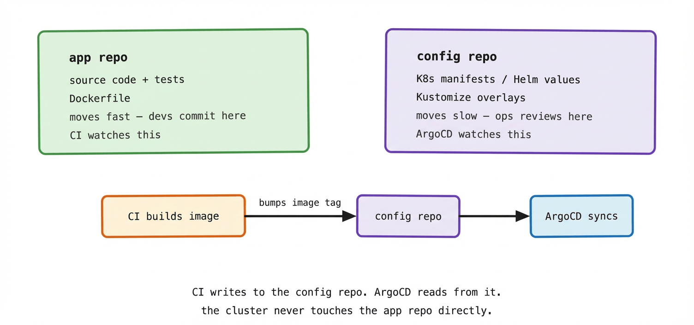
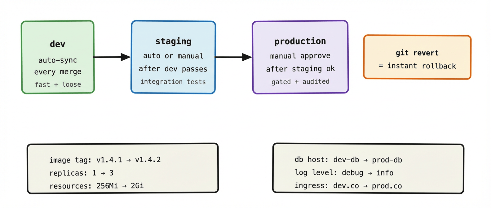

Here’s a conversation that happens on almost every team adopting GitOps for the first time. You’ve got ArgoCD running, you’ve written your first Application, you’ve seen the sync work. Now someone asks: “where exactly does all this YAML live?”

It’s a deceptively important question. Get the repo structure wrong early and you’ll spend months untangling it. Get it right and it scales from one service to hundreds without much additional ceremony.

There are a few patterns that have emerged from teams doing this at scale, and some opinions — including some strong ones — about which approaches survive contact with real production systems.

## The app repo and the config repo

The first thing to establish is a separation that catches many teams off guard: your application code and your deployment configuration should almost always live in different repositories.

The **app repo** is where developers work. It contains the application source code, tests, and the Dockerfile. The CI pipeline watches it, builds images from it, and pushes them to a container registry. This repo moves fast — commits happen constantly, branches proliferate, pull requests open and close all day.

The **config repo** (sometimes called the GitOps repo or the infra repo) is where deployment configuration lives. It contains Kubernetes manifests, Helm values files, and Kustomize overlays. ArgoCD watches this repo. It moves slowly and deliberately — changes here directly affect running systems.

Why separate them? A few reasons that become obvious after you’ve mixed them once.

When your app repo and config repo are the same, every commit to application code triggers ArgoCD to re-evaluate your manifests, even if nothing deployment-related changed. Your GitOps controller ends up doing a lot of unnecessary work.

More importantly, the people and processes that govern each repo are different. Application code goes through developer review. Deployment configuration changes — especially to production — might need a separate approval gate, different reviewers, or stricter branch protection. Keeping them separate lets you apply different rules to each.

And practically: your config repo commit history becomes your deployment history. When it’s mixed with thousands of application code commits, finding “what changed in production last Tuesday” becomes archaeology.



The CI pipeline is the bridge between the two repos. When a new image is built and pushed, CI opens a pull request (or directly commits, depending on your workflow) to the config repo, bumping the image tag. ArgoCD detects the change, syncs it to the cluster. The app repo never has to know anything about Kubernetes.

## Monorepo: one config repo for everything

The monorepo pattern puts all your deployment configuration — every application, every environment — in a single repository. Everything is visible in one place. Cross-cutting changes (updating a shared Helm chart version, changing a cluster-wide default) happen in one PR.

A typical monorepo structure looks like this:

```
config-repo/
├── apps/
│   ├── payments-api/
│   │   ├── base/
│   │   └── overlays/
│   │       ├── dev/
│   │       ├── staging/
│   │       └── production/
│   ├── orders-api/
│   │   └── ...
│   └── frontend/
│       └── ...
├── infrastructure/
│   ├── namespaces/
│   ├── rbac/
│   └── monitoring/
└── argocd/
    └── applications/
```

Each application has a `base` directory with the common configuration and `overlays` for each environment. The `argocd/applications` directory contains the ArgoCD Application objects themselves — more on that pattern in post 08.

The monorepo works well for smaller organisations and teams that operate tightly together. Visibility is high. Reviews happen in one place. New engineers can find everything without a map.

It starts to strain when you have many teams. If the payments team and the orders team are both committing to the same repo, they’re stepping on each other’s PRs, slowing each other down, and seeing each other’s deployment configuration. Merge conflicts in YAML are not fun.

## Multi-repo: one config repo per app or per team

The multi-repo pattern gives each application — or each team — its own config repo. The payments team owns `payments-config`. The orders team owns `orders-config`. Infrastructure lives in `platform-config`. ArgoCD watches all of them.

```
payments-config/          orders-config/
├── dev/                  ├── dev/
├── staging/              ├── staging/
└── production/           └── production/

platform-config/
├── namespaces/
├── rbac/
└── monitoring/
```

Teams move independently. A deploy to the payments service doesn’t require touching the same repo as orders. Access control is simpler — the payments team only has write access to `payments-config`. Blast radius is smaller — a mistake in `payments-config` can only affect payments.

The cost is coordination. Cross-cutting changes require PRs to multiple repos. Discovering what version of something is running in production means checking multiple places. Tooling to manage many repos (repo creation, access control, CI templates) becomes something you have to build or buy.

## How environment promotion works

This is where most teams need to think carefully, because getting promotion wrong is how you end up deploying untested changes to production.

The principle is simple: a change should prove itself in lower environments before it reaches production. Dev first. Then staging. Then production. Each promotion is a deliberate act, not an automatic cascade.



In practice, promotion looks like this. CI builds a new image and bumps the tag in the dev overlay. ArgoCD auto-syncs dev immediately. Once dev looks healthy — integration tests pass, nothing is on fire — someone opens a PR to update the staging overlay with the same image tag. That PR gets reviewed and merged. ArgoCD syncs staging. After a soak period, the same again for production, usually with a required approval from a senior engineer or through a change management tool.

The key point: production never gets a change that hasn’t been in staging first. The only thing that changes between environments is configuration — image tags, replica counts, resource limits, hostnames. The manifests are structurally identical. What Kustomize and Helm overlays exist to manage is exactly this per-environment variance without duplication.

## A folder structure that scales

Here’s a monorepo layout that holds up reasonably well as teams and services grow:

```
config-repo/
│
├── apps/                        # application deployments
│   ├── payments-api/
│   │   ├── base/                # shared across all envs
│   │   │   ├── deployment.yaml
│   │   │   ├── service.yaml
│   │   │   └── kustomization.yaml
│   │   └── overlays/
│   │       ├── dev/
│   │       │   ├── kustomization.yaml
│   │       │   └── values.yaml  # image tag, replicas for dev
│   │       ├── staging/
│   │       └── production/
│   └── orders-api/
│       └── ...
│
├── platform/                    # cluster-level config
│   ├── namespaces/
│   ├── rbac/
│   ├── network-policies/
│   └── monitoring/
│
└── argocd/                      # ArgoCD manages itself
    ├── projects/
    └── applications/            # one Application per app per env
        ├── payments-api-dev.yaml
        ├── payments-api-staging.yaml
        └── payments-api-production.yaml
```

A few design decisions baked into this structure worth naming explicitly.

`apps/` and `platform/` are separate top-level directories because they have different owners and different change cadences. Application teams own `apps/`. The platform team owns `platform/`. In a multi-repo world, these would be different repositories entirely.

The `base/` + `overlays/` pattern comes from Kustomize — we’ll cover it properly in post 05. The point is that the base contains everything that’s the same across environments, and overlays contain only the differences. You’re not copying YAML between environments; you’re layering changes on top of a shared foundation.

The `argocd/applications/` directory is the App of Apps pattern — ArgoCD manages its own Application objects via GitOps, rather than having them created manually. This is what post 08 is about, but it’s worth noting the directory here because it belongs in the structure from day one, not bolted on later.

## Branch strategy: a note of caution

Some teams use branches to represent environments — `main` is production, `staging` branch is staging, `dev` branch is dev. ArgoCD watches different branches for different environments.

This sounds elegant but causes real pain in practice. Merge conflicts between environment branches are common. Cherry-picking changes between branches is error-prone. The branch history becomes confusing quickly. And it’s easy to accidentally deploy staging changes to production by pointing ArgoCD at the wrong branch.

The pattern that tends to work better is a single branch (`main`) with directories per environment. Promotion is a commit to the right directory, not a branch merge. The branch protection rules on `main` are your gate. It’s simpler, it’s less error-prone, and it’s easier to reason about when something goes wrong.

## What to remember

Separate your app repo from your config repo. They have different owners, different cadences, and different access controls. Mixing them creates friction that compounds over time.

Monorepo works well for small to medium teams. Multi-repo scales better for large organisations with many independent teams. The right answer depends more on your team topology than on any technical argument.

Environment promotion is a deliberate act — a PR, a review, a merge. Not an automatic cascade. Production should only ever see changes that have proven themselves in lower environments first.

Use directories to represent environments, not branches. Single `main` branch, per-environment overlays, branch protection as your gate.

Next up: Helm and Kustomize — the two tools you’ll use to manage the per-environment differences without copying YAML everywhere.
