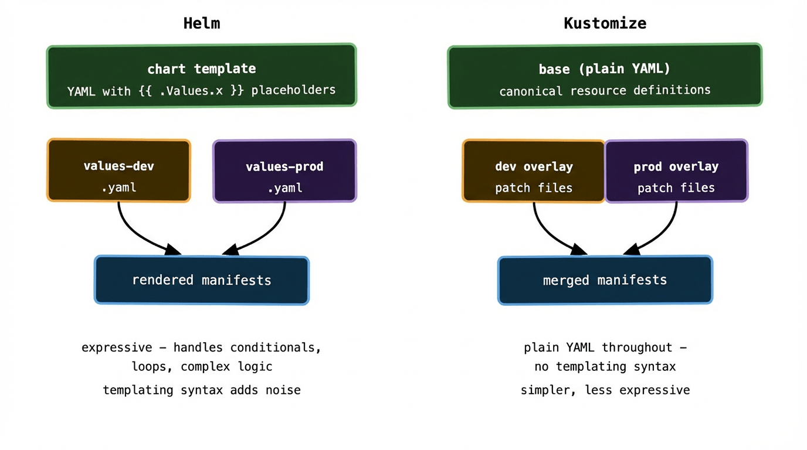

By now you have a Git repo, ArgoCD watching it, and a folder structure that separates environments. The next problem is one that every team hits within the first week: your payments API in dev and your payments API in production are almost identical, but not quite. Different image tags, different replica counts, different resource limits, different database hostnames.

You could maintain three completely separate copies of your YAML — one per environment. This works until you need to add a new label to your Deployment and have to make the same change in three places and inevitably miss one. It’s the Kubernetes equivalent of copy-paste inheritance.

Helm and Kustomize both solve this problem, but they do it differently. Understanding both — and knowing when to reach for each — is one of the more practically valuable things you can learn about running GitOps at any real scale.

## The environment variance problem

Before the tools, the problem. Here’s a Deployment that runs in three environments. The differences are:

```
                dev           staging        production
image tag:      v1.4.2        v1.4.2         v1.3.9
replicas:       1             2              5
memory limit:   256Mi         512Mi          2Gi
database:       dev-db:5432   stg-db:5432    prod-db:5432
log level:      debug         info           info
```

The structure of the Deployment is identical. The values differ. What you want is a way to write the structure once and supply different values per environment — without duplicating anything you don’t have to.

## Helm: parameterised templates

Helm is a package manager for Kubernetes. A Helm chart is a collection of YAML templates with placeholders — `{{ .Values.replicaCount }}`, `{{ .Values.image.tag }}` — that get filled in at render time from a `values.yaml` file.

The chart template for a Deployment looks something like this:

```yaml
# templates/deployment.yaml
apiVersion: apps/v1
kind: Deployment
spec:
  replicas: {{ .Values.replicaCount }}
  template:
    spec:
      containers:
        - name: api
          image: "{{ .Values.image.repository }}:{{ .Values.image.tag }}"
          resources:
            limits:
              memory: {{ .Values.resources.limits.memory }}
          env:
            - name: LOG_LEVEL
              value: {{ .Values.logLevel }}
            - name: DB_HOST
              value: {{ .Values.database.host }}
```

And the values files per environment:

```yaml
# values-dev.yaml
replicaCount: 1
image:
  tag: v1.4.2
resources:
  limits:
    memory: 256Mi
logLevel: debug
database:
  host: dev-db:5432
```

```yaml
# values-production.yaml
replicaCount: 5
image:
  tag: v1.3.9
resources:
  limits:
    memory: 2Gi
logLevel: info
database:
  host: prod-db:5432
```

ArgoCD has native Helm support. You point an Application at a chart and tell it which values file to use:

```yaml
source:
  repoURL: https://github.com/my-org/config-repo
  path: charts/payments-api
  helm:
    valueFiles:
      - values-production.yaml
```

ArgoCD renders the chart with those values and applies the result. No Helm CLI required in the cluster — ArgoCD handles the rendering internally.

The appeal of Helm is its expressiveness. Templates support conditionals, loops, helper functions, and named templates. You can build charts that handle genuinely complex conditional logic — enabling or disabling entire features based on values. Helm also has a rich ecosystem of pre-built charts for common infrastructure (Prometheus, cert-manager, RabbitMQ) that you can deploy without writing any templates yourself.

The cost is that Go templating syntax is noisy and can become hard to read in complex charts. A heavily templated Deployment YAML with nested conditionals starts to look less like configuration and more like code — which makes it harder to review and reason about.

## Kustomize: base plus overlays

Kustomize takes a different philosophical approach. Instead of templates with placeholders, it uses plain Kubernetes YAML with a layering system. You write a `base` that contains the canonical version of your resources, and `overlays` that patch specific fields for each environment.

No templating language. No placeholders. Just YAML and patches.

The base looks like regular Kubernetes manifests:

```yaml
# base/deployment.yaml
apiVersion: apps/v1
kind: Deployment
spec:
  replicas: 1
  template:
    spec:
      containers:
        - name: api
          image: my-org/payments-api:latest
          resources:
            limits:
              memory: 256Mi
```

```yaml
# base/kustomization.yaml
resources:
  - deployment.yaml
  - service.yaml
```

The production overlay patches only what differs:

```yaml
# overlays/production/kustomization.yaml
bases:
  - ../../base
patches:
  - path: replica-patch.yaml
  - path: resources-patch.yaml
images:
  - name: my-org/payments-api
    newTag: v1.3.9
```

```yaml
# overlays/production/replica-patch.yaml
apiVersion: apps/v1
kind: Deployment
metadata:
  name: payments-api
spec:
  replicas: 5
```

```yaml
# overlays/production/resources-patch.yaml
apiVersion: apps/v1
kind: Deployment
metadata:
  name: payments-api
spec:
  template:
    spec:
      containers:
        - name: api
          resources:
            limits:
              memory: 2Gi
```

Kustomize merges the base and the patches to produce the final manifests. ArgoCD handles this natively too — point the Application `path` at the overlay directory and it knows what to do.

The appeal of Kustomize is that every file is valid Kubernetes YAML. There are no templating artefacts, no `{{ }}` syntax, no rendering step you need to think about. A reviewer looking at a patch file sees exactly what it changes and nothing else. The cognitive overhead is lower.

The limitation is expressiveness. Kustomize can patch field values, add labels, change image tags, and merge lists — but it can’t express complex conditional logic. If you need “create this resource only in production” or “add this sidecar only if feature flag X is enabled,” Kustomize gets awkward. Helm handles those cases much more cleanly.



## How ArgoCD and Flux handle both

Both ArgoCD and Flux support Helm and Kustomize natively, without any extra setup. They detect which one to use based on the presence of a `Chart.yaml` (Helm) or a `kustomization.yaml` (Kustomize) in the target directory.

For Helm, ArgoCD renders the chart server-side and applies the rendered manifests. It shows you the rendered output in the diff view — so you’re always looking at actual Kubernetes resources, not template syntax. This is genuinely useful: you can see exactly what will be applied before you approve a sync.

For Kustomize, ArgoCD runs `kustomize build` on the target overlay and applies the result. Same story — the diff view shows post-merge YAML, not the raw patches.

Flux has a dedicated `HelmRelease` resource for managing Helm releases, and a `Kustomization` resource (confusingly, a Flux-specific object, distinct from a Kustomize `kustomization.yaml`) for managing Kustomize overlays. It’s slightly more explicit about which tool it’s using, which some teams prefer.

One practical ArgoCD tip: enable the `--server-side-apply` flag on your applications. It uses Kubernetes server-side apply rather than client-side apply, which handles field ownership and merge conflicts much more gracefully — especially important when you have Helm and other controllers (like autoscalers) both modifying the same resources.

## Which to choose

The answer most experienced teams arrive at — after trying both in isolation and finding limitations — is: use both, for different purposes.

**Reach for Kustomize** when you’re managing your own application manifests and the per-environment differences are straightforward. Image tags, replica counts, resource limits, environment-specific ConfigMap values. The patches are easy to read, easy to review, and there’s no templating overhead. This covers the majority of application deployments.

**Reach for Helm** when you’re deploying third-party software — Prometheus, cert-manager, RabbitMQ, ingress controllers, anything from the Helm chart ecosystem. You don’t want to write your own Kubernetes manifests for these. The chart is maintained by the project, versioned, and handles upgrade paths correctly. Your job is just to write a values file.

**Use both together** when you have complex internal tooling or platform components that genuinely need conditional logic. Some teams write Helm charts for their internal platform components — things that need to enable or disable entire subsystems based on environment — and use Kustomize for their application tier.

A common pattern in production repos:

```
config-repo/
├── apps/
│   └── payments-api/         # Kustomize — own app, simple variance
│       ├── base/
│       └── overlays/
│           ├── dev/
│           └── production/
└── platform/
    ├── monitoring/            # Helm — third-party chart
    │   └── values-production.yaml
    ├── cert-manager/          # Helm — third-party chart
    │   └── values.yaml
    └── ingress-nginx/         # Helm — third-party chart
        └── values.yaml
```

ArgoCD Applications in the `platform/` directory reference the Helm chart directly from the upstream chart repository and supply your values file. ArgoCD Applications in the `apps/` directory reference the Kustomize overlays. Both live in the same config repo; both are managed the same way. The tool choice is an implementation detail, not an architectural commitment.

## A real-world friction point: image tag management

One thing that causes surprising amounts of friction in practice is how image tags get updated across environments.

With Kustomize, bumping an image tag in the production overlay is a one-line change — update the `newTag` value and commit. With Helm, it’s a one-line change in the values file. Either way, this is what your CI pipeline does automatically when promoting a new build: open a PR to the config repo that bumps the tag in the relevant overlay or values file.

The friction comes when you have many services and many environments. At scale, you end up writing tooling to automate these PRs — or you use a dedicated tool like Renovate Bot (configured with the `docker` or `helm` datasource) to watch your container registry and open PRs automatically when new tags are pushed. Renovate handles both Helm and Kustomize natively, which is one of the reasons it’s become popular in GitOps setups.

This ties back to something from post 04: CI should write to the config repo, not deploy directly. The automated tag-bump PR is how that handoff works in practice. A human (or an automated gate checking that tests passed) approves the PR. ArgoCD picks up the merge and syncs the cluster.

## What to remember

Helm and Kustomize solve the same problem — environment variance without YAML duplication — but differently. Helm is a templating system: powerful and expressive, but noisier. Kustomize is a layering system: simpler and more readable, but less flexible.

Use Kustomize for your own application manifests where the differences between environments are straightforward. Use Helm for third-party charts where someone else has already done the templating work. Use both in the same repo without guilt.

ArgoCD and Flux both support both tools natively — the choice of rendering tool is independent of the choice of GitOps controller.

Automate image tag updates. The manual PR-per-service approach breaks down fast as the number of services grows. Renovate Bot or a similar tool is worth setting up early.

Next up: secrets — the one thing you genuinely cannot commit to Git, and the patterns that handle it without breaking the GitOps model.
