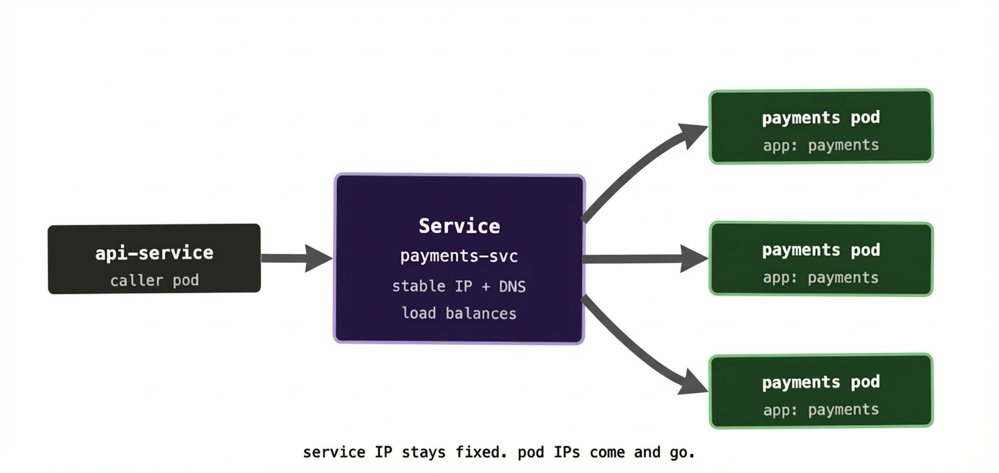
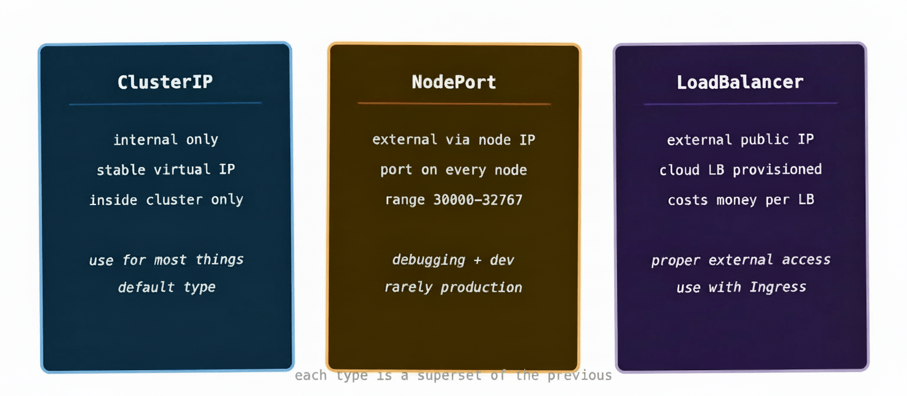

Here’s a problem that becomes obvious the moment you try to connect two things in a Kubernetes cluster. In the last post we established that pods are ephemeral — they die and get replaced, and the replacement gets a new IP address. So if service A wants to talk to service B, what IP does it connect to? The one that was valid five minutes ago might belong to a dead pod now.

This isn’t a Kubernetes-specific problem. It’s the fundamental challenge of service discovery in any distributed system. Kubernetes solves it with an object called a Service.

## What a Service actually does

A Service gives a stable endpoint — a fixed IP address and DNS name — to a group of pods. It doesn’t care which specific pods are healthy or where they’re running. It just knows “I’m responsible for pods with this label” and it routes traffic to whichever of those pods are currently alive and ready.

The grouping works through **label selectors**, the same mechanism we saw in Deployments. You put a label on your pods (say, `app: payments`) and your Service declares a selector for that same label. Any pod matching the selector gets added to the Service’s pool automatically. When a pod dies and gets replaced, the replacement has the same labels, so it joins the pool automatically too. No manual registration, no service registry to update.

Under the hood, Kubernetes maintains a list of healthy pod IPs for each Service — this is called an **Endpoints** object, and it gets updated continuously as pods come and go. `kube-proxy` on each node watches these Endpoints and keeps the local routing rules in sync, so traffic sent to the Service IP gets forwarded to a live pod.



The caller doesn’t know or care about individual pod IPs. It just talks to the Service, and the Service handles the rest.

## The three Service types you’ll actually use

Kubernetes has several Service types, but in practice you’ll encounter three regularly.

**ClusterIP** is the default. It gives your Service a stable IP address that’s only reachable from inside the cluster. Nothing outside the cluster can talk to it. This is right for the vast majority of internal services — your database, your cache, your internal APIs. Things that pods talk to, but that the outside world has no business accessing directly.

Think of ClusterIP like an internal phone extension. Anyone in the office can dial it, but it doesn’t ring if you call from outside.

**NodePort** exposes the Service on a static port on every node in the cluster. If your cluster has nodes at `10.0.0.1`, `10.0.0.2`, and `10.0.0.3`, and your NodePort Service is assigned port 31000, then traffic hitting any of those nodes on port 31000 gets routed to your Service. It’s reachable from outside the cluster, but in a fairly blunt way — you’re tying yourself to specific node IPs and ephemeral-ish port numbers. Useful for debugging or very simple setups, but not something you’d typically use in production.

Think of NodePort like propping the fire exit open — traffic can get in, but it’s not the entrance you’d design for.

**LoadBalancer** provisions an actual load balancer in your cloud provider and gives it a public IP address that forwards traffic to your Service. On AWS you get an ELB, on GCP a Network Load Balancer, on Azure an Azure Load Balancer. This is how you expose something properly to the internet. One LoadBalancer Service per application that needs external access — though in practice, if you have many services to expose, you’d typically put an Ingress in front of them instead (more on that in a future post).

Think of LoadBalancer like a front desk receptionist — a single, well-known point of contact that routes incoming traffic to the right place.



One thing that catches people out: these types are cumulative. A LoadBalancer Service also gets a NodePort and a ClusterIP assigned automatically. A NodePort Service also gets a ClusterIP. You’re always getting all the layers below, even if you only asked for the top one.

## DNS inside the cluster

Here’s the bit that makes everything click together. Kubernetes runs its own internal DNS server (CoreDNS). Every Service that gets created automatically gets a DNS entry in the form:

```
<service-name>.<namespace>.svc.cluster.local
```

So if you create a Service called `payments-svc` in the `default` namespace, any pod in the cluster can reach it at `payments-svc.default.svc.cluster.local`. Or, if both services are in the same namespace, just `payments-svc` — Kubernetes fills in the rest.

This is the feature that makes microservice communication clean. Your API service doesn’t hardcode an IP address for the payments service. It just calls `http://payments-svc/charge` and Kubernetes handles the routing. Change the number of pods behind the Service, roll out a new version, move the pods to different nodes — none of that changes the address your services use to talk to each other.

In practice this means your application configuration for service-to-service calls is just a DNS name, and it never has to change regardless of what the cluster is doing underneath.

## A quick look at kube-proxy

You don’t interact with kube-proxy directly, but it’s worth knowing what it does because it’s the thing that actually makes Service routing work on each node.

kube-proxy runs as a DaemonSet — one pod per node, always. It watches the API server for changes to Services and Endpoints. When a new Service is created or a pod’s health changes, kube-proxy updates the node’s networking rules (typically via iptables or ipvs) so that traffic destined for the Service IP gets forwarded to one of the healthy pod IPs behind it.

The load balancing at this level is simple — roughly round-robin across healthy endpoints. For more sophisticated load balancing (circuit breaking, retries, traffic weighting), you’d introduce a service mesh like Istio or Linkerd on top, but for the vast majority of cases the built-in behaviour is perfectly adequate.

## A real-world gotcha: forgetting to check your selector

One of the most common Service-related debugging sessions goes like this. You create a Deployment and a Service. You can reach the Service IP but get connection refused. You check the pods — they’re running fine. You check the Service — it looks correct. You spend 20 minutes scratching your head.

Nine times out of ten, the label selector on the Service doesn’t match the labels on the pods. Maybe there’s a typo. Maybe the Deployment template uses `app: payment` but the Service selector says `app: payments`. Kubernetes doesn’t error — it just creates a Service with zero endpoints, which means no traffic ever gets routed anywhere.

The first debugging command to run in this situation:

bash

```
kubectl get endpoints payments-svc
```

If it shows `<none>` where there should be a list of pod IPs, your selector is wrong. Compare it carefully against `kubectl get pods --show-labels` and look for the mismatch.

At scale, this kind of thing can manifest in subtle ways — especially in environments with lots of namespaces and label conventions set by different teams at different times. A consistent labelling strategy across your cluster is worth establishing early and enforcing via admission webhooks or policy tools later.

## What to remember

Services solve the ephemeral IP problem. They give a stable DNS name and virtual IP to a group of pods, load-balance traffic across healthy instances, and update their routing automatically as pods come and go.

Use ClusterIP for internal communication between services. Use LoadBalancer (usually behind an Ingress) when you need to expose something externally. Treat NodePort as a debugging tool rather than a production pattern.

When Service routing looks broken, check the endpoints first. An empty endpoints list tells you the selector isn’t matching anything, and that’s almost always the root cause.

Next up: ConfigMaps and Secrets — how to get configuration into your pods without baking it into your container images.
