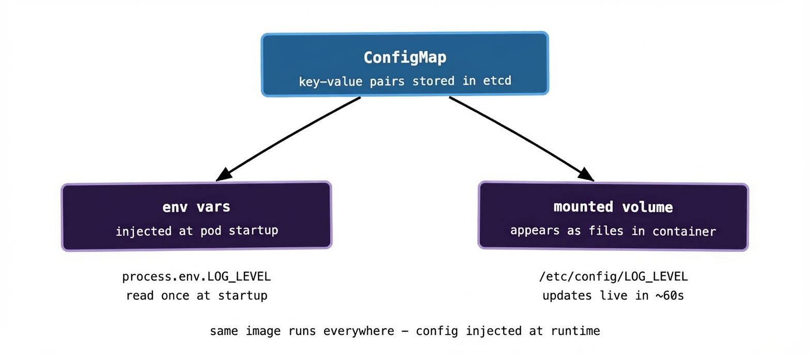

There’s a pattern that shows up constantly in immature container setups: configuration baked directly into the container image. The database hostname, the log level, the feature flags — all hardcoded at build time. Want to change the log level in production? Rebuild the image. Want to point at a different database? Rebuild the image. Want to run the same image in staging and production with different settings? You can’t — you have two different images instead of one.

This is a solved problem, and Kubernetes has two objects specifically for it: **ConfigMaps** for ordinary configuration, and **Secrets** for sensitive values. They’re similar in structure but different in intent, and understanding both will save you from some painful antipatterns early on.

## ConfigMaps: separating config from code

A ConfigMap is just a key-value store that lives in Kubernetes. You put your configuration in it — database hostnames, feature flag values, log levels, config file contents — and then mount it into your pods. The pod gets the configuration at runtime, not at build time, which means the same image can run in dev, staging, and production with completely different config.

A simple ConfigMap looks like this:

```yaml
apiVersion: v1
kind: ConfigMap
metadata:
  name: api-config
data:
  LOG_LEVEL: "info"
  DATABASE_HOST: "postgres.default.svc.cluster.local"
  MAX_CONNECTIONS: "50"
  FEATURE_NEW_CHECKOUT: "false"
```

There are two ways to get that config into a pod: environment variables, or mounted as files. Both are valid; the right choice depends on what your application expects.

**As environment variables**, each key in the ConfigMap becomes an environment variable in your container:

```yaml
envFrom:
  - configMapRef:
      name: api-config
```

Your application reads `LOG_LEVEL`, `DATABASE_HOST`, and so on from the environment exactly as it would anywhere else. No Kubernetes-specific code required.

**As a mounted volume**, the ConfigMap appears as a directory inside the container, with each key becoming a file whose contents are the corresponding value:

```yaml
volumeMounts:
  - name: config-volume
    mountPath: /etc/config
volumes:
  - name: config-volume
    configMap:
      name: api-config
```

Your app would then read `/etc/config/LOG_LEVEL`, `/etc/config/DATABASE_HOST`, and so on. This approach is particularly useful when your application expects a config file rather than environment variables — you can put the entire contents of a config file as a single key in a ConfigMap and mount it directly to the path your app expects.



One thing worth knowing: if you mount a ConfigMap as a volume, Kubernetes will update the files inside the running pod when the ConfigMap changes — usually within a minute or so. Environment variables, by contrast, are injected at pod startup and don’t update until the pod is restarted. Whether that matters depends on whether your application hot-reloads config or reads it once at startup.

## Secrets: the same idea, different intent

Secrets work almost identically to ConfigMaps in terms of how you define and consume them. The difference is that they’re designed to hold sensitive values — passwords, API keys, TLS certificates, tokens. You use them the same way: inject as environment variables or mount as files.

```yaml
apiVersion: v1
kind: Secret
metadata:
  name: db-credentials
type: Opaque
data:
  DB_PASSWORD: cGFzc3dvcmQxMjM=   # base64 encoded
  API_KEY: c2VjcmV0a2V5MTIz       # base64 encoded
```

The values are base64 encoded, which catches people out. Base64 is not encryption — it’s just encoding. Anyone with read access to the Secret can decode the values trivially. Don’t mistake it for security.

```yaml
envFrom:
  - secretRef:
      name: db-credentials
```

Your container sees `DB_PASSWORD` and `API_KEY` as plain environment variables, decoded automatically.

## What Kubernetes actually protects — and what it doesn’t

This is the honest part of the conversation, because the name “Secret” sets expectations that the implementation doesn’t always meet.

By default, Secrets are stored in etcd in base64 — which, as established, is not encrypted. Anyone who can read etcd directly can read your Secrets. Kubernetes does support encrypting Secrets at rest in etcd via an `EncryptionConfiguration`, but it’s not on by default and requires explicit setup.

Access to Secrets is controlled by RBAC (role-based access control). You can and should restrict which service accounts and users can read which Secrets. A pod only needs access to the Secrets it actually uses — giving everything blanket read access to all Secrets in a namespace is a pattern worth avoiding.

In managed Kubernetes (EKS, GKE, AKS), envelope encryption is often offered — the cloud provider’s key management service encrypts the encryption keys, giving you a proper chain of custody. Worth enabling if you’re running on a managed platform.

But even with all of this, the fundamental limitation remains: once a Secret is injected into a pod as an environment variable, any process in that container can read it. If your container gets compromised, the attacker can read your secrets. This is inherent to the environment variable model.

## The case for external secret stores

For anything beyond basic setups, the pattern that tends to win in production is keeping sensitive credentials out of Kubernetes Secrets entirely and pulling them from a dedicated secret store at runtime.

HashiCorp Vault is the most common choice. Your pods authenticate to Vault using their Kubernetes service account token, Vault validates the token with the Kubernetes API, and if the pod is authorised it gets the credentials it needs — often as short-lived dynamic credentials that expire after a few hours rather than long-lived static ones.

AWS Secrets Manager and GCP Secret Manager serve a similar purpose in their respective clouds.

The External Secrets Operator (ESO) is a popular bridge: it watches Custom Resources you define in Kubernetes and syncs values from your external store into Kubernetes Secrets automatically. Your pods still consume regular Kubernetes Secrets, but the source of truth is external and properly secured.  
  
External store Kubernetes  
───────────── ──────────  
Vault / AWS SM ──ESO──► Secret ──► Pod env vars

At scale — hundreds of clusters across multiple cloud regions — centralising secrets in something like Vault rather than scattering them across cluster-local Secrets is the only approach that stays manageable. Rotating a credential in one place propagates everywhere rather than requiring manual updates across every cluster.

## A few practical patterns worth knowing

**Don’t put Secrets in your Git repo.** This sounds obvious but happens constantly. YAML files with base64-encoded values get committed, pushed, and forgotten. Tools like `git-secrets`, `detect-secrets`, or pre-commit hooks help catch this. If you’re using GitOps (storing your desired cluster state in Git), use something like Sealed Secrets or ESO so only the encrypted or external reference is in the repo, not the value itself.

**Name your ConfigMaps and Secrets with versions or hashes when the content matters.** If your Deployment references `api-config` and you update the ConfigMap, the Deployment doesn’t automatically redeploy — because from Kubernetes’ perspective, the Deployment spec hasn’t changed. One pattern for forcing a rollout is to include a hash of the ConfigMap contents in an annotation on the pod template, so changing the ConfigMap changes the annotation and triggers a rollout. Tools like Helm do this automatically.

**Keep Secrets out of container logs.** It’s surprisingly easy for a misconfigured application to log its environment variables on startup — including whatever you injected from Secrets. A log management pipeline that indexes and retains logs for 30 days has just become your secret store’s leakage vector. Audit your apps for this.

## What to remember

ConfigMaps and Secrets are Kubernetes’ answer to externalising configuration from container images. They let you run the same image in every environment and inject the right config at runtime. ConfigMaps for ordinary config, Secrets for sensitive values.

Both can be injected as environment variables or mounted as files. Mounted volumes update automatically; environment variables require a pod restart.

Kubernetes Secrets are not strongly encrypted by default — they’re access-controlled. For anything sensitive in a production environment, treat them as a convenient delivery mechanism rather than a secure vault, and back them with an actual secret store like Vault or a cloud-native equivalent.

Next up: Storage — PersistentVolumes, PersistentVolumeClaims, and how stateful workloads get somewhere to put their data.
