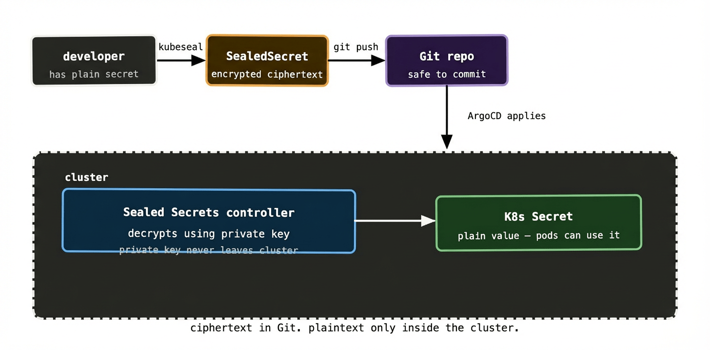
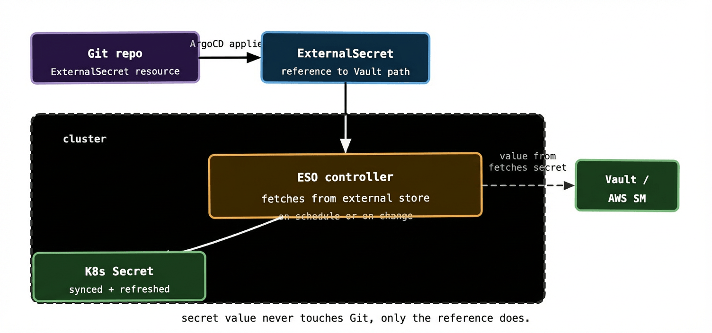
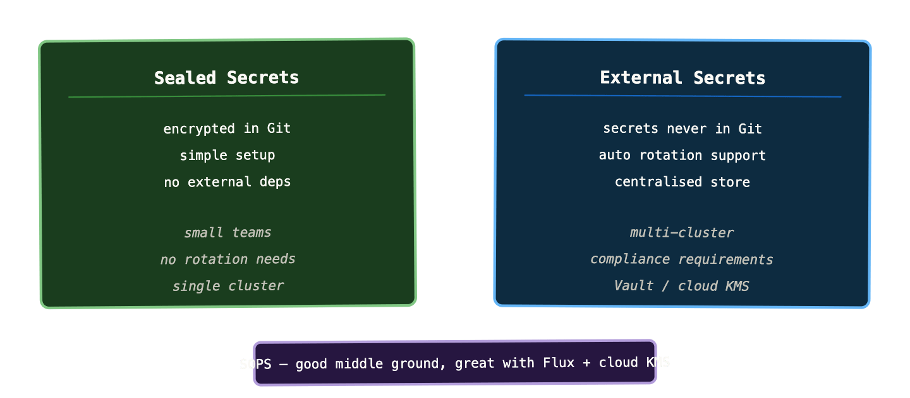

Everything we’ve covered so far has a satisfying elegance to it. Desired state in Git. ArgoCD watching. Cluster reconciling. The whole system is auditable, reproducible, and self-healing.

Then someone asks: “where do the database passwords go?”

And the answer can’t be “in Git.” Not in plain text, anyway. Git repositories — even private ones — get cloned to developer laptops, backed up to third-party services, included in contractor access grants, and occasionally leaked. Committing a production database password to Git is not a theoretical risk; it’s a when-not-if.

But if secrets aren’t in Git, you’ve broken the GitOps model. The cluster configuration is no longer fully described by the repository. You’ve reintroduced a class of manual, out-of-band state that exists somewhere — in someone’s head, in a shared spreadsheet, in an undocumented process.

This tension is real, and it’s the most common stumbling block for teams adopting GitOps seriously. The good news is that several patterns have emerged that resolve it cleanly. The right one depends on your team size, threat model, and existing infrastructure.

## Why you can’t just commit base64 to Git

The first instinct many teams have is to commit Kubernetes Secrets to Git, reasoning that the values are base64-encoded and therefore “protected.” This is wrong in a way worth being explicit about.

Base64 is an encoding, not encryption. It’s reversible by anyone with a terminal:

```shell
echo "cGFzc3dvcmQxMjM=" | base64 -d
# password123
```

Committing base64-encoded secrets to Git is functionally identical to committing them in plain text. Anyone with read access to the repo has the secrets. And “read access to the repo” is a much larger group than “people who should know the production database password.”

So: encoding is not encryption. Never treat it as such.

## Pattern 1: Sealed Secrets

Sealed Secrets, from Bitnami, is the simplest pattern to understand. It lets you encrypt secrets so they’re safe to commit to Git — but can only be decrypted by the Sealed Secrets controller running in your specific cluster.

The workflow looks like this. You install a controller in your cluster. The controller generates an asymmetric key pair and keeps the private key secret inside the cluster. You use the `kubeseal` CLI to encrypt your secret with the controller’s public key, producing a `SealedSecret` resource. You commit that `SealedSecret` to Git. ArgoCD applies it to the cluster. The controller decrypts it using its private key and creates a regular Kubernetes Secret.

```shell
# create a regular secret locally (never committed)
kubectl create secret generic db-creds \
  --from-literal=password=supersecret \
  --dry-run=client -o yaml | \
  kubeseal --format yaml > db-creds-sealed.yaml

# db-creds-sealed.yaml is now safe to commit
```

The resulting `SealedSecret` looks like this in Git:

```yaml
apiVersion: bitnami.com/v1alpha1
kind: SealedSecret
metadata:
  name: db-creds
spec:
  encryptedData:
    password: AgBvK3...long encrypted string...
```

Anyone who reads the Git repo sees ciphertext. Only the controller in the target cluster can decrypt it. The GitOps model is preserved — everything is in Git, ArgoCD applies it, the cluster is fully described by the repo.



The main limitation of Sealed Secrets is key management. The controller’s private key is the single point of trust. If you lose it — if the cluster is destroyed without a backup of the key — you lose the ability to decrypt any of your sealed secrets. You’d need to re-seal everything from the original plain-text values. This is manageable with good backup discipline, but it adds operational overhead.

Sealed Secrets also doesn’t help with secret rotation. If a password changes, you re-seal it and commit the new ciphertext. There’s no automatic rotation. For teams with compliance requirements around secret rotation frequency, this is a gap.

## Pattern 2: External Secrets Operator

The External Secrets Operator (ESO) takes a different approach. Rather than encrypting secrets for storage in Git, it keeps secrets entirely out of Git and syncs them into the cluster from an external store — Vault, AWS Secrets Manager, GCP Secret Manager, Azure Key Vault, or any of a dozen others.

You commit an `ExternalSecret` resource to Git. This is a description of which secret to fetch and where from — not the secret value itself. The ESO controller watches for these resources, calls out to your secret store, fetches the values, and creates a regular Kubernetes Secret in the cluster.

```yaml
apiVersion: external-secrets.io/v1beta1
kind: ExternalSecret
metadata:
  name: db-creds
spec:
  refreshInterval: 1h
  secretStoreRef:
    name: vault-backend
    kind: SecretStore
  target:
    name: db-creds        # name of the K8s Secret to create
  data:
    - secretKey: password
      remoteRef:
        key: secret/payments/db
        property: password
```

This is GitOps-compatible because the `ExternalSecret` resource is the desired state — it lives in Git, ArgoCD applies it, ESO reconciles it. The actual secret value is never in Git; only the reference to where it lives is.



The `refreshInterval` field is where ESO genuinely outshines Sealed Secrets. Set it to `1h` and ESO will re-fetch the secret from Vault every hour. If you rotate the password in Vault, ESO picks it up and updates the Kubernetes Secret automatically. No redeployment of the controller, no re-sealing, no manual intervention. For environments with compliance requirements around rotation, this is a significant operational improvement.

ESO also centralises your secrets in one authoritative store. If you’re running 20 Kubernetes clusters, the alternative to ESO is managing secrets separately in each cluster, which quickly becomes unmanageable. With ESO and Vault, you manage secrets in one place and ESO handles distribution. Rotate a credential in Vault once; every cluster gets the update on the next refresh cycle.

The cost is the dependency on the external store. If Vault is unavailable, ESO can’t refresh secrets. Existing Kubernetes Secrets remain (they’re not deleted on refresh failure), but new pods that need secrets will be blocked if the Secret hasn’t been created yet. Vault high availability and ESO error handling become things your platform team owns.

## Pattern 3: SOPS

SOPS (Secrets OPerationS), originally from Mozilla, takes yet another approach. It encrypts YAML and JSON files in place, leaving the structure visible but the values encrypted. You commit the encrypted file to Git. The GitOps controller decrypts it at apply time using a key from AWS KMS, GCP KMS, Azure Key Vault, or a local age/PGP key.

An encrypted SOPS file looks like this in Git:

```yaml
db_password: ENC[AES256_GCM,data:tGq8...==,tag:abc123...]
db_host: prod-db:5432   # unencrypted — SOPS can encrypt selectively
sops:
  kms:
    - arn: arn:aws:kms:eu-west-1:123456:key/abc-123
  lastmodified: '2024-01-15T10:23:00Z'
  version: 3.7.3
```

The structure — which keys exist, what the unencrypted values look like — is visible. Only the sensitive values are encrypted. This makes diffs readable: you can see that `db_host` changed without being able to read the password.

Flux has native SOPS support built in. ArgoCD requires either the `argocd-vault-plugin` or a custom init container to handle decryption. For Flux users in particular, SOPS is a natural first choice.

The key management story with SOPS is tighter than Sealed Secrets when you use a cloud KMS. AWS KMS, for example, has IAM policies that control which roles can decrypt which keys. Your cluster’s node role gets decrypt permission; developers’ IAM roles don’t. Rotating the encryption key is a KMS operation — no re-sealing individual secrets.

## Which pattern fits which situation



**Sealed Secrets** is the right starting point for small teams, single clusters, and situations where you don’t have an existing secret store to integrate with. Setup is fast, there are no external dependencies, and it gets you to a fully GitOps-compatible secrets workflow in an afternoon. The operational gaps — manual rotation, key backup — are manageable at small scale.

**External Secrets Operator** is the right answer for multi-cluster environments, compliance-heavy contexts, or anywhere you already have Vault or a cloud secret manager. The operational investment is higher upfront — you need a secret store, ESO installed, and a SecretStore configuration — but the long-term operational story is cleaner. Secret rotation is automated. Secrets are centrally managed. Adding a new cluster means pointing ESO at the same store, not re-sealing a library of secrets.

**SOPS** sits between the two. It keeps secrets in Git (encrypted), doesn’t require an external store, but uses proper cryptography via cloud KMS rather than a cluster-specific key pair. It’s particularly strong for teams already using Flux, where it’s a first-class supported feature. If you’re on ArgoCD it requires slightly more plumbing.

## The things that go wrong

A few failure modes that are common enough to be worth naming explicitly.

**Forgetting to scan for accidentally committed secrets.** Even with the best intentions, a plain-text secret will end up in a commit eventually. `git-secrets`, `trufflehog`, or `detect-secrets` in pre-commit hooks catch these before they’re pushed. GitHub and GitLab also have built-in secret scanning. None of these are optional — treat them as required CI steps.

**Not rotating after a leak.** If a secret does end up in Git history, removing it from the latest commit isn’t enough. Git history is permanent; the secret is in every clone of the repo. You need to rotate the credential immediately and then optionally rewrite history (with `git filter-repo`) if the repo is private and you want to clean it up. The credential rotation is the urgent part.

**ESO failing silently.** If ESO can’t reach Vault during a refresh cycle, it logs an error and keeps the existing Kubernetes Secret in place. This is usually the right behaviour — better stale secrets than no secrets — but it means your pods keep running with potentially outdated credentials. Wire ESO’s sync failure metrics into your alerting stack so you know when refreshes are failing consistently.

**Sealed Secrets key backup.** The most common Sealed Secrets operational incident is cluster disaster recovery: someone rebuilds a cluster from the GitOps repo, ArgoCD syncs everything, and then discovers that the Sealed Secrets controller generated a new key pair. None of the SealedSecret resources in Git can be decrypted. The fix — export and back up the controller’s key before you need it — is one of those things that seems unnecessary until it’s very urgently necessary.

```yaml
# run this regularly and store the output somewhere safe
kubectl get secret -n kube-system \
  -l sealedsecrets.bitnami.com/sealed-secrets-key \
  -o yaml > sealed-secrets-key-backup.yaml
```

## What to remember

You cannot commit plain-text secrets to Git. Base64 encoding is not encryption — treat it as plain text.

Three patterns handle this cleanly. Sealed Secrets encrypts secrets for storage in Git — simple, no external deps, good for single clusters. External Secrets Operator keeps secrets out of Git entirely and syncs them from a centralised store — better for multi-cluster and rotation requirements. SOPS encrypts files in place using cloud KMS — a good middle ground, especially with Flux.

At any real scale, the External Secrets Operator pattern wins on operational simplicity. Managing secrets centrally in Vault and distributing them via ESO is far more tractable than maintaining per-cluster encrypted stores as your cluster count grows.

Whatever pattern you choose, add secret scanning to your CI pipeline from day one and back up your Sealed Secrets key if you use it.

Next up: progressive delivery — canary releases, blue/green deployments, and how they fit into the GitOps model.
