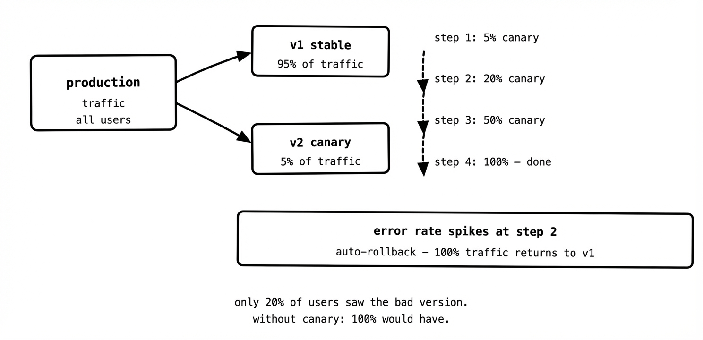
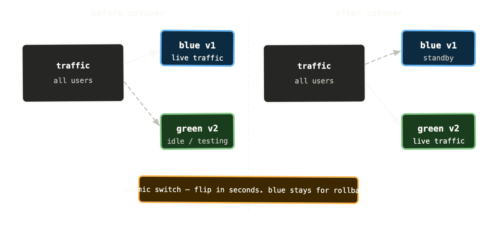
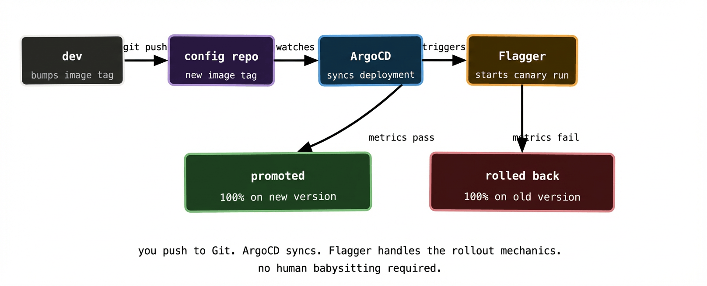

Rolling updates, which we covered back in the Kubernetes series, are a significant improvement over taking your service down to deploy a new version. But they have a blind spot: the moment the rollout completes, 100% of your traffic is hitting the new version. If that version has a subtle bug — one that only manifests under real production load, with real user data, at real traffic volumes — you find out the hard way.

Progressive delivery is the set of techniques that close that gap. Instead of going from 0% to 100% in one move, you expose the new version to a small slice of traffic first, watch what happens, and only proceed if things look healthy. If something goes wrong, you’ve affected a fraction of your users rather than all of them.

This post covers the two main patterns — canary and blue/green — and how they fit into a GitOps workflow with Flagger doing the heavy lifting.

## Why rolling updates aren’t always enough

Rolling updates protect you from one failure mode: the new version crashing immediately. Kubernetes health checks catch that — if the new pods fail their readiness probe, the rollout stalls and old pods keep serving traffic.

What rolling updates don’t protect you from is the new version running but producing bad results. Higher error rates. Increased latency. Subtle data corruption that takes minutes to manifest. A regression in a code path that only gets hit under specific conditions.

By the time you notice any of these, the rollout has completed. All your pods are on the new version. Your only recovery option is a rollback — which is fast in Kubernetes, but still means a period where all your traffic was hitting broken code.

Progressive delivery shifts the risk profile. Instead of discovering a problem after full rollout, you discover it while only a small percentage of users are affected. The blast radius shrinks dramatically.

## Canary deployments

A canary release sends a small percentage of traffic — say 5% — to the new version while the remaining 95% stays on the old version. You watch your metrics. If error rates, latency, and business metrics look healthy, you gradually increase the traffic weight: 5%, then 20%, then 50%, then 100%. If anything looks wrong at any stage, you route all traffic back to the old version and investigate.

The name comes from the coal mining practice of carrying a canary into a mine to detect toxic gases. The canary gets the bad news first. In this case, the canary is a small slice of your real production traffic.



The key metrics you watch during a canary analysis are typically error rate, p99 latency, and whatever business metrics matter for the service — successful checkout completions, message processing rate, payment success rate. If any of these degrade beyond a threshold during the canary phase, you abort and roll back. If they stay healthy through all stages, you promote the canary to stable.

## Blue/green deployments

Blue/green takes a different approach. Instead of gradually shifting traffic, you run two complete, identical environments simultaneously — the “blue” (current stable) and the “green” (new version). All traffic goes to blue. When the green environment is ready and tested, you flip all traffic to green in a single atomic switch. Blue stays running as an instant rollback target.

```
before:    all traffic → blue (v1)
           green (v2) running but receiving no traffic

after:     all traffic → green (v2)
           blue (v1) still running, ready for instant rollback
```

The advantage over canary is the atomic cutover — there’s no period where users get inconsistent experiences because some hit v1 and some hit v2. This matters for services where version skew between requests causes problems — certain database schema changes, API versions that aren’t backwards compatible, or stateful workflows that can’t tolerate mid-flight version changes.

The cost is resource usage. You’re running two complete copies of your production environment simultaneously. For large services this is expensive. For smaller services or short-lived deployments the cost is acceptable.



Blue/green also pairs well with database migrations. You run the migration against the new schema in the green environment, verify it’s correct, then flip traffic. If something goes wrong, you flip back to blue — which is still pointing at the old schema version. This only works cleanly if your migrations are backwards compatible (which they should be regardless), but it gives you a much cleaner rollback story than “apply the migration in reverse and hope.”

## Flagger: automating the analysis

Doing canary or blue/green manually — watching dashboards, adjusting traffic weights by hand, deciding when to promote — is operationally heavy. It requires someone to babysit every deploy. Flagger automates this.

Flagger is a Kubernetes operator that runs canary analysis automatically. You define a `Canary` resource that describes your deployment, the traffic routing rules, and the success criteria. Flagger runs the rollout, queries your metrics at each step, and promotes or rolls back based on the results — without human intervention.

```yaml
apiVersion: flagger.app/v1beta1
kind: Canary
metadata:
  name: payments-api
spec:
  targetRef:
    apiVersion: apps/v1
    kind: Deployment
    name: payments-api
  service:
    port: 80
  analysis:
    interval: 1m
    threshold: 5
    maxWeight: 50
    stepWeight: 10
    metrics:
      - name: request-success-rate
        thresholdRange:
          min: 99
        interval: 1m
      - name: request-duration
        thresholdRange:
          max: 500
        interval: 1m
```

Read this in plain English: “Every minute, check that the canary has a success rate above 99% and p99 latency below 500ms. Increase traffic weight by 10% at each step up to 50%. If the metrics fail 5 consecutive checks at any point, roll back automatically.”

Flagger supports multiple traffic routing backends — Istio, Linkerd, AWS App Mesh, NGINX Ingress, Contour. It also supports A/B testing and blue/green out of the box — the `Canary` resource just needs a different `analysis` configuration.

## How progressive delivery fits into GitOps

Here’s where some teams get confused. If ArgoCD is continuously reconciling your cluster to match Git, and Flagger is actively changing traffic weights and creating new deployments — who’s in charge?

The answer is: they’re operating at different levels and don’t conflict.

ArgoCD manages the static desired state — the Flagger `Canary` resource definition, the base Deployment, the Service, the Ingress. These live in Git and ArgoCD applies them. Flagger manages the dynamic rollout state — the traffic weights, the primary and canary Deployments it creates internally, the analysis loop. These are ephemeral and not stored in Git.

The trigger for a new canary rollout is a change to the Deployment’s container image in Git. ArgoCD syncs that change. Flagger detects the image change on the Deployment it’s watching and kicks off a new canary analysis automatically. You’ve initiated the deploy by pushing to Git — the mechanics of the rollout are Flagger’s job.



One nuance: ArgoCD will show the application as `OutOfSync` during a canary rollout, because Flagger is modifying the Deployment (changing the primary image, managing traffic weights) in ways that diverge from what’s in Git. This is expected behaviour. You typically configure the `Canary` resource in ArgoCD to ignore the fields Flagger manages:

```yaml
ignoreDifferences:
  - group: apps
    kind: Deployment
    jsonPointers:
      - /spec/replicas
      - /spec/template/spec/containers/0/image
```

This tells ArgoCD: “Flagger owns these fields — don’t treat changes to them as drift.” The rest of the Deployment — labels, environment variables, resource limits — is still ArgoCD’s domain.

## Metrics: the thing canary analysis actually depends on

Automated canary analysis is only as good as your metrics. If you don’t have meaningful metrics, Flagger can’t tell the difference between a healthy canary and a quietly broken one.

The minimum you need: a request success rate metric and a latency metric, queryable from Prometheus (or Datadog, or whatever metrics backend you’re using). Flagger ships with templates for the most common sources.

For most HTTP services, these come for free if you’re running a service mesh like Istio or have an ingress controller that exports per-route metrics. The canary and stable Deployments get separate Kubernetes Services, which means traffic to each is tracked separately, which means your metrics backend can tell them apart.

For non-HTTP services — queue consumers, batch processors, async workers — you need to think harder about what “healthy” means. A queue consumer might be healthy if its processing error rate is below 1% and its processing latency is below 5 seconds. Those metrics need to exist in your metrics backend before Flagger can query them. Instrumenting your services properly before adding progressive delivery is not optional; it’s the prerequisite.

## When to use canary vs blue/green

Both patterns reduce risk. The right choice depends on your service’s characteristics.

Canary is better when you want to minimise resource usage and when your service can tolerate a period of mixed version traffic without correctness issues. Most stateless HTTP services fall here. The gradual nature of canary also gives you more signal — you’re watching metrics across multiple traffic weight stages rather than making a binary go/no-go decision.

Blue/green is better when version skew between requests is genuinely problematic, when you need atomic cutovers, or when you want a fast and complete rollback path. It’s also simpler to reason about — two environments, one active. The resource cost is the trade-off.

In practice, most teams end up with canary for their application services and blue/green for their infrastructure components where stability and atomicity matter more than resource efficiency.

## What to remember

Rolling updates protect you from crashes. Progressive delivery protects you from bad-but-running code. They solve different problems and work well together.

Canary releases gradually shift traffic to the new version, watching metrics at each step. Blue/green runs two environments simultaneously and flips traffic atomically. Canary is cheaper; blue/green is simpler and more atomic.

Flagger automates canary analysis — it queries your metrics, promotes or rolls back automatically, and removes the need for humans to babysit every deploy. You push to Git, ArgoCD syncs the change, Flagger runs the analysis.

Good metrics are the prerequisite for automated analysis. If your services aren’t instrumented, progressive delivery gives you the mechanics without the intelligence. Instrument first.

Next up: the final post — running GitOps at scale across multiple clusters and multiple teams, including the App of Apps pattern and ApplicationSets.
