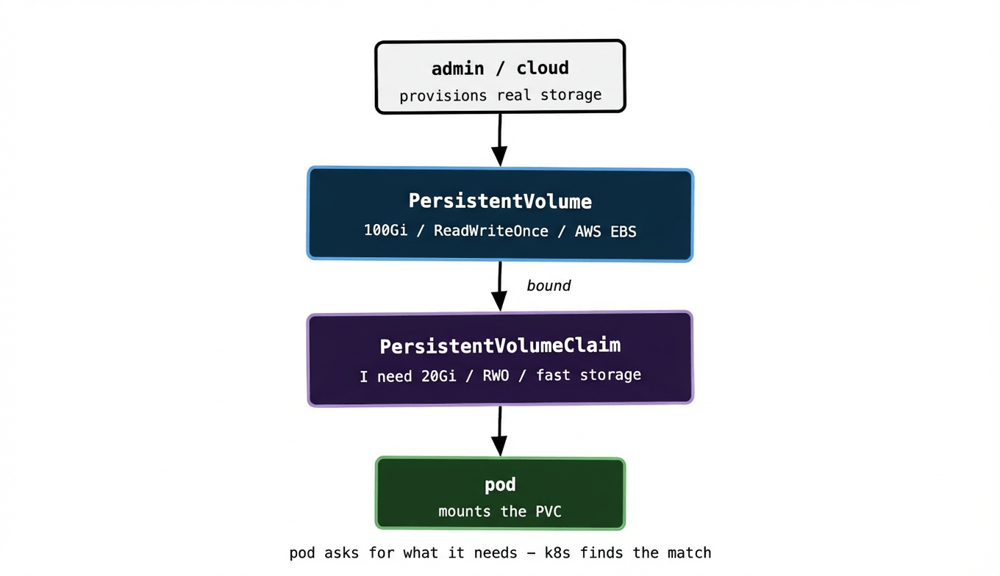

Everything we’ve covered so far has been pleasantly stateless. Pods come and go, get replaced, move between nodes — and because they don’t hold any important data locally, that’s fine. But at some point your cluster needs to run something stateful. A database. A message broker. A shared file store. Something that needs to write data to disk and have that data survive a pod restart.

This is where Kubernetes storage comes in, and it’s one of the more conceptually layered parts of the platform. There are three objects to understand — Volumes, PersistentVolumes, and PersistentVolumeClaims — and the relationship between them is what trips most people up initially.

## Ephemeral vs persistent storage

By default, anything a container writes to its filesystem is ephemeral. When the container dies, the data dies with it. When the pod is replaced, you start with a clean slate.

For many workloads that’s exactly right. Your API server shouldn’t be writing important state to local disk — it should be writing to a database. But the database itself needs somewhere durable to write to. That’s the distinction: ephemeral storage for throwaway scratch space, persistent storage for anything that needs to outlive its pod.

Kubernetes has a concept simply called a **Volume** for attaching storage to a pod. The simplest kind, `emptyDir`, creates a temporary directory that lives as long as the pod does — useful for sharing data between containers in the same pod (remember the sidecar pattern from post 03), but not for anything you need to keep.

```yaml
volumes:
  - name: scratch
    emptyDir: {}
```

For storage that outlives the pod, you need PersistentVolumes.

## The landlord and tenant model

Here’s the mental model that makes PersistentVolumes click: think of it like renting a flat.

A **PersistentVolume (PV)** is the flat itself — a physical piece of storage that exists in your infrastructure. It might be an AWS EBS volume, a GCP Persistent Disk, an NFS share, or a local disk on a node. It has a certain size and certain capabilities. The cluster administrator (or a dynamic provisioner — more on that shortly) creates it and makes it available.

A **PersistentVolumeClaim (PVC)** is the rental application. A pod doesn’t request a specific PV by name — it submits a claim saying “I need 20GB of storage that supports read-write access from a single node.” Kubernetes looks at the available PVs and binds the claim to one that satisfies the requirements.

The pod then mounts the PVC, not the PV directly. It doesn’t know or care which specific piece of underlying storage it got — just that it has storage meeting its requirements.



This indirection is deliberate. It decouples the application developer (who knows they need 20GB of storage) from the infrastructure operator (who knows which storage systems are available). The developer writes a PVC. The operator makes PVs available. Kubernetes matches them.

## Access modes: who can mount this volume

When you define a PV or PVC you specify an access mode — how many nodes can mount the volume simultaneously and in what way.

**ReadWriteOnce (RWO)** means the volume can be mounted by a single node at a time in read-write mode. This is the most common mode and maps naturally to block storage like AWS EBS or GCP Persistent Disks. Only one node can have it attached, though multiple pods on that same node can access it.

**ReadOnlyMany (ROX)** means multiple nodes can mount it simultaneously, but only for reads. Useful for distributing static assets or config data.

**ReadWriteMany (RWX)** means multiple nodes can mount it read-write simultaneously. This requires networked storage — NFS, CephFS, or cloud-native equivalents. Block storage simply doesn’t support it at the hardware level.

The access mode is one of the things Kubernetes checks when binding a PVC to a PV — a PVC requesting RWX won’t bind to a PV that only supports RWO.

## StorageClasses and dynamic provisioning

Creating PersistentVolumes by hand — going to AWS, provisioning an EBS volume, noting the volume ID, writing a PV manifest — is fine for a handful of volumes and tedious beyond that. Dynamic provisioning solves this.

A **StorageClass** defines a type of storage and the provisioner that creates it. When a PVC references a StorageClass, Kubernetes calls out to the provisioner, which creates the underlying storage automatically and binds it to the PVC. No manual PV creation required.

```yaml
apiVersion: storage.k8s.io/v1
kind: StorageClass
metadata:
  name: fast
provisioner: ebs.csi.aws.com
parameters:
  type: gp3
  encrypted: "true"
reclaimPolicy: Delete
allowVolumeExpansion: true
```

And a PVC that uses it:

```yaml
apiVersion: v1
kind: PersistentVolumeClaim
metadata:
  name: database-storage
spec:
  accessModes:
    - ReadWriteOnce
  storageClassName: fast
  resources:
    requests:
      storage: 50Gi
```

When this PVC is created, the EBS CSI driver provisions a 50Gi gp3 EBS volume in AWS, creates the corresponding PV, and binds it — all automatically. When you’re running clusters at any real scale this is the only practical approach. Manual PV management doesn’t survive contact with a production environment.

The `reclaimPolicy` is worth paying attention to. `Delete` means when the PVC is deleted, the underlying storage is deleted too. `Retain` means the storage survives PVC deletion — useful if you want the data to outlive the claim, but you’ll accumulate orphaned volumes if you’re not careful. Most managed Kubernetes setups default to `Delete`, which is right for ephemeral workloads but something to think hard about before applying to anything holding data you care about.

## StatefulSets and volumeClaimTemplates

In post 04 we touched on StatefulSets for workloads that need stable identity. Storage is the other half of that story.

A StatefulSet can define a `volumeClaimTemplates` block, which automatically creates a PVC for each pod in the set — and crucially, keeps that PVC bound to that specific pod across restarts and rescheduling. When pod `rabbitmq-1` is replaced, the new pod gets the same PVC that the old one had, with the same data intact.

```yaml
volumeClaimTemplates:
  - metadata:
      name: data
    spec:
      accessModes: ["ReadWriteOnce"]
      storageClassName: fast
      resources:
        requests:
          storage: 20Gi
```

This is the mechanism that makes running stateful systems like RabbitMQ, Kafka, and MySQL in Kubernetes viable. Each pod in the StatefulSet gets its own persistent volume, its own stable hostname, and its own stable identity. The storage follows the pod identity, not the pod IP.

Managing RabbitMQ clusters across hundreds of Kubernetes environments makes this concrete fast. Each RabbitMQ node in a cluster needs its own durable storage for its message store and metadata. Without StatefulSets and persistent volumes, a single node restart would lose any messages not yet replicated — which in a busy cluster under load can be a meaningful amount of data. With the right StatefulSet configuration, the node comes back up, reattaches its volume, and rejoins the cluster with its state intact.

## What can go wrong

A PVC stuck in `Pending` is one of the most common storage-related issues you’ll encounter. The usual causes:

No PV available that satisfies the claim — either the StorageClass doesn’t exist, the requested size is larger than any available PV, or the access mode doesn’t match. `kubectl describe pvc <name>` will show you the binding failure reason.

The provisioner isn’t working — check that the CSI driver for your storage backend is running and healthy. On managed Kubernetes this is usually fine, but on self-managed clusters the storage driver is something you maintain.

The node can’t attach the volume — block storage like EBS can only be attached to one node at a time. If a pod is being scheduled to a node but the volume is still attached to the old node (which might be in the process of draining), there’s a delay while the detach completes. This usually resolves itself within a couple of minutes, but it can look alarming mid-deployment.

## What to remember

Pods get ephemeral storage by default — it dies when the pod dies. For anything you need to keep, use PersistentVolumes.

The PV/PVC split separates the concern of “what storage exists” (the PV, managed by admins or dynamic provisioners) from “what storage my app needs” (the PVC, written by developers). Pods mount PVCs, not PVs directly.

StorageClasses and dynamic provisioning automate PV creation — the only practical approach at any real scale. Pick your reclaim policy carefully.

StatefulSets extend this with per-pod PVCs that follow each pod’s identity across restarts, which is what makes running stateful distributed systems in Kubernetes manageable.

Next up: resource requests and limits — how Kubernetes knows how hungry your workloads are, and what happens when you get it wrong.
