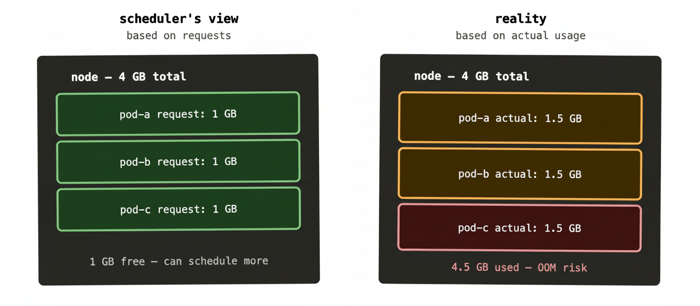
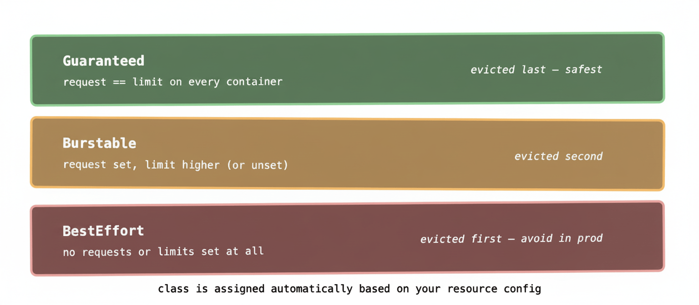

This is the post where we talk about one of the most consequential — and most commonly misconfigured — parts of running Kubernetes in production. Get resource requests and limits right and your cluster runs efficiently, workloads are stable, and the scheduler makes sensible decisions. Get them wrong and you’ll encounter pods being mysteriously killed, nodes running out of memory at 2am, or a cluster sitting at 15% utilisation while the scheduler insists it can’t fit anything else on it.

It’s worth getting this one right early.

## The fundamental distinction: requests vs limits

These two settings look similar but do completely different things.

A **request** is a guaranteed reservation. When you say a container needs 256Mi of memory and 250m of CPU, the scheduler will only place that pod on a node that has at least that much *unallocated* capacity. Once placed, those resources are considered spoken for — even if the container isn’t actually using them. The request is the scheduler’s unit of currency.

A **limit** is a hard ceiling. The container is allowed to use up to this much. If it tries to use more CPU than its limit, it gets throttled — slowed down, but not killed. If it tries to use more memory than its limit, it gets killed immediately with an OOMKilled (Out Of Memory) error, and Kubernetes restarts it.

The mental model: a request is what you’re guaranteed to get, a limit is the most you’re ever allowed to use.

```yaml
resources:
  requests:
    memory: "256Mi"
    cpu: "250m"
  limits:
    memory: "512Mi"
    cpu: "1000m"
```

In this example, the scheduler reserves 256Mi and 0.25 CPU cores for this container on whatever node it lands on. At runtime, the container can burst up to 512Mi of memory and a full CPU core if the node has spare capacity — but never beyond that.

## How the scheduler uses requests

The scheduler doesn’t look at actual resource usage when placing pods. It looks at what’s been *requested*. This is a crucial distinction that catches a lot of people out.

Imagine a node has 4GB of memory. Three pods are running on it, each requesting 1GB. From the scheduler’s perspective, 3GB is allocated and 1GB is free. It’ll place a new pod requesting 800Mi on that node without hesitation.

But here’s the catch: those three pods might each actually be using 1.5GB — bursting above their request because they have higher limits and there’s spare physical memory available. In reality the node might be running at 4.5GB of usage against 4GB of actual RAM, and the OS is starting to feel pressure. The scheduler doesn’t know this because it works from requests, not from metrics.

This is why setting requests accurately matters. Too low and you’re lying to the scheduler — it thinks the node has more room than it does, leading to overcommitment and eventual instability. Too high and you’re wasting capacity — the scheduler thinks nodes are full when they actually have plenty of headroom.



When this situation tips over — when actual usage exceeds physical capacity — the Linux kernel’s OOM killer starts evicting processes. Kubernetes will try to evict pods gracefully first based on their QoS class (more on that shortly), but if things get bad enough, the kernel steps in and starts killing things without ceremony. This is the scenario you really want to avoid, because the order of eviction isn’t always what you’d choose.

## CPU vs memory: they behave differently

This is important and frequently glossed over.

CPU is **compressible**. If a container hits its CPU limit, the kernel throttles it — it runs slower, but it keeps running. Your application might become sluggish, latency might spike, but it won’t crash. CPU over-limits are recoverable at runtime.

Memory is **incompressible**. There’s no such thing as memory throttling. If a container hits its memory limit, it gets killed immediately — `OOMKilled` in `kubectl describe pod`. No warning, no grace period. The container restarts from scratch.

This asymmetry means memory limits warrant more careful thought than CPU limits. Setting memory limits too low for a workload that has legitimate memory spikes will result in repeated OOMKills — which looks like instability but is actually just misconfiguration.

```
CPU over limit  →  throttled (runs slower)
RAM over limit  →  OOMKilled (restarts immediately)
```

In practice: be conservative with memory limits (set them high enough that legitimate usage fits), and be more aggressive about CPU limits since the failure mode is gentler.

## CPU units: what 250m actually means

CPU is measured in millicores. 1000m equals one full CPU core. So `250m` is a quarter of a core, `500m` is half a core, `2000m` (or just `2`) is two full cores.

Memory uses standard binary suffixes: `Mi` for mebibytes, `Gi` for gibibytes. `256Mi` is 256 mebibytes. You’ll also see `M` and `G` (megabytes and gigabytes) — they’re slightly different values but close enough that the distinction rarely matters in practice.

## QoS classes: how Kubernetes decides what to evict first

When a node is under memory pressure, Kubernetes needs to decide which pods to evict. It uses three Quality of Service classes, assigned automatically based on how you’ve configured requests and limits.

**Guaranteed** is the safest class. A pod gets this if every container in it has both requests and limits set, and the request equals the limit. These pods are the last to be evicted. They’re also the least flexible — they can never burst above their request, because the limit matches it.

**Burstable** is the middle tier. A pod gets this if at least one container has a request or limit set, but the request doesn’t equal the limit. These pods can burst above their request if the node has headroom, but they’re evicted before Guaranteed pods under pressure.

**BestEffort** is the lowest tier — evicted first. A pod gets this class if no containers have any requests or limits set at all. Kubernetes will schedule these anywhere and kill them first when things get tight. Running production workloads without any resource configuration puts them in this class, which is almost never what you want.



For most production workloads, Burstable is the right class. You set a request that reflects typical usage (so the scheduler places pods sensibly) and a limit that gives room to handle load spikes (so occasional bursts don’t cause OOMKills). Guaranteed makes sense for latency-sensitive or business-critical workloads where you want absolute predictability and never want to be evicted under pressure.

## Getting the numbers right

The honest answer is that setting good requests and limits requires observation. You can make educated guesses based on load testing — and you should — but real-world usage patterns frequently surprise you.

The workflow most teams settle on:

Start with conservative estimates — lower than you think you need for requests, higher than you think you need for limits. Deploy to a staging environment, run realistic load, and observe actual usage via your metrics stack (Prometheus + `kubectl top pods` are the common tools).

Once you have real usage data, set requests at roughly the 50th–75th percentile of observed usage, and limits at the 95th–99th percentile. This gives the scheduler accurate placement information while leaving headroom for legitimate spikes.

Then monitor continuously. Workloads change. A service that was using 200Mi six months ago might be using 600Mi now because it’s grown or because something started leaking memory. Resource configuration isn’t a one-time exercise.

Vertical Pod Autoscaler (VPA) can automate this analysis — it watches actual usage and recommends (or automatically applies) updated requests and limits. Useful, but worth understanding the underlying concepts before relying on automation to set them.

## A real-world example: RabbitMQ memory sizing

RabbitMQ has its own internal memory management and will start refusing new messages when it hits a configurable watermark — by default 40% of available system memory. In a Kubernetes pod, “available system memory” means the container’s memory limit.

If you set a memory limit of 2Gi on a RabbitMQ pod, RabbitMQ sees 2Gi and starts flow-controlling publishers at 800Mi. If your actual queue depth regularly approaches that threshold, you’ll see producers getting blocked — not because the node is out of memory, but because RabbitMQ is doing its job based on the limit you gave it.

The fix is either to raise the limit or to tune RabbitMQ’s `vm_memory_high_watermark` to a lower percentage so it starts flow-controlling earlier and recovers faster. But you can only reason about this correctly if you understand that the limit is what RabbitMQ sees as its total available memory — and that the request is what the scheduler used to decide which node to put it on, which might be a completely different number.

This is the kind of subtle interaction between Kubernetes resource configuration and application-level behaviour that bites teams running stateful workloads. The scheduler placed the pod correctly, the pod is running, there’s no OOMKill — but the application is misbehaving because its view of available memory doesn’t match your intuition about what the node has.

## LimitRange and ResourceQuota: guardrails at scale

Two objects worth knowing about once you’re running multiple teams or multiple namespaces on a shared cluster.

A **LimitRange** sets default requests and limits for pods in a namespace, and can enforce minimum and maximum values. If a developer deploys a pod without any resource configuration, the LimitRange applies defaults automatically. This prevents BestEffort pods from sneaking into production and keeps individual workloads from consuming unreasonable amounts of cluster resources.

A **ResourceQuota** caps the total resources a namespace can consume — both compute resources and object counts. You might limit the `team-payments` namespace to 16 CPU cores and 32Gi of memory total, so a misconfigured deployment can’t starve other teams’ workloads.

Together these two objects are how platform teams maintain sanity on multi-tenant clusters — not by trusting every team to configure their workloads perfectly, but by building guardrails that make misconfiguration less catastrophic.

## What to remember

Requests are for the scheduler — they determine where pods get placed. Limits are for the runtime — they determine what happens when a pod tries to use too much. Always set both.

CPU throttles when you exceed the limit. Memory kills. Treat memory limits with more care.

QoS class is assigned automatically based on your resource configuration. Aim for Burstable for most workloads, Guaranteed for critical ones, and never let production pods be BestEffort.

Set requests based on observed typical usage, not guesswork. The numbers matter because the scheduler trusts them completely.

Next up: health checks — liveness, readiness, and startup probes. Because a container being “running” and a container being “healthy” are two very different things.
