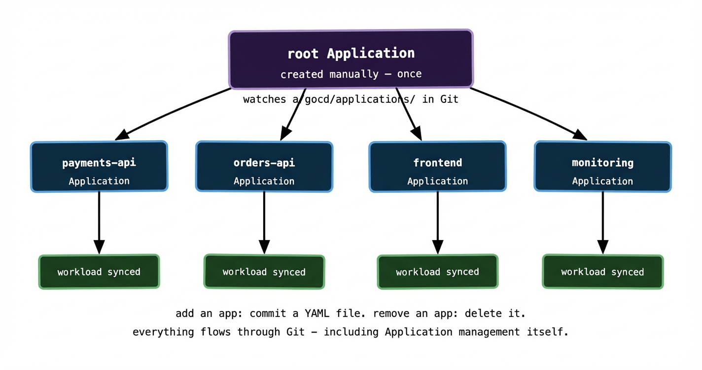
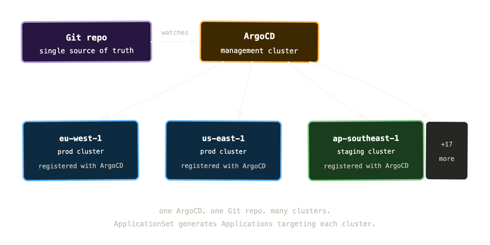

Everything in this series so far has implicitly assumed a relatively simple setup: one team, one or a handful of clusters, one ArgoCD instance, a config repo with a reasonable number of applications. That setup works well and scales further than you’d think.

But at some point the wheels start to come off. You’ve got 20 clusters across multiple regions and cloud providers. Dozens of teams deploying hundreds of services. ArgoCD Applications being created manually, inconsistently, with different naming conventions and sync policies. The config repo has grown into something nobody fully understands. A new cluster takes days to onboard because there’s no repeatable process.

This post is about the patterns that prevent that outcome — or dig you out of it if you’re already there.

## The problem with managing Applications manually

When you start with ArgoCD, you create Applications through the UI or by applying YAML manually. This is fine for a handful of apps. It doesn’t scale.

The first problem is drift. If your ArgoCD Application objects aren’t themselves managed by GitOps, they can diverge from what you intended. Someone tweaks a sync policy in the UI and nobody knows. An Application gets deleted and nobody notices for a week because the workload keeps running from its last sync.

The second problem is repetition. If you have 50 services across 3 environments, you have 150 Application objects to create, maintain, and keep consistent. Doing this by hand is error-prone and tedious.

The third problem is onboarding. Adding a new cluster means recreating all your Application objects on the new cluster. Without automation, this is a significant manual effort every time.

The patterns in this post solve all three.

## The App of Apps pattern

The App of Apps pattern is the simplest solution to manual Application management. Instead of creating ArgoCD Applications by hand, you create a single “root” Application that points to a directory of Application manifests in your Git repo. ArgoCD applies those manifests — which are themselves Application objects — and ArgoCD then manages each of those child Applications.

Your Git repo structure looks like this:

```
argocd/
├── root-app.yaml          # the one Application you create manually
└── applications/
    ├── payments-api-prod.yaml
    ├── orders-api-prod.yaml
    ├── frontend-prod.yaml
    └── monitoring-prod.yaml
```

The root Application:

```yaml
apiVersion: argoproj.io/v1alpha1
kind: Application
metadata:
  name: root
  namespace: argocd
spec:
  source:
    repoURL: https://github.com/my-org/config-repo
    path: argocd/applications
    targetRevision: HEAD
  destination:
    server: https://kubernetes.default.svc
    namespace: argocd
  syncPolicy:
    automated:
      prune: true
      selfHeal: true
```

You create this one Application manually — once, ever. After that, adding a new application to your cluster means adding a YAML file to `argocd/applications/` and committing. ArgoCD’s root app picks it up, creates the child Application, and that Application syncs its workload. Removing an application means deleting the YAML file. Everything flows through Git.



The elegance of App of Apps is that ArgoCD is now managing itself via GitOps. The Application objects are desired state in Git. ArgoCD reconciles them. Drift in Application configuration gets corrected automatically. New cluster? Bootstrap it with the root Application and everything else follows.

## ApplicationSets: generating Applications from a template

App of Apps works well when your applications are all different — different repos, different paths, different sync policies. But when you have many applications that follow the same pattern across many clusters, you end up writing very similar Application YAML files over and over. Fifty services times three environments is 150 near-identical files to maintain.

ApplicationSets solve this with a template and a generator. You describe the pattern once, and ApplicationSet generates all the Application objects automatically.

A simple example — generating an Application for every directory in your repo:

```yaml
apiVersion: argoproj.io/v1alpha1
kind: ApplicationSet
metadata:
  name: all-apps
spec:
  generators:
    - git:
        repoURL: https://github.com/my-org/config-repo
        revision: HEAD
        directories:
          - path: apps/*/overlays/production
  template:
    metadata:
      name: '{{path.basename}}-production'
    spec:
      project: default
      source:
        repoURL: https://github.com/my-org/config-repo
        targetRevision: HEAD
        path: '{{path}}'
      destination:
        server: https://kubernetes.default.svc
        namespace: '{{path.basename}}'
      syncPolicy:
        automated:
          prune: true
          selfHeal: true
```

This generates one Application per directory matching `apps/*/overlays/production`. Add a new directory for a new service — a new Application is created automatically. Remove the directory — the Application is pruned. No manual Application management at all.

ApplicationSets ship with several generators beyond the git directory generator — list generators for explicit sets of values, cluster generators for multi-cluster deployments, matrix generators that combine two generators, and merge generators for complex compositions. The cluster generator is particularly powerful.

## Multi-cluster: one ArgoCD managing many clusters

A single ArgoCD installation can manage multiple clusters. You register each cluster with ArgoCD and then Applications can target any of them by server URL. This is what makes GitOps practical at the scale of 20+ clusters — you don’t run a separate ArgoCD per cluster; you run one ArgoCD that has visibility and control over all of them.



The cluster generator for ApplicationSets makes this particularly powerful. You register your clusters with ArgoCD and label them — `environment=production`, `region=eu-west-1`, `team=payments`. Then an ApplicationSet can target all clusters matching a label selector:

```yaml
generators:
  - clusters:
      selector:
        matchLabels:
          environment: production
```

This generates one Application per production cluster, all pointing at the same Git path, all with the same sync policy. Add a new production cluster, register it with ArgoCD, give it the right label — ApplicationSet picks it up and deploys the full workload automatically. No manual Application creation. No per-cluster YAML to maintain.

This is the pattern that makes managing 20+ clusters survivable. The alternative — maintaining per-cluster Application objects by hand — is a maintenance burden that compounds with every cluster you add.

## RBAC and multi-tenancy: letting teams own their namespaces

At scale, multiple teams are deploying to the same clusters. You need to control who can deploy what, where — without requiring every team to go through a central platform team bottleneck.

ArgoCD’s Projects are the mechanism for this. A Project defines a boundary around a set of Applications: which Git repos they can source from, which clusters and namespaces they can deploy to, and which resource types they’re allowed to manage.

```
apiVersion: argoproj.io/v1alpha1
kind: AppProject
metadata:
  name: payments-team
spec:
  sourceRepos:
    - https://github.com/my-org/payments-config
  destinations:
    - namespace: payments-*
      server: '*'
  clusterResourceWhitelist: []   # no cluster-scoped resources
  namespaceResourceWhitelist:
    - group: apps
      kind: Deployment
    - group: ''
      kind: Service
    - group: ''
      kind: ConfigMap
```

The payments team can deploy from their config repo to any namespace starting with `payments-`, on any cluster, but only Deployments, Services, and ConfigMaps. They can’t create ClusterRoles, modify other teams’ namespaces, or touch cluster-scoped resources. The platform team manages Projects; application teams manage Applications within their Project.

Combined with Git repository access controls — the payments team only has write access to `payments-config` — this gives you a multi-tenant GitOps setup where teams operate independently without stepping on each other or accidentally affecting the cluster beyond their boundary.

## Drift detection at scale

In a single-cluster setup, drift is easy to notice — ArgoCD turns red in the UI and you investigate. At 20 clusters, drift in one corner of the fleet can go unnoticed for days if you’re not actively monitoring.

The right approach is to wire ArgoCD’s metrics into your alerting stack and define clear SLOs around sync health. ArgoCD exposes Prometheus metrics for everything relevant:  
  
`argocd_app_info # per-app sync and health statusargocd_app_sync_total # sync attempt counts and outcomesargocd_cluster_info # registered cluster statusargocd_git_request_duration_seconds # Git fetch latenc`

Alerts worth setting up from day one:

An application has been OutOfSync for more than 10 minutes — either a sync is failing or drift has been detected and isn’t being corrected.

A sync is failing repeatedly — the manifests in Git are invalid, a resource is stuck in a non-recoverable state, or there’s a permissions issue.

A cluster hasn’t been successfully synced in the last hour — the ArgoCD agent may have lost connectivity to the cluster or the cluster itself is unhealthy.

ArgoCD also has a notifications engine that can post these alerts to Slack, PagerDuty, or any webhook. Wiring drift alerts to your on-call channel means you find out about fleet-wide sync problems as soon as they occur, not when a team reports that their deployment isn’t working.

## A practical onboarding checklist for a new cluster

One of the best tests of whether your GitOps setup is mature is how long it takes to onboard a new cluster. If the answer involves a lot of manual steps, you’ve got work to do. A mature setup should look something like this:

First, provision the cluster — Terraform, Pulumi, or your cloud provider’s CLI. Second, install ArgoCD using a bootstrap Helm chart or a dedicated bootstrap Application in your management cluster. Third, register the new cluster with the central ArgoCD instance and apply the appropriate labels. Fourth, create or update an ApplicationSet to include the new cluster. Everything else — namespaces, RBAC, workloads, monitoring, secrets — deploys automatically because it’s all described in Git.

The goal is for “add a new cluster” to be a process measured in minutes, not days. At 20+ clusters you’re adding and replacing clusters regularly — for version upgrades, capacity changes, regional expansions. If each one requires significant manual intervention, your operational cost scales linearly with cluster count. With a mature GitOps setup, it’s nearly flat.

## What breaks at scale and how to catch it

A few failure modes that don’t appear in small setups but surface reliably as you grow.

**Git repository becomes a bottleneck.** If you have hundreds of Applications all polling the same repo at a high frequency, the repo server can struggle. ArgoCD’s repo server is stateless and horizontally scalable — run multiple replicas. Also consider sharding your config repo: one repo per cluster group or one per team, rather than a single monolithic repo for everything.

**ApplicationSet generates too aggressively.** A misconfigured generator can create hundreds of Applications pointing at non-existent paths or wrong clusters. Build validation into your CI pipeline — render the ApplicationSet and check that the generated Applications look sane before merging. ArgoCD’s dry-run mode helps here.

**Secret sprawl.** At scale, ESO’s `SecretStore` and `ExternalSecret` objects proliferate across hundreds of namespaces. Without consistent naming conventions and regular audits, you end up with orphaned ExternalSecrets pointing at deleted Vault paths, or multiple ExternalSecrets syncing the same secret into different namespaces with slightly different names. A naming convention enforced by an admission webhook prevents most of this.

**Sync waves and ordering.** When you’re deploying a full environment from scratch — CRDs, then operators, then the applications that depend on those operators — you need to control the order. ArgoCD supports sync waves via the `argocd.argoproj.io/sync-wave` annotation. Resources with a lower wave number sync first. Use wave -1 for CRDs, wave 0 for operators, wave 1 for applications. Without this, you get race conditions where an application tries to create a custom resource before its CRD exists.

```
metadata:
  annotations:
    argocd.argoproj.io/sync-wave: "-1"   # sync this first
```

## Putting it all together

Eight posts in, here’s the full GitOps picture:

Git is the source of truth. Everything — application manifests, cluster configuration, ArgoCD Applications themselves — lives in Git and is managed through pull requests. ArgoCD watches Git and continuously reconciles the cluster to match. Helm and Kustomize handle per-environment variance without duplication. Secrets stay out of Git via Sealed Secrets or the External Secrets Operator. Flagger handles progressive delivery automatically. ApplicationSets generate Applications across clusters from templates. Projects enforce team boundaries. Metrics and alerting surface drift before it becomes an incident.

The clusters that are easiest to operate at scale are the ones where the answer to “what’s running in cluster X?” is always “check the Git repo” — and that answer is always correct. That’s what a mature GitOps setup delivers.

Getting there is an investment. The tooling has real complexity, the patterns take time to learn, and the discipline of keeping everything in Git requires cultural buy-in as much as technical setup. But the operational leverage compounds. A team of four platform engineers managing 20 clusters with GitOps is more capable and less stressed than a team of ten managing the same clusters without it.

The repo is the cluster. Keep them in sync and everything else gets easier.
