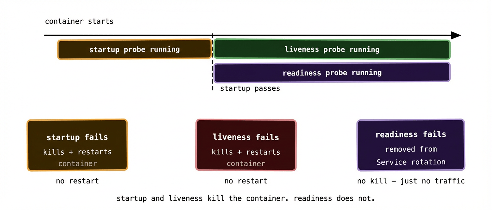

Here’s something that surprises a lot of people coming to Kubernetes for the first time. A pod in `Running` state doesn’t mean your application is actually working. It means the container process started. Those are very different things.

Your application might have started, connected to the wrong database, cached a broken config, and now be returning 500 errors on every request — and Kubernetes, without any additional configuration, will happily keep sending it traffic. It has no way to know something’s wrong. As far as it’s concerned, the process is running and that’s sufficient.

Health probes are how you close that gap. They’re how you tell Kubernetes what “healthy” actually means for your application, so it can make sensible decisions about when to send traffic and when to restart things.

There are three probe types, and they do different jobs.

## Liveness: restart me when I’m broken

A liveness probe answers the question: is this container still alive and worth keeping running? If the probe fails repeatedly, Kubernetes kills the container and restarts it.

The use case is applications that can get into a stuck or deadlocked state without actually crashing. The process is still running — it’s consuming memory, it shows up in `ps`, the container isn’t exiting — but it’s not doing anything useful. Maybe it’s stuck waiting on a lock that’ll never release. Maybe a goroutine leaked and the thread pool is exhausted. The application is alive in the biological sense but dead in the useful sense.

Without a liveness probe, that container stays in its broken state indefinitely. With one, Kubernetes detects it and restarts the container, which in most cases clears the problem.

```yaml
livenessProbe:
  httpGet:
    path: /healthz
    port: 8080
  initialDelaySeconds: 10
  periodSeconds: 15
  failureThreshold: 3
```

This configuration hits `/healthz` every 15 seconds. If it fails 3 times in a row, the container gets restarted. The `initialDelaySeconds` gives the application time to start before Kubernetes begins checking — without it, a slow-starting app might fail its first few liveness checks and get into a restart loop before it’s even had a chance to initialise.

## Readiness: don’t send me traffic until I’m ready

A readiness probe answers a different question: is this container ready to serve traffic right now? If the probe fails, Kubernetes removes the pod from the Service’s endpoints — traffic stops being routed to it — but the container isn’t restarted.

This is the probe that handles the gap between “container started” and “application is ready.” An API server might take 30 seconds to warm up its connection pools, load its caches, and run its startup migrations. During that window it should not be receiving production traffic. A readiness probe holds it out of rotation until it signals it’s ready.

It also handles temporary unavailability mid-lifecycle. Maybe your service needs to talk to a database, and the database has a brief blip. A readiness probe that checks database connectivity will pull the pod out of rotation during the blip and put it back when connectivity recovers — without restarting the container or losing its in-memory state.

```yaml
readinessProbe:
  httpGet:
    path: /ready
    port: 8080
  initialDelaySeconds: 5
  periodSeconds: 10
  failureThreshold: 2
  successThreshold: 1
```

The key distinction from liveness: a failing readiness probe takes the pod out of the load balancer rotation. A failing liveness probe kills and restarts the container. They have different consequences and should check different things.

## Startup: give slow starters a chance

The startup probe is the newest of the three and solves a specific problem: applications that take a long time to initialise.

Before startup probes existed, you’d handle slow-starting apps by setting a high `initialDelaySeconds` on the liveness probe. The problem is that delay applies for the entire lifetime of the container — so if the container does get stuck mid-lifecycle and needs to be restarted, Kubernetes waits out the full delay before it starts checking whether the restart was successful. A 120-second initialisation delay means 120 seconds of blindness after every restart.

A startup probe runs only during the startup phase. While it’s running, liveness and readiness probes are disabled — Kubernetes waits for the startup probe to succeed before enabling the others. Once it succeeds, it stops running and never runs again for that container instance.

```yaml
startupProbe:
  httpGet:
    path: /healthz
    port: 8080
  failureThreshold: 30
  periodSeconds: 10
```

This configuration gives the application up to 300 seconds (30 failures × 10 second period) to start up. Once it passes, the liveness and readiness probes take over with their tighter cadence. You get a generous startup window without permanently loosening your runtime health checking.



## Three probe mechanisms

All three probe types support the same three checking mechanisms. Which one you use depends on what your application exposes.

**HTTP GET** is the most common. Kubernetes makes an HTTP request to the specified path and port. Any response in the 200–399 range counts as a pass. Anything else — including a timeout or a connection refused — counts as a failure. This is what most web services use.

**TCP socket** checks whether a TCP connection can be established on the specified port. No data is exchanged — Kubernetes just verifies the port is accepting connections. Useful for services that don’t speak HTTP, like databases or message brokers.

**Exec** runs a command inside the container and checks the exit code. Exit code 0 means success; anything else is a failure. The most flexible option but also the most expensive — it forks a new process for every check. Use it when HTTP and TCP aren’t an option, but don’t reach for it first.

```yaml
livenessProbe:
  exec:
    command:
      - rabbitmqctl
      - status
  initialDelaySeconds: 30
  periodSeconds: 20
```

For RabbitMQ, for example, an exec probe running `rabbitmqctl status` is a common pattern — it checks whether the broker is actually responsive, not just whether the Erlang VM process is running.

## What your health endpoints should actually check

This is where a lot of teams make a subtle mistake. They implement `/healthz` as a route that returns 200 OK unconditionally — a “dead simple” health check that tells Kubernetes nothing useful.

Think about what each probe is actually trying to learn.

Your **liveness** endpoint should check whether the application is fundamentally functional. Can it reach its own internal state? Are its critical background threads alive? It should be fast and it should not depend on external services — if your liveness probe calls your database and the database has a blip, you don’t want all your pods restarting simultaneously. Keep liveness checks shallow and internal.

Your **readiness** endpoint can be more comprehensive. Can you connect to the database? Is the cache warm? Have background jobs finished their initialisation? These are things that determine whether the pod should be receiving traffic, and it’s fine for the readiness check to be more expensive and more opinionated.

A useful pattern:  
  
`GET /healthz → liveness: is the process functional? (fast, internal only)GET /ready → readiness: is the app ready for traffic? (can check dependencies)`

Keeping these as separate endpoints with different logic is much cleaner than trying to make one endpoint serve both purposes.

## Common misconfiguration patterns

**Too aggressive a liveness probe** is probably the most damaging mistake. If your `failureThreshold` is 1 and your `periodSeconds` is 5, a single slow response restarts your container. Under load, when response times naturally increase, you can end up in a death spiral: load causes slowness, slowness causes restarts, restarts cause more load on the remaining pods, which causes more slowness.

The liveness probe should only fire on genuine failure, not on slowness under pressure. Use a higher `failureThreshold` and a longer `periodSeconds` than feels necessary. Three or five consecutive failures over 30–60 seconds is a reasonable bar — if your application is genuinely stuck, that’s enough time to detect it without being trigger-happy.

**Using the same check for liveness and readiness** is a common shortcut that causes subtle problems. If your liveness probe checks database connectivity and the database goes away, every pod in your Deployment restarts simultaneously — because they all fail liveness at the same time. But the database coming back doesn’t fix anything faster; now you just have all your pods in a restart loop while the database recovers. If database connectivity had only affected readiness, the pods would have quietly gone out of rotation, waited for the database to recover, passed their readiness check, and come back into rotation — no restarts, no disruption.

**Missing `initialDelaySeconds` on liveness** causes new pods to get killed before they’ve finished starting. Set it conservatively — longer than you think you need. A pod that takes an extra 10 seconds to become live is much less harmful than one that gets into a restart loop because it failed its liveness check during initialisation.

**No probes at all** is worse than any of the above. Without probes, a pod that’s crashing on startup will just sit in CrashLoopBackOff receiving no traffic — which is fine, Kubernetes at least isn’t routing to it. But a pod that starts successfully and then silently stops working will receive traffic indefinitely, causing errors for your users until someone notices. Readiness probes in particular should be considered non-negotiable for any service that receives traffic.

## Probes and rolling updates

Health probes interact directly with how rolling updates behave, which is worth understanding before you hit it in production.

During a rolling update, Kubernetes won’t mark a new pod as ready — and therefore won’t remove an old pod — until the new pod passes its readiness probe. This is the mechanism that makes zero-downtime deployments work correctly. If your new pod has a bug that causes it to fail readiness, the rollout stalls with old pods still serving traffic. You get to fix the problem and push a corrected image without users having experienced downtime.

This is also why missing readiness probes on Deployments is particularly harmful. Without a readiness probe, Kubernetes assumes a pod is ready as soon as its container starts. If the container starts and then crashes five seconds later before serving any real traffic, the rollout will have already started killing old pods. With a readiness probe, the new pods have to prove themselves before the old ones are removed.

## What to remember

Three probes, three jobs. Startup gives slow-starting applications a grace period before liveness and readiness kick in. Liveness detects stuck or broken containers and restarts them. Readiness controls whether a pod receives traffic — without restarting it.

Liveness and readiness should check different things. Liveness: internal process health only, no external dependencies. Readiness: whatever the pod needs to serve traffic successfully, including external dependencies.

Be conservative with liveness probe thresholds — a false positive causes a restart, which is disruptive. Be responsive with readiness probe thresholds — a faster readiness failure means faster removal from traffic rotation, which protects your users.

No probes at all is the worst configuration. At minimum, every service that receives traffic should have a readiness probe.

Next up: the final post — day-2 operations. What running Kubernetes actually looks like once the initial setup is done and you’re in the business of keeping things working.
